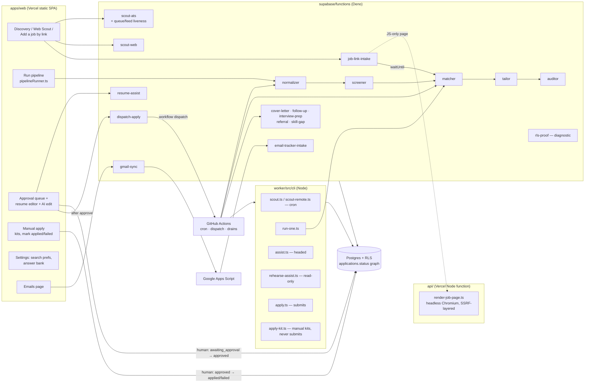
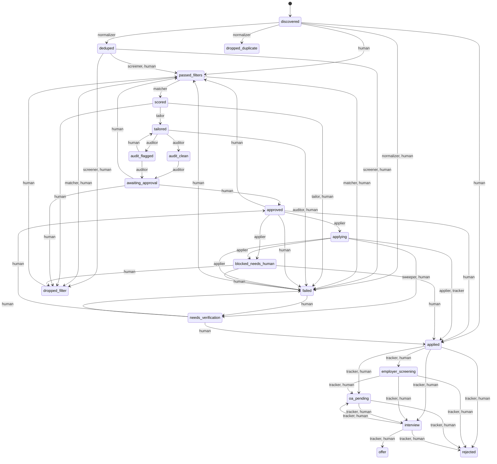
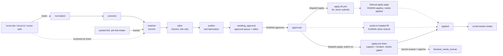

# applyyy — System Architecture

_Last verified against code: 2026-11-08 (2a9ac31)._

The current architecture of the job-application pipeline. **This file holds no counts.** Every
inventory points at the command that regenerates it, so run the command rather than trusting
prose. The status graph (§3) was regenerated from the live table on 2026-11-08, and the live
migration head equalled the newest file in `supabase/migrations/` that day.

Related docs:
- Dated inventories with numbers (languages, LOC, dependencies, vulnerabilities): [`stack/`](stack/README.md).
- Why each agent is shaped the way it is: [`architecture/agents.md`](architecture/agents.md).
- The status graph as a control structure: [`architecture/graph-engineering.md`](architecture/graph-engineering.md).
- Live status: the "Current state" section of [`PROGRESS.md`](PROGRESS.md). It can go stale; verify before you rely on it.

## 1. Purpose

Find jobs, filter them cheaply, score and tailor a resume per job **without inventing
anything**, audit the tailoring, and put it in front of a human. **Nothing is ever submitted
without a human approval.** After approval the worker can submit automatically
(`SUBMISSION_IMPLEMENTED = true` in `worker/src/playwright-page.ts`, since 2026-10-09). Every
submit is bounded by a per-run cap, a circuit breaker, a robots.txt gate, and a run that is
dry unless a human or a repo variable makes it live (§2, "Workflows").

A job the bot cannot submit goes to the **Manual apply** page
(`apps/web/src/features/manual-apply/`) with a kit, and Teja applies by hand.

Stack: Supabase Postgres (RLS on every table) + Deno Edge Functions
(`supabase/functions/`); React + Vite dashboard (`apps/web/`, Vercel); Node + Playwright
worker (`worker/`, GitHub Actions and the local terminal); Gemini as the LLM. pnpm only.

## 2. Component map



Inventories: `ls apps/web/src/features` (console pages), `ls packages` (shared libraries:
types, resume template, master ingest, PDF parse, robots gate), `ls api` (Vercel function).

### Edge functions

Regenerate the list with `ls -d supabase/functions/*/ | grep -v _shared`. Gateway JWT
posture is set per function in `supabase/config.toml` (`verify_jwt`).

| Function | Agent identity | Reads status | Writes status | Trigger |
|---|---|---|---|---|
| `scout-ats` | `scout_ats` | — (inserts); liveness reads in-flight rows | inserts `passed_filters` / `dropped_filter` (screened at insert); `discovered` only if screening is unavailable. Marks closed postings (queue and feed liveness, below) | manual (Discovery page) |
| `scout-web` | `scout_aggregator` | — (inserts) | inserts `discovered` | manual (Web Scout panel) |
| `normalizer` | `normalizer` | `discovered` | `deduped`, `dropped_duplicate` | Run pipeline · `prescreen-drain.yml` (dispatch); `?application_id=` targets one row |
| `screener` | `screener` | `deduped` | `passed_filters`, `dropped_filter` (tech gate → work-auth/country gate → cascade, incl. `experience_ceiling` read from the JD) | Run pipeline · `prescreen-drain.yml` (dispatch); `?application_id=` targets one row |
| `matcher` | `matcher` | `passed_filters` | `scored`, `dropped_filter`, `failed`. A score below `MATCH_ADVANCE_FLOOR` (`_shared/match/score-threshold.ts`) does not advance | Run pipeline · run-one · `postscreen-drain.yml` · `pregate-sweep.yml` (`?mode=pregate_only`) · job-link-intake (background) |
| `tailor` | `tailor` | `scored` | `tailored` (+ `tailored_profile`, `tailor_refs`, `master_version`) | Run pipeline · run-one · `postscreen-drain.yml` · job-link-intake (background) |
| `auditor` | `auditor` | `tailored`, `audit_clean`, `audit_flagged` | `audit_clean`/`audit_flagged` → `awaiting_approval` | Run pipeline · run-one · `postscreen-drain.yml` · job-link-intake (background) |
| `job-link-intake` | `human` (user-triggered) | — (inserts, or revives `discovered`/`deduped`/`dropped_filter`/`failed`) | inserts or moves to `passed_filters` as `human`, then runs matcher → tailor → auditor via `EdgeRuntime.waitUntil` | Add-a-job-by-link panel · `ingest-links.yml` |
| `resume-assist` | — | — | none (proposes edit ops; the human applies them through the guarded save) | approval page AI edit box |
| `dispatch-apply` | — | counts `approved` rows whose job is still live | none. Starts `apply-kit.yml` on every call; starts `apply.yml` as a live drain only when `system_settings.auto_apply_on_approve` is exactly true | approval page, once after a successful approve |
| `cover-letter` | `cover_letter` | `tailored`, `audit_clean`, `audit_flagged` | none (letter only; never written at `awaiting_approval`) | `satellites.yml` |
| `follow-up` | `follow_up` | `applied` | none (`follow_up_nudges` drafts) | `satellites.yml` |
| `interview-prep` | `interview_prep` | `interview` | none (`interview_prep_packs`) | `satellites.yml` |
| `referral` | `referral` | `passed_filters`, `scored` | none (drafts) | `satellites.yml` |
| `skill-gap` | `skill_gap` | `scored`, `applied` | none (`skill_gap_reports`) | `satellites.yml` |
| `email-tracker-intake` | `tracker` | `applying`, `needs_verification`, `applied` … `interview` | receipt → `applied`; post-apply edges (deterministic classifier, `decide.ts`) | push from Apps Script, `X-Applyy-Intake-Secret` |
| `gmail-sync` | — | — | none (proxies "sync now" to the Apps Script Web App) | Emails page |
| `rls-proof` | — | — | — | one-shot diagnostic; refuses the prod ref |

Notes:
- **dispatch-apply** (`supabase/functions/dispatch-apply/handler.ts`). Its gates, in order:
  the caller must be the app user; an unreadable switch is a 503 (never read as on or off);
  no live `approved` row is a 200 that says why; a missing `GITHUB_APPLY_DISPATCH_TOKEN`
  secret is a 503. A GitHub refusal is a 502. The kit run needs no switch because a kit never
  submits and writes no status. The switch is set on the Search preferences page
  (`apps/web/src/features/settings/SearchPreferencesPage.tsx`) and is born off (migration
  `20261105140000_auto_apply_on_approve.sql`). The same migration makes
  `system_settings.max_applications_per_day` nullable: NULL means "no daily limit".
- **Scout liveness** (`supabase/functions/scout-ats/index.ts`). Queue liveness
  (`_shared/scout/queue-liveness.ts`) confirms on the same poll that a queue row whose posting
  left its board is really closed. Feed liveness (`_shared/scout/feed-liveness.ts`) retires
  in-flight rows with no ATS when their own posting page answers 404 or 410. The page fetch
  goes through the SSRF guard in `scout-ats/page-fetch.ts`. Both are capped per run.
- **ATS adapters** live in `supabase/functions/_shared/ats/registry.ts`: Greenhouse, Lever,
  Ashby, and Workday (discovery only). SmartRecruiters is not registered: its robots.txt says
  `Disallow: /` (ruling 2026-11-01). Re-check: `grep -n import supabase/functions/_shared/ats/registry.ts`.
- **Gemini callers:** `grep -rlE "_shared/gemini|gemini/client" supabase/functions/*/index.ts supabase/functions/_shared/follow-up`.

There is **no database scheduler**: `select extname from pg_extension where extname in
('pg_cron','pg_net')` returns nothing (re-checked 2026-11-08). Edge agents run only when the
browser, a worker CLI or a GitHub Actions workflow invokes them.

### Worker CLIs (`ls worker/src/cli`, scripts in `worker/package.json`)

| Script | File | What it does | Trigger |
|---|---|---|---|
| `scout` | `cli/scout.ts` | ATS boards → `jobs`, screens inline, inserts applications | `scout.yml` cron + dispatch |
| `scout:remote` | `cli/scout-remote.ts` | RemoteOK/Jobicy/Arbeitnow through the same screener path | `scout-remote.yml` cron + dispatch |
| `run-one` | `cli/run-one.ts` | one row through matcher → tailor → auditor via the deployed functions | `run-one.yml` (dispatch) or local |
| `assist` | `cli/assist.ts` | opens ONE `approved` application headed, fills it, **human clicks Submit**, y/n records the outcome. Robots-checks the resolved form URL before the claim | local terminal |
| `rehearse` | `cli/rehearse-assist.ts` | read-only preflight and rehearsal of an assisted submit (`--id <uuid>`): env, owner, status, kill switch, daily cap, kit, resume, posting open, then every assist step up to the click. Writes nothing. Exit 0 ready, 2 waiting on Teja, 1 failed | local terminal |
| `apply` | `cli/apply.ts` | batch applier; submits `approved` rows under the cap `APPLY_MAX_SUBMITS` + circuit breaker (`worker/src/claim-loop.ts`); robots-gated. A required field it cannot answer is reported to `unanswered_questions` | `apply.yml` (see Workflows) |
| `keepalive` | `cli/keepalive.ts` | DB activity + repo activity so nothing pauses silently | `keepalive.yml` cron |
| — (no script) | `cli/apply-kit.ts` | builds manual apply kits (plans fields, renders the resume, one note); never claims, fills or submits; robots-gated; sweep honours the kill switch | `apply-kit.yml` cron + `workflow_run` after apply + dispatch (also from `dispatch-apply`) |
| — (no script) | `cli/resume-pages.ts` | prints the real PDF page count of each resume in a rows file (the one-page rule's measuring stick). Read-only | local terminal |

### Workflows

`ls .github/workflows` lists them. They fall in three classes.

| Class | Workflows |
|---|---|
| CI | `ci.yml` |
| Scheduled (+ dispatch) | `scout`, `scout-remote`, `apply`, `apply-kit`, `satellites`, `keepalive`, `jobs-tombstone` |
| Dispatch only | `run-one`, `ingest-links`, `prescreen-drain`, `postscreen-drain`, `pregate-sweep` |

Schedules: `grep -n "cron:" .github/workflows/*.yml`. GitHub's scheduled runs can start
hours late; read actual start times with `gh run list --workflow <file>`.

Gates that decide whether a run does anything real:
- **`apply.yml`** (`.github/workflows/apply.yml`). A scheduled run is dry unless the repo
  variable `APPLYY_CRON_LIVE` is exactly `true`. A manual run is live only with
  `dry_run=false` plus one of two inputs: `apply_only_id=<uuid>` (one row), or
  `drain_approved=true` (the approved queue, `APPLY_MAX_SUBMITS=25` per run). The two inputs
  cannot be combined. Otherwise `APPLY_MAX_SUBMITS` is `3`. A drain that stops on its cap
  re-dispatches itself (the `redispatch` job), so leftovers go to the next run.
- **`satellites.yml`**. The scheduled job runs only while the repo variable
  `APPLYY_SATELLITES_LIVE` is exactly `true`. A manual dispatch always runs.
- **The drains:** `prescreen-drain` and `pregate-sweep` are manual only. `postscreen-drain` runs
  after each scout finishes, once a day at 04:30 UTC, and on manual dispatch. That is Teja's ruling of
  2026-11-09, which reversed the 2026-11-05 manual-only ruling; the trigger set is pinned by
  `apps/web/test/postscreenDrainTriggers.test.ts`. They call edge functions with the app-user secrets and fail closed.
- **`jobs-tombstone.yml`** runs weekly. It purges the heavy payload (`description_raw`,
  `raw_payload`) of old `dropped_filter` jobs through `public.tombstone_dropped_jobs` and logs
  to `agent_runs` as `jobs_tombstone`. The row stays, so its fingerprint still dedupes the
  next scan. Why and how: [`db/2026-11-05-jobs-tombstone-policy.md`](db/2026-11-05-jobs-tombstone-policy.md).

## 3. Status graph (generated from the live edge table)

Source of truth: `select from_status, to_status, allowed_agents from
public.application_status_transitions order by 1,2;`. `packages/shared-types/src/status-flow.ts`
is a client mirror, not the rule. **Regenerate this diagram from the query whenever a migration
touches that table.**



Regenerated from the live table on 2026-11-08. Where the less obvious edges come from:

| Edge | Who | Why | Migration |
|---|---|---|---|
| `discovered → passed_filters` | human | a pasted job link | `20261031200000` |
| `awaiting_approval`/`approved → passed_filters` | human | re-run after a master-profile change | `20261101173000` |
| `failed → passed_filters` | human | re-run of a row that failed before approval; bounded by `guard_failed_rerun` | `20261102203000` |
| `approved → applied`, `approved → failed` | human | Teja applied by hand from a kit, or gave up (Manual apply page) | `20261105121500` |
| `discovered → applied` | human | "Add to Applied" on the Emails page, only through `track_email_as_applied` | `20261105124600` |
| `applying → applied` | tracker | an emailed receipt confirms a submit | — |

Invariants worth re-checking after any graph migration:
- Every edge into `approved` is human-only:
  `select * from application_status_transitions where to_status='approved' and allowed_agents <> '{human}'` → no rows.
- `applying` has exactly one source, `approved`, and only the applier takes it:
  `select from_status, allowed_agents from application_status_transitions where to_status='applying'`.
- No agent can claim a submit it did not make: the edges `approved → applied` and
  `discovered → applied` are human-only.
- `interview ↔ oa_pending` is a machine-walkable cycle with no bound (graph-engineering §3.1).

## 4. Agent chain



The **Tailor cannot invent**: it emits references to master-profile node ids, and the
validator resolves every ref against the pinned master. The Auditor is the separate critic.

**One-page resume rule.** A tailored resume must fit one page. The template shrinks typography
first (`packages/resume-template/`), and the approval editor fits every save on one page and
records what it cut (`apps/web/src/features/approval/`). `worker/src/cli/resume-pages.ts`
measures the real page count.

**Unanswered questions.** When the applier's field planner refuses a required field, the worker
calls `record_unanswered_questions` (`worker/src/supabase-gateway.ts`). One row per
(user, question key) lands in `public.unanswered_questions` (migration
`20261105230000_unanswered_questions.sql`). Teja answers it once on the Answer bank page,
which writes `answer_bank`. A row there is a report, never an answer: the planner reads only
`answer_bank`.

## 5. Security model

- **One app user, no service role.** Every edge function and worker CLI signs in as the
  same Supabase Auth user (`APPLYY_APP_USER_EMAIL` / `APPLYY_APP_USER_PASSWORD`,
  `supabase/functions/_shared/db/client.ts`) and runs under RLS. The service role is
  deliberately unused, so the JWT cannot tell the browser from an agent.
- **Caller check before sign-in (W15).** `createAuthorizedAppUserClient` (same file) verifies
  the caller's bearer token first and signs in only for an authorized caller. So a visitor with
  the public anon key cannot make a function spend a password grant. Every function uses it
  except `email-tracker-intake` (shared-secret header) and `rls-proof`:
  `grep -rL createAuthorizedAppUserClient supabase/functions/*/index.ts`.
- **Agent key.** Machine clients send `x-applyy-agent-key` (`_shared/db/agent-key.ts`, env
  `APPLYY_AGENT_KEY`). `applyy_internal.agent_key_state()` (SECURITY DEFINER) compares its
  SHA-256 with `applyy_internal.agent_key` and returns
  `unconfigured_locked | unconfigured | missing | invalid | valid`.
  Guarded: `advance_application_status` when `p_agent <> 'human'`, `claim_applications`,
  `release_application_claim`, `sweep_stale_claims`, and the `application_events` "append
  own events" policy. The key is seeded, so a request without the right key is refused
  (42501). **Fail-closed since migration `20261102210000`:** an empty key table returns
  `unconfigured_locked` and locks every machine agent out. Running agents without the key
  takes two deliberate statements: delete the key AND set
  `applyy_internal.agent_key_emergency.allow_unkeyed_agents = true`. Never "fix" a lockout by
  deleting the key. Check: `select count(*) from applyy_internal.agent_key` (expect 1) and
  `select allow_unkeyed_agents from applyy_internal.agent_key_emergency`. The key has three
  copies (Supabase secrets, GitHub secrets, Teja's Windows user env) that must stay in sync on
  rotation (repo `CLAUDE.md` §7).
- **Grants.** anon/PUBLIC EXECUTE is revoked on the claim and advance RPCs. Check:
  `select proname, proacl from pg_proc where proname in ('advance_application_status','claim_applications','release_application_claim')`.
  Since `20261105203000_revoke_definer_execute_and_truncate.sql`, `authenticated` also has no
  EXECUTE on `bootstrap_user_defaults()` and `rls_auto_enable()`, and `anon`/`authenticated`
  have no TRUNCATE on public tables (RLS does not apply to TRUNCATE).
- **Transition guard.** `guard_status_transition` (BEFORE UPDATE) refuses an edge absent
  from the table or not allowed for `applyy.acting_agent` (42501).
- **Insert guard.** `guard_status_insert` admits only `discovered`, `passed_filters`,
  `dropped_filter` on INSERT — the update guard never sees inserts.
- **Freeze.** `guard_tailored_profile_freeze` refuses any change to
  `tailored_profile` unless the row *was* at `scored`, `audit_flagged` or
  `awaiting_approval` (42501). What was approved is what gets sent.
- **Failed-rerun guard.** `guard_failed_rerun` (BEFORE UPDATE) refuses `failed →
  passed_filters` for a row that failed at or after approval, so a re-run can never re-submit.
- **Stale-read gate.** `advance_application_status(..., p_expected_updated_at)` raises
  SQLSTATE `PT409` (HTTP 409) if the row changed since it was read. Callers that pass it:
  `grep -rln p_expected_updated_at apps/web/src worker/src supabase/functions`.
- **Double submit.** `applying → applying` raises `55000` under a row lock.
- **Kill switch.** `system_settings.system_enabled` (per user), enforced inside
  `claim_applications` and by `readKillSwitch` (`_shared/db/gates.ts`) at the top of the
  pipeline edge agents, failing closed on a missing row or a failed read. Check:
  `select user_id, system_enabled from system_settings`. It is absolute: `scout-ats` ignores
  `?force=true` for the halt (`scout-ats/gate.ts`), and `email-tracker-intake` consults the
  switch before any status move, failing closed when it is unreadable. Intel events are still
  stored and the 202 is kept, so Apps Script does not redeliver the batch.
- **`system_settings.dry_run` is inert.** Nothing reads it (migration
  `20261105202000_system_settings_dry_run_comment_inert.sql`). Whether a run submits is decided
  by `apply.yml` (§2, "Workflows").
- **List all triggers:** `select tgname from pg_trigger where tgrelid='public.applications'::regclass and not tgisinternal`.

## 6. Data pins and space

- `tailored_profile.master_version` is **the** pin. The auditor and cover-letter resolve the
  master through it (`_shared/audit/pinned-master.ts`), never through "latest".
- `applications.master_version` is also written by the tailor (`_shared/tailor/persist.ts`),
  in the same update as `tailored_profile`. If the two ever disagree, the JSON pin wins.
- `master_profiles` versions are immutable and carry `content_hash`.
- **Jobs tombstone.** A tombstoned job has `jobs.tombstoned_at` set and no payload. The CHECK
  `jobs_tombstone_is_slim` makes a tombstone with a payload unrepresentable, and the trigger
  `jobs_keep_tombstone_slim` keeps a re-discovered tombstone slim (migration
  `20261105200000_jobs_tombstone.sql`). Reason: the Free Plan database quota is 500 MB.

## 7. Deploy model

- **Web:** Vercel auto-deploys on push to `main`. Prove what is live with a present and an
  absent bundle sentinel (repo `CLAUDE.md` §4). The Vercel Node function
  `api/render-job-page.ts` (headless Chromium, SSRF-layered) ships on the same push.
- **Database and functions:** deployed only by the orchestrator session, from a **pinned clean
  worktree** — never the shared tree, which carries peers' uncommitted edits. A peer never
  deploys. Recipe in repo `CLAUDE.md` §3:
  1. `git worktree add --detach <tmp> <sha>`; copy `supabase/.temp/{project-ref,pooler-url,linked-project.json,postgres-version}` in.
  2. Unset the wrong-account `SUPABASE_ACCESS_TOKEN`.
  3. `supabase db push --linked --dry-run` → push only if it lists exactly the expected files.
  4. `supabase functions deploy <fn> --project-ref xynqxekcqizwhtskzqrq --use-api --import-map supabase/functions/deno.json`.
     The `--import-map` flag is mandatory: `--use-api` does not read `deno.json` by itself.
  5. Verify by a SQL **shape** check, then `git worktree remove <tmp>`.
- **Deploy order.** Code that calls a new DB object ships after its migration (for example,
  `20261105230000` before the worker hook that calls `record_unanswered_questions`). For an
  edge function and the web, the strict reader of a new response shape ships first.
- **New edge-function secrets** are named in the function, never stored in a doc. Example:
  `dispatch-apply` needs `GITHUB_APPLY_DISPATCH_TOKEN` (a fine-grained PAT, this repo only,
  Actions read and write).
- **Backlog:** `supabase migration list --linked`, or compare
  `select max(version) from supabase_migrations.schema_migrations` with `ls supabase/migrations | tail -1`.

## 8. Verification commands

```
Deno tree:   cd supabase/functions && deno check --reload _shared/ */
             # assert it ran: … 2>&1 | sed 's/\x1b\[[0-9;]*m//g' | grep -c "^Check"
Deno tests:  node --test "supabase/functions/**/*.test.ts"   # from repo root; tests must be > 0
Web:         cd apps/web && ./node_modules/.bin/tsc --noEmit && ./node_modules/.bin/vite build
Worker:      cd worker && ./node_modules/.bin/tsc --noEmit && ./node_modules/.bin/vitest run
Workspace:   pnpm run typecheck   # does NOT cover supabase/functions; may write the lockfile
Package:     pnpm --filter @applyy/web …   # NOT `--filter web`, which matches nothing
```

Read a checker's own exit code, never `$?` after a pipe. `fail 0` means something only
next to a non-zero `tests`. CI (`.github/workflows/ci.yml`) runs typecheck and tests on
every push and PR to `main`, including the web build Vercel would deploy and the `api/`
function check. A docs-only push runs no CI (`paths-ignore`).

## 9. Not built / known gaps (re-check each)

| Gap | Re-check |
|---|---|
| Agent key is fail-closed (empty table = every machine agent locked out; emergency flag in `applyy_internal.agent_key_emergency`) | `select count(*) from applyy_internal.agent_key` (expect 1) |
| No database scheduler: edge agents run on clicks, worker CLIs and GitHub Actions (cron is best-effort, often hours late) | `select extname from pg_extension where extname='pg_cron'` |
| Bot submits mostly end at `blocked_needs_human` (reCAPTCHA, unsupported forms, unanswerable questions; see the note in `dispatch-apply/handler.ts`). Those rows go to Manual apply | `select status, count(*) from applications where status in ('approved','blocked_needs_human','applied') group by 1` |
| Aggregator adapters Adzuna/Jooble/Workable (`_shared/scout/adapters/`) unreached | `grep -rln "scout/tiers" supabase/functions worker/src \| grep -v test` (empty = unreached) |
| ATS simulator unwired (only a comment names it) | `grep -rlnE "from \"[^\"]*ats-simulator" supabase/functions apps/web/src \| grep -v test` |
| `interview ↔ oa_pending` cycle unbounded | §3 invariants |
| No LIVE declared-vs-graph diff test (`packages/shared-types/test/enum-parity.test.ts` compares migrations with the mirror only) | `grep -rln application_status_transitions --include=*.test.ts .` |
| `degree_mismatch` has no producer (`experience_ceiling` is live since `20261104193000`, `_shared/screen/required-experience.ts`) | `select rule_type, enabled, config from filter_rules where rule_type in ('experience_ceiling','degree_mismatch')` |
| NOT a gap: two `application_events` rows per transition is deliberate. The `log_status_change` trigger writes the `status_change` witness; the RPC adds a `note` row with the caller's `p_detail`, only when `p_detail` is non-empty. Removing either loses data the other never sees | `select application_id, count(*) from application_events group by 1 order by 2 desc limit 5` |
| Nothing alerts on a failed Vercel deploy (`ci.yml` builds the same artifact but does not watch Vercel) | Vercel MCP `list_deployments`, or the Vercel dashboard |
| Wildcard CORS on every edge function; GitHub secret and code scanning off | [security/2026-11-05-vulnerability-remeasure.md](security/2026-11-05-vulnerability-remeasure.md) |
| Where rows sit | `select status, count(*) from applications group by 1 order by 1` |
