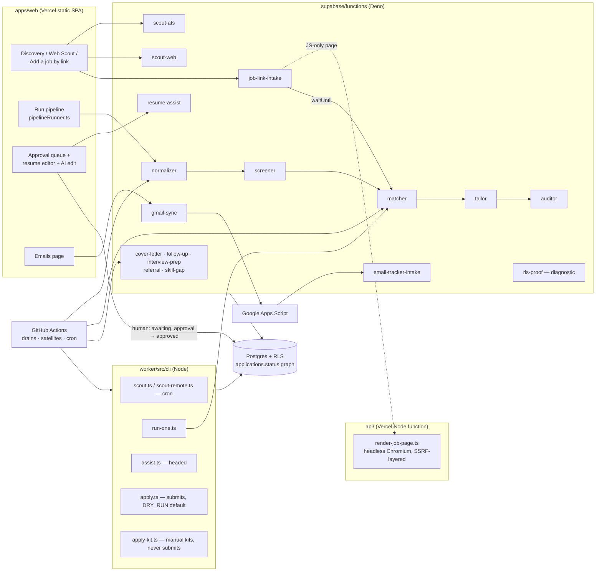
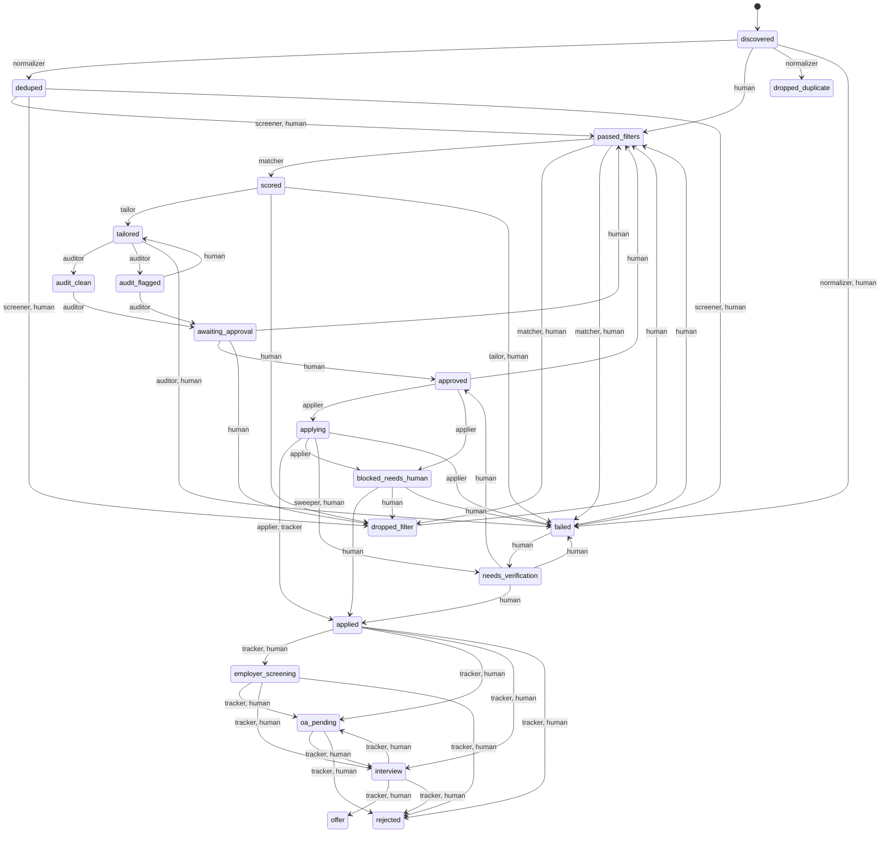
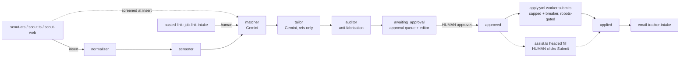

# applyyy — System Architecture

The current architecture of the job-application pipeline. **This file holds no counts and
no line numbers** — every inventory points at the command that regenerates it, so run the
command rather than trusting prose. Last reconciled against code (HEAD `00ecabb`) and the live
database on 2026-11-05. Inventories with numbers (languages, LOC, dependencies, integrations,
vulnerabilities) are dated snapshots under [`stack/`](stack/README.md). History and reasoning: [`architecture/agents.md`](architecture/agents.md) (why
each agent is shaped the way it is) and
[`architecture/graph-engineering.md`](architecture/graph-engineering.md) (the status graph as
a control structure). Live status: the "Current state" section of [`PROGRESS.md`](PROGRESS.md).

## 1. Purpose

Find jobs, filter them cheaply, score and tailor a resume per job **without inventing
anything**, audit the tailoring, and put it in front of a human. **Nothing is ever submitted
without a human approval; after approval the worker submits automatically** (since
2026-10-09, `SUBMISSION_IMPLEMENTED = true` in `worker/src/playwright-page.ts`), bounded by
a per-run cap, a circuit breaker, a robots.txt gate, and `DRY_RUN` defaulting true.

Stack: Supabase Postgres (RLS on every table) + Deno Edge Functions
(`supabase/functions/`); React + Vite dashboard (`apps/web/`, Vercel); Node + Playwright
worker (`worker/`, GitHub Actions and the local terminal); Gemini as the LLM. pnpm only.

## 2. Component map



Inventories: `ls apps/web/src/features` (console pages), `ls packages` (shared libraries:
types, résumé template, master ingest, PDF parse, robots gate), `ls api` (Vercel function).

### Edge functions

Regenerate the list with `ls -d supabase/functions/*/ | grep -v _shared`. Gateway JWT
posture is per function in `supabase/config.toml`.

| Function | Agent identity | Reads status | Writes status | Trigger |
|---|---|---|---|---|
| `scout-ats` | `scout_ats` | — (inserts) | inserts `passed_filters` / `dropped_filter` (screened at insert); `discovered` only if screening is unavailable | manual (Discovery page) |
| `scout-web` | `scout_aggregator` | — (inserts) | inserts `discovered` | manual (Web Scout panel) |
| `normalizer` | `normalizer` | `discovered` | `deduped`, `dropped_duplicate` | Run pipeline · `prescreen-drain.yml` (dispatch); `?application_id=` targets one row |
| `screener` | `screener` | `deduped` | `passed_filters`, `dropped_filter` (tech gate → work-auth/country gate → cascade, incl. `experience_ceiling` read from the JD) | Run pipeline · `prescreen-drain.yml` (dispatch); `?application_id=` targets one row |
| `matcher` | `matcher` | `passed_filters` | `scored`, `dropped_filter`, `failed` | Run pipeline · run-one · `postscreen-drain.yml` · `pregate-sweep.yml` (`?mode=pregate_only`) · job-link-intake (background) |
| `tailor` | `tailor` | `scored` | `tailored` (+ `tailored_profile`, `tailor_refs`, `master_version`) | Run pipeline · run-one · `postscreen-drain.yml` · job-link-intake (background) |
| `auditor` | `auditor` | `tailored`, `audit_clean`, `audit_flagged` | `audit_clean`/`audit_flagged` → `awaiting_approval` | Run pipeline · run-one · `postscreen-drain.yml` · job-link-intake (background) |
| `job-link-intake` | `human` (user-triggered) | — (inserts, or revives `discovered`/`deduped`/`dropped_filter`/`failed`) | inserts or moves to `passed_filters` as `human`, then runs matcher → tailor → auditor via `EdgeRuntime.waitUntil` | Add-a-job-by-link panel · `ingest-links.yml` |
| `resume-assist` | — | — | none (proposes edit ops; the human applies them through the guarded save) | approval page AI edit box |
| `cover-letter` | `cover_letter` | `tailored`, `audit_clean`, `audit_flagged` | none (letter only; never written at `awaiting_approval`) | `satellites.yml` daily cron + dispatch |
| `follow-up` | `follow_up` | `applied` | none (`follow_up_nudges` drafts) | `satellites.yml` daily cron + dispatch |
| `interview-prep` | `interview_prep` | `interview` | none (`interview_prep_packs`) | `satellites.yml` daily cron + dispatch |
| `referral` | `referral` | `passed_filters`, `scored` | none (drafts) | `satellites.yml` daily cron + dispatch |
| `skill-gap` | `skill_gap` | `scored`, `applied` | none (`skill_gap_reports`) | `satellites.yml` daily cron + dispatch |
| `email-tracker-intake` | `tracker` | `applying`, `needs_verification`, `applied` … `interview` | receipt → `applied`; post-apply edges (deterministic classifier, `decide.ts`) | push from Apps Script, `X-Applyy-Intake-Secret` |
| `gmail-sync` | — | — | none (proxies "sync now" to the Apps Script Web App) | Emails page |
| `rls-proof` | — | — | — | one-shot diagnostic; refuses the prod ref |

Gemini callers: `grep -rlE "_shared/gemini|gemini/client" supabase/functions/*/index.ts supabase/functions/_shared/follow-up`.

There is **no database scheduler**: `select extname from pg_extension where extname in
('pg_cron','pg_net')` returns nothing. Edge agents run only when the browser, a worker CLI or a
GitHub Actions workflow invokes them.

### Worker CLIs (`ls worker/src/cli`)

| Script | File | What it does | Trigger |
|---|---|---|---|
| `scout` | `cli/scout.ts` | ATS boards → `jobs`, screens inline, inserts applications | `scout.yml` cron + dispatch |
| `run-one` | `cli/run-one.ts` | one row through matcher → tailor → auditor via the deployed functions | `run-one.yml` (dispatch) or local |
| `assist` | `cli/assist.ts` | opens ONE `approved` application headed, fills it, **human clicks Submit**, y/n records the outcome | local terminal |
| `apply` | `cli/apply.ts` | batch applier; submits `approved` rows (cap `APPLY_MAX_SUBMITS`, default 3, + circuit breaker; robots.txt-gated) | `apply.yml` cron — `DRY_RUN` defaults true; a scheduled run is live only while repo variable `APPLYY_CRON_LIVE` is `true` |
| `keepalive` | `cli/keepalive.ts` | DB activity + repo activity so nothing pauses silently | `keepalive.yml` cron |
| `scout:remote` | `cli/scout-remote.ts` | RemoteOK/Jobicy/Arbeitnow through the same screener path | `scout-remote.yml` cron + dispatch |
| — (no script) | `cli/apply-kit.ts` | builds manual apply kits (plans fields, renders the résumé, one note); never claims, fills or submits; robots-gated; sweep honours the kill switch | `apply-kit.yml` cron + `workflow_run` after apply + dispatch |

Workflows (`ls .github/workflows`) fall in three classes. **CI:** `ci.yml`. **Scheduled:**
`scout`, `scout-remote`, `apply`, `apply-kit`, `satellites`, `keepalive`. **Dispatch-only:**
`run-one`, `ingest-links`, `prescreen-drain`, `postscreen-drain`, `pregate-sweep`. The drains
call edge functions with the app-user secrets and fail closed. Schedules:
`grep -n "cron:" .github/workflows/*.yml`. GitHub's scheduled runs can start hours late; read
actual start times with `gh run list --workflow <file>`.

## 3. Status graph (generated from the live edge table)

Source of truth: `select from_status, to_status, allowed_agents from
public.application_status_transitions order by 1,2;`. `packages/shared-types/src/status-flow.ts`
is a client mirror, not the rule. **Regenerate this diagram from the query whenever a migration
touches that table.**



Regenerated from the live table on 2026-11-05. The `→ passed_filters` re-entry edges are
human-only: a pasted link (migration `20261031200000`), a master-profile change re-run
(`20261101173000`) and a failed-before-approval re-run (`20261102203000`, bounded by
`guard_failed_rerun`). `applying → applied` also admits `tracker`: an emailed receipt confirms
a submit.

Invariants worth re-checking after any graph migration:
- Every edge into `approved` is human-only:
  `select * from application_status_transitions where to_status='approved' and allowed_agents <> '{human}'` → no rows.
- `applying` has exactly one source, `approved`:
  `select from_status from application_status_transitions where to_status='applying'`.
- `interview ↔ oa_pending` is a machine-walkable cycle with no bound (graph-engineering §3.1).

## 4. Agent chain



The **Tailor cannot invent**: it emits references to master-profile node ids, and the
validator resolves every ref against the pinned master. The Auditor is the separate critic.

## 5. Security model

- **One app user, no service role.** Every edge function and worker CLI signs in as the
  same Supabase Auth user (`createAppUserClient`, `supabase/functions/_shared/db/client.ts`)
  and runs under RLS. The service role is deliberately unused, so the JWT cannot tell the
  browser from an agent.
- **Agent key.** Machine clients send `x-applyy-agent-key` (`_shared/db/agent-key.ts`, env
  `APPLYY_AGENT_KEY`). `applyy_internal.agent_key_state()` (SECURITY DEFINER) compares its
  SHA-256 with `applyy_internal.agent_key` and returns
  `unconfigured_locked | unconfigured | missing | invalid | valid`.
  Guarded: `advance_application_status` when `p_agent <> 'human'`, `claim_applications`,
  `release_application_claim`, `sweep_stale_claims`, and the `application_events` "append
  own events" policy. The key is seeded (since 2026-10-09 ~13:40 IST), so a request without
  the right key is refused (42501). **Fail-closed since migration `20261102210000`
  (2026-11-04):** an empty key table returns `unconfigured_locked` and locks every machine
  agent out. Running agents without the key takes two deliberate statements: delete the key
  AND set `applyy_internal.agent_key_emergency.allow_unkeyed_agents = true`. Never "fix" a
  lockout by deleting the key. Check: `select count(*) from applyy_internal.agent_key`
  (expect 1) and `select allow_unkeyed_agents from applyy_internal.agent_key_emergency`.
- **Grants.** anon/PUBLIC EXECUTE is revoked on those three RPCs. Check:
  `select proname, proacl from pg_proc where proname in ('advance_application_status','claim_applications','release_application_claim')`.
- **Transition guard.** `guard_status_transition` (BEFORE UPDATE) refuses an edge absent
  from the table or not allowed for `applyy.acting_agent` (42501).
- **Insert guard.** `guard_status_insert` admits only `discovered`, `passed_filters`,
  `dropped_filter` on INSERT — the update guard never sees inserts.
- **Freeze.** `guard_tailored_profile_freeze` refuses any change to
  `tailored_profile` unless the row *was* at `scored`, `audit_flagged` or
  `awaiting_approval` (42501). What was approved is what gets sent.
- **Failed-rerun guard.** `guard_failed_rerun` (BEFORE UPDATE) refuses `failed →
  passed_filters` for a row that failed at or after approval, so a re-run can never re-submit.
- **Stale-read gate.** `advance_application_status(..., p_expected_updated_at)` raises
  SQLSTATE `PT409` (HTTP 409) if the row changed since it was read. Callers that pass it:
  `grep -rln p_expected_updated_at apps/web/src worker/src supabase/functions`.
- **Double submit.** `applying → applying` raises `55000` under a row lock.
- **Kill switch.** `system_settings.system_enabled` (per user), enforced inside
  `claim_applications` and by `readKillSwitch` (`_shared/db/gates.ts`) at the top of the
  pipeline edge agents, failing closed on a missing row or a failed read. Check:
  `select user_id, system_enabled from system_settings`. **Absolute since `f918671`
  (2026-10-23):** `scout-ats` deliberately ignores `?force=true` for the halt
  (`scout-ats/gate.ts`), and `email-tracker-intake` consults the switch before any status
  move, failing closed when it is unreadable — intel events are still stored (append-only,
  already written) and the 202 is kept so Apps Script does not redeliver the batch.
- **List all triggers:** `select tgname from pg_trigger where tgrelid='public.applications'::regclass and not tgisinternal`.

## 6. Data pins

- `tailored_profile.master_version` is **the** pin. The auditor and cover-letter resolve the
  master through it (`_shared/audit/pinned-master.ts`), never through "latest".
- `applications.master_version` is also written by the tailor (`_shared/tailor/persist.ts`),
  in the same update as `tailored_profile`. If the two ever disagree, the JSON pin wins.
- `master_profiles` versions are immutable and carry `content_hash`.

## 7. Deploy model

- **Web:** Vercel auto-deploys on push to `main`. Prove what is live with a present and an
  absent bundle sentinel (repo `CLAUDE.md` §4). The Vercel Node function
  `api/render-job-page.ts` (headless Chromium, SSRF-layered) ships on the same push.
- **Database and functions:** deployed only with Teja's direct approval, by the
  orchestrator session, from a **pinned clean worktree** — never the shared tree, which
  carries peers' uncommitted edits. Recipe in `CLAUDE.md` §3:
  1. `git worktree add <tmp> <sha>`; copy `supabase/.temp/{project-ref,pooler-url,linked-project.json,postgres-version}` in.
  2. Unset the wrong-account `SUPABASE_ACCESS_TOKEN`.
  3. `supabase db push --linked --dry-run` → push only if it lists exactly the expected files.
  4. `supabase functions deploy <fn> --project-ref xynqxekcqizwhtskzqrq --use-api`.
  5. Verify by a SQL **shape** check, then `git worktree remove <tmp>`.
- **Backlog:** `supabase migration list --linked`, or compare
  `select max(version) from supabase_migrations.schema_migrations` with `ls supabase/migrations | tail -1`.

## 8. Verification commands

```
Deno tree:   cd supabase/functions && deno check --reload <paths>
             # assert it ran: … 2>&1 | sed 's/\x1b\[[0-9;]*m//g' | grep -c "^Check"
Deno tests:  node --test "supabase/functions/**/*.test.ts"   # from repo root; tests must be > 0
Web:         cd apps/web && ./node_modules/.bin/tsc --noEmit && ./node_modules/.bin/vite build
Worker:      cd worker && ./node_modules/.bin/tsc --noEmit && ./node_modules/.bin/vitest run
Workspace:   pnpm run typecheck   # does NOT cover supabase/functions; may write the lockfile
Package:     pnpm --filter @applyy/web …   # NOT `--filter web`, which matches nothing
```

Read a checker's own exit code, never `$?` after a pipe. `fail 0` means something only
next to a non-zero `tests`. CI (`.github/workflows/ci.yml`) runs typecheck and tests on
every push and PR to `main`, including the web build Vercel would deploy and the `api/`
function check.

## 9. Not built / known gaps (re-check each)

| Gap | Re-check |
|---|---|
| Agent key is fail-closed (empty table = every machine agent locked out; emergency flag in `applyy_internal.agent_key_emergency`) | `select count(*) from applyy_internal.agent_key` (expect 1) |
| No database scheduler: edge agents run on clicks, worker CLIs and GitHub Actions (cron is best-effort, often hours late) | `select extname from pg_extension where extname='pg_cron'` |
| Aggregator adapters Adzuna/Jooble/Workable unreached; SmartRecruiters is registered but refused by its robots.txt (`Disallow: /`, ruling 2026-11-01) | `grep -rn "scout/tiers" supabase/functions worker/src \| grep -v test` |
| ATS simulator unwired | `grep -rlnE "from \"[^\"]*ats-simulator" supabase/functions apps/web/src \| grep -v test` |
| `interview ↔ oa_pending` cycle unbounded | §3 invariants |
| No LIVE declared-vs-graph diff test (`packages/shared-types/test/enum-parity.test.ts` compares migrations with the mirror only) | `grep -rln application_status_transitions --include=*.test.ts .` |
| `experience_ceiling` is live since `20261104193000` (`_shared/screen/required-experience.ts` reads the JD; `max_years` in the rule config). `degree_mismatch` still has no producer | `select rule_type, enabled, config from filter_rules where rule_type in ('experience_ceiling','degree_mismatch')` |
| NOT a gap (verified 2026-10-23): two `application_events` rows per transition is deliberate — the `log_status_change` trigger writes the `status_change` witness (from/to status), the RPC adds a `note` row carrying the caller's `p_detail` (scores, hashes, block history), and only when `p_detail` is non-empty. Removing either loses data the other never sees | `select application_id, count(*) from application_events group by 1 order by 2 desc limit 5` |
| Nothing alerts on a failed Vercel deploy (`ci.yml` builds the same artifact but does not watch Vercel) | Vercel MCP `list_deployments`, or the Vercel dashboard |
| Wildcard CORS on every edge function; GitHub secret and code scanning off | [security/2026-11-05-vulnerability-remeasure.md](security/2026-11-05-vulnerability-remeasure.md) |
| Where rows sit | `select status, count(*) from applications group by 1 order by 1` |
