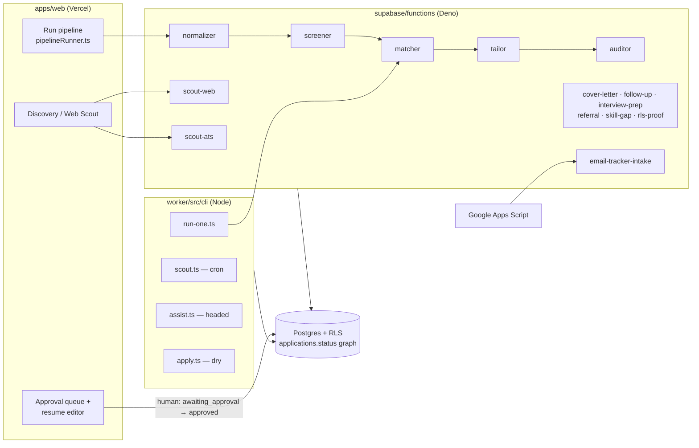
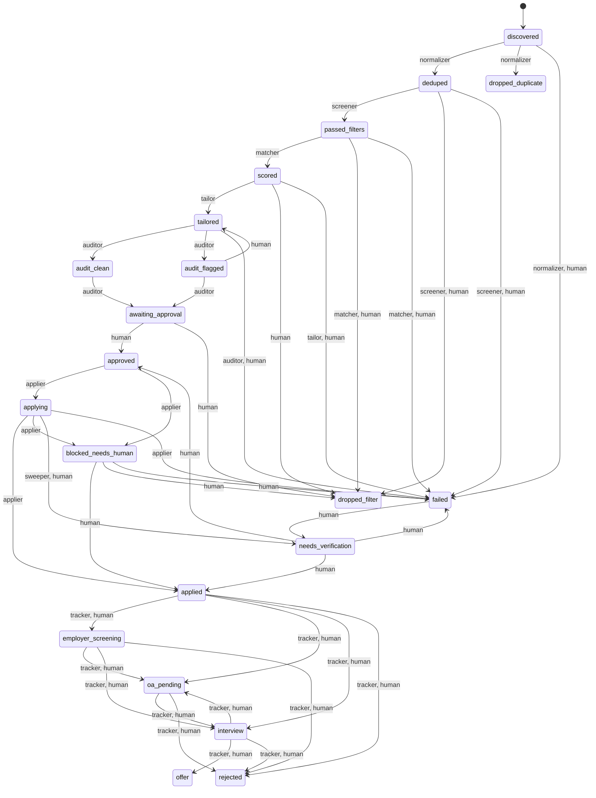

# applyyy — System Architecture

The current architecture of the job-application pipeline. **This file holds no counts and
no line numbers** — every inventory points at the command that regenerates it, so run the
command rather than trusting prose. Last reconciled against code and the live database on
2026-10-08. History and reasoning: [`architecture/agents.md`](architecture/agents.md) (why
each agent is shaped the way it is) and
[`architecture/graph-engineering.md`](architecture/graph-engineering.md) (the status graph as
a control structure). Live status: the "Current state" section of [`PROGRESS.md`](PROGRESS.md).

## 1. Purpose

Find jobs, filter them cheaply, score and tailor a resume per job **without inventing
anything**, audit the tailoring, and put it in front of a human. **Nothing is ever submitted
without a human approval, and today the human also clicks Submit.**

Stack: Supabase Postgres (RLS on every table) + Deno Edge Functions
(`supabase/functions/`); React + Vite dashboard (`apps/web/`, Vercel); Node + Playwright
worker (`worker/`, GitHub Actions and the local terminal); Gemini as the LLM. pnpm only.

## 2. Component map



### Edge functions

Regenerate the list with `ls -d supabase/functions/*/ | grep -v _shared`. Gateway JWT
posture is per function in `supabase/config.toml`.

| Function | Agent identity | Reads status | Writes status | Trigger |
|---|---|---|---|---|
| `scout-ats` | `scout_ats` | — (inserts) | inserts `passed_filters` / `dropped_filter` (screened at insert); `discovered` only if screening is unavailable | manual (Discovery page) |
| `scout-web` | `scout_aggregator` | — (inserts) | inserts `discovered` | manual (Web Scout panel) |
| `normalizer` | `normalizer` | `discovered` | `deduped`, `dropped_duplicate` | manual (Run pipeline); `?application_id=` targets one row |
| `screener` | `screener` | `deduped` | `passed_filters`, `dropped_filter` | manual (Run pipeline); `?application_id=` targets one row |
| `matcher` | `matcher` | `passed_filters` | `scored`, `dropped_filter` | Run pipeline · run-one |
| `tailor` | `tailor` | `scored` | `tailored` (+ `tailored_profile`, `tailor_refs`, `master_version`) | Run pipeline · run-one |
| `auditor` | `auditor` | `tailored`, `audit_clean`, `audit_flagged` | `audit_clean`/`audit_flagged` → `awaiting_approval` | Run pipeline · run-one |
| `cover-letter` | `cover_letter` | `tailored`, `audit_clean`, `audit_flagged` | none (letter only; never written at `awaiting_approval`) | manual HTTP only |
| `follow-up` | `follow_up` | `applied` | none (`follow_up_nudges` drafts) | manual HTTP only |
| `interview-prep` | `interview_prep` | `interview` | none (`interview_prep_packs`) | manual HTTP only |
| `referral` | `referral` | `passed_filters`, `scored` | none (drafts) | manual HTTP only |
| `skill-gap` | `skill_gap` | `scored`, `applied` | none (`skill_gap_reports`) | manual HTTP only |
| `email-tracker-intake` | `tracker` | `applied` … `interview` | post-apply edges (deterministic classifier, `decide.ts`) | push from Apps Script, `X-Applyy-Intake-Secret` |
| `rls-proof` | — | — | — | one-shot diagnostic |

There is **no database scheduler**: `select extname from pg_extension where extname in
('pg_cron','pg_net')` returns nothing. Edge agents run only when something invokes them.

### Worker CLIs (`worker/package.json` scripts)

| Script | File | What it does | Trigger |
|---|---|---|---|
| `scout` | `cli/scout.ts` | ATS boards → `jobs`, screens inline, inserts applications | `scout.yml` cron + dispatch |
| `run-one` | `cli/run-one.ts` | one row through matcher → tailor → auditor via the deployed functions | `run-one.yml` (dispatch) or local |
| `assist` | `cli/assist.ts` | opens ONE `approved` application headed, fills it, **human clicks Submit**, y/n records the outcome | local terminal |
| `apply` | `cli/apply.ts` | batch applier; refuses to submit while `SUBMISSION_IMPLEMENTED=false` | `apply.yml` cron, `DRY_RUN` defaults true |
| `keepalive` | `cli/keepalive.ts` | DB activity + repo activity so nothing pauses silently | `keepalive.yml` cron |
| `scout:remote` | `cli/scout-remote.ts` | RemoteOK/Jobicy/Arbeitnow | **no workflow invokes it** |

Workflow schedules: `grep -n "cron:" .github/workflows/*.yml`. GitHub's scheduled runs can
start hours late; read actual start times with `gh run list --workflow <file>`.

## 3. Status graph (generated from the live edge table)

Source of truth: `select from_status, to_status, allowed_agents from
public.application_status_transitions order by 1,2;`. `packages/shared-types/src/status-flow.ts`
is a client mirror, not the rule. **Regenerate this diagram from the query whenever a migration
touches that table.**



Invariants worth re-checking after any graph migration:
- Every edge into `approved` is human-only:
  `select * from application_status_transitions where to_status='approved' and allowed_agents <> '{human}'` → no rows.
- `applying` has exactly one source, `approved`:
  `select from_status from application_status_transitions where to_status='applying'`.
- `interview ↔ oa_pending` is a machine-walkable cycle with no bound (graph-engineering §3.1).

## 4. Agent chain

```mermaid
flowchart LR
  scout[scout-ats / scout.ts / scout-web] -->|insert| N[normalizer] --> S[screener]
  scout -.->|screened at insert| M
  S --> M[matcher<br/>Gemini] --> T[tailor<br/>Gemini, refs only] --> A[auditor<br/>anti-fabrication]
  A --> Q[awaiting_approval<br/>approval queue + editor]
  Q -->|HUMAN approves| AP[approved]
  AP --> AS[assist.ts headed fill<br/>HUMAN clicks Submit]
  AS --> AD[applied] --> ET[email-tracker-intake]
```



The **Tailor cannot invent**: it emits references to master-profile node ids, and the
validator resolves every ref against the pinned master. The Auditor is the separate critic.

## 5. Security model

- **One app user, no service role.** Every edge function and worker CLI signs in as the
  same Supabase Auth user (`createAppUserClient`, `supabase/functions/_shared/db/client.ts`)
  and runs under RLS. The service role is deliberately unused, so the JWT cannot tell the
  browser from an agent.
- **Agent key.** Machine clients send `x-applyy-agent-key` (`_shared/db/agent-key.ts`, env
  `APPLYY_AGENT_KEY`). `applyy_internal.agent_key_state()` (SECURITY DEFINER) compares its
  SHA-256 with `applyy_internal.agent_key` and returns `unconfigured | missing | invalid | valid`.
  Guarded: `advance_application_status` when `p_agent <> 'human'`, and
  `claim_applications` / `release_application_claim` for **every** caller.
  **Rollout state:** while the table is empty, enforcement is OFF and the functions raise a
  WARNING. Check: `select count(*) from applyy_internal.agent_key` (0 = off). Seeding the
  hash turns on all three; `delete from applyy_internal.agent_key` turns them off.
- **Grants.** anon/PUBLIC EXECUTE is revoked on those three RPCs. Check:
  `select proname, proacl from pg_proc where proname in ('advance_application_status','claim_applications','release_application_claim')`.
- **Transition guard.** `guard_status_transition` (BEFORE UPDATE) refuses an edge absent
  from the table or not allowed for `applyy.acting_agent` (42501).
- **Insert guard.** `guard_status_insert` admits only `discovered`, `passed_filters`,
  `dropped_filter` on INSERT — the update guard never sees inserts.
- **Freeze.** `guard_tailored_profile_freeze` refuses any change to
  `tailored_profile` unless the row *was* at `scored`, `audit_flagged` or
  `awaiting_approval` (42501). What was approved is what gets sent.
- **Stale-read gate.** `advance_application_status(..., p_expected_updated_at)` raises
  SQLSTATE `PT409` (HTTP 409) if the row changed since it was read. Callers that pass it:
  `grep -rln p_expected_updated_at apps/web/src worker/src supabase/functions`.
- **Double submit.** `applying → applying` raises `55000` under a row lock.
- **Kill switch.** `system_settings.system_enabled` (per user), enforced inside
  `claim_applications` and by `readKillSwitch` (`_shared/db/gates.ts`) at the top of the
  pipeline edge agents, failing closed on a missing row or a failed read. Check:
  `select user_id, system_enabled from system_settings`. Exceptions: see §9.
- **List all triggers:** `select tgname from pg_trigger where tgrelid='public.applications'::regclass and not tgisinternal`.

## 6. Data pins

- `tailored_profile.master_version` is **the** pin. The auditor and cover-letter resolve the
  master through it (`_shared/audit/pinned-master.ts`), never through "latest".
- `applications.master_version` is also written by the tailor (`_shared/tailor/persist.ts`),
  in the same update as `tailored_profile`. If the two ever disagree, the JSON pin wins.
- `master_profiles` versions are immutable and carry `content_hash`.

## 7. Deploy model

- **Web:** Vercel auto-deploys on push to `main`. Prove what is live with a present and an
  absent bundle sentinel (repo `CLAUDE.md` §8).
- **Database and functions:** deployed only with Teja's direct approval, by the
  orchestrator session, from a **pinned clean worktree** — never the shared tree, which
  carries peers' uncommitted edits. Recipe in the latest `docs/handoff/*orchestrator-handoff.md`:
  1. `git worktree add <tmp> <sha>`; copy `supabase/.temp/{project-ref,pooler-url,linked-project.json,postgres-version}` in.
  2. Unset the wrong-account `SUPABASE_ACCESS_TOKEN`.
  3. `supabase db push --linked --dry-run` → push only if it lists exactly the expected files.
  4. `supabase functions deploy <fn> --project-ref xynqxekcqizwhtskzqrq --use-api`.
  5. Verify by a SQL **shape** check, then `git worktree remove <tmp>`.
- **Backlog:** `supabase migration list --linked`, or compare
  `select max(version) from supabase_migrations.schema_migrations` with `ls supabase/migrations | tail -1`.

## 8. Verification commands

```
Deno tree:   cd supabase/functions && deno check --reload <paths>
             # assert it ran: … 2>&1 | sed 's/\x1b\[[0-9;]*m//g' | grep -c "^Check"
Deno tests:  node --test "supabase/functions/**/*.test.ts"   # from repo root; tests must be > 0
Web:         cd apps/web && ./node_modules/.bin/tsc --noEmit && ./node_modules/.bin/vite build
Worker:      cd worker && ./node_modules/.bin/tsc --noEmit && ./node_modules/.bin/vitest run
Workspace:   pnpm run typecheck   # does NOT cover supabase/functions; may write the lockfile
Package:     pnpm --filter @applyy/web …   # NOT `--filter web`, which matches nothing
```

Read a checker's own exit code, never `$?` after a pipe. `fail 0` means something only
next to a non-zero `tests`. CI (`.github/workflows/ci.yml`) runs typecheck and tests on
every push to `main`.

## 9. Not built / known gaps (re-check each)

| Gap | Re-check |
|---|---|
| Submission unimplemented; humans submit via `assist.ts` | `grep -n "SUBMISSION_IMPLEMENTED =" worker/src/playwright-page.ts` |
| Agent-key enforcement off | `select count(*) from applyy_internal.agent_key` |
| No scheduler for edge agents (pipeline is click-driven) | `select extname from pg_extension where extname='pg_cron'` |
| Auxiliary functions have no invoker in repo | `grep -rnE "cover-letter\|follow-up\|interview-prep\|referral\|skill-gap" apps/web/src worker/src .github` |
| `email-tracker-intake` never reads the kill switch; `scout-ats` lets `?force=true` bypass it | `grep -ln "readKillSwitch\|system_enabled" supabase/functions/{email-tracker-intake,scout-ats}/*.ts` and `grep -n "force" supabase/functions/scout-ats/index.ts` |
| Aggregator adapters (Adzuna/Jooble/Workable/SmartRecruiters) unreachable | `grep -rn "scout/tiers" supabase/functions worker/src \| grep -v test` |
| ATS simulator unwired | `grep -rln "ats-simulator" supabase/functions apps/web/src \| grep -v test` |
| `scout-remote.ts` invoked by nothing | `grep -n "scout:remote" .github/workflows/*.yml` |
| `interview ↔ oa_pending` cycle unbounded | §3 invariants |
| No live declared-vs-graph diff test | `grep -rln application_status_transitions --include=*.test.ts .` |
| `email_events.thread_id` never written | `grep -n thread_id supabase/functions/email-tracker-intake/index.ts` |
| `experience_ceiling` / `degree_mismatch` cannot fire (JD fields never populated); skips are recorded in `agent_runs.error_detail` | `select count(*) filter (where min_experience_years is not null) from jobs` |
| Screener's `already_applied` checks a history that includes the row itself (masked today by the earlier tech gate) | `_shared/screen/supabase-queries.ts` `applicationHistory()`; `select drop_reason, count(*) from applications where status='dropped_filter' group by 1` |
| `bootstrap_user_defaults()` has no caller; a new signup gets no defaults | `grep -rn "bootstrap_user_defaults" apps worker supabase/functions` |
| Every transition writes two `application_events` rows (RPC + `log_status_change` trigger) | `select application_id, count(*) from application_events group by 1 order by 2 desc limit 5` |
| Nothing alerts on a failed Vercel deploy | `grep -in vercel .github/workflows/*.yml` |
| Where rows sit | `select status, count(*) from applications group by 1 order by 1` |
