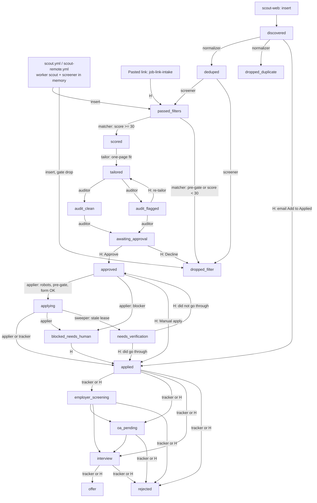

# Pipeline end to end: one job, from discovery to tracked

_Last verified against code: 2026-11-08 (2a9ac31)._

This page follows one job through every status in `applications.status`. For each step it
names who moves the row, the file that does it, what starts it, and which gates can stop it.

It describes **committed** code at `2a9ac31`. Uncommitted peer work in `manual-apply/`,
`dispatch-apply/handler.ts`, `worker/src/apply-one.ts` and `worker/src/assist/rehearse.ts`
is not described here.

## 1. Where the edges come from

The status graph is data, not code. Each allowed move is one row in the table
`application_status_transitions` (`from_status`, `to_status`, `allowed_agents`, `note`).
`advance_application_status()` refuses any move that has no row, or whose agent is not in
`allowed_agents`. Every status UPDATE must go through that function (repo `CLAUDE.md` §7).

Read the live edges, never a copy of them:

```sql
select from_status, to_status, allowed_agents, note
from application_status_transitions order by 1, 2;
```

The migrations that create or change edges (find them again with
`git grep -l application_status_transitions -- supabase/migrations`):

| Migration | What it added or changed |
|---|---|
| `20260909234900_status_transition_guard.sql` | The table, the guard trigger and the core graph |
| `20260910190000_fix_sweep_count_bootstrap_seed_and_blocked_edge.sql` | `approved -> blocked_needs_human` (applier parks without passing through `applying`) |
| `20260917130000_guard_application_status_on_insert.sql` | `applyy_internal.guard_status_insert()`: a new row may start only at `discovered`, `passed_filters` or `dropped_filter` |
| `20261004210000_agent_names_and_cover_letter.sql` | Agent names in `allowed_agents` |
| `20261009235000_tracker_confirms_applied.sql` | `applying -> applied` for `tracker` (a verified ATS receipt email) |
| `20261031200000_human_pasted_link_reenters_passed_filters.sql` | `discovered -> passed_filters` and `dropped_filter -> passed_filters`, human only (pasted link) |
| `20261101173000_master_change_reruns_pipeline.sql` | `awaiting_approval -> passed_filters` and `approved -> passed_filters`, human only (master changed) |
| `20261102203000_failed_before_approval_reruns.sql` | `failed -> passed_filters`, human only, with `applyy_internal.guard_failed_rerun()` |
| `20261105121500_human_resolves_approved_from_manual_apply.sql` | `approved -> applied` and `approved -> failed`, human only (Manual apply lane) |
| `20261105124600_email_add_to_applied_and_read_at.sql` | `discovered -> applied`, human only (job applied to outside the portal) |

Other DB guards that act on every move:

- `applyy_internal.guard_tailored_profile_freeze()` (`20261006190000_freeze_tailored_profile_outside_review.sql`):
  `tailored_profile` can change only at `scored`, `audit_flagged` or `awaiting_approval`.
- The agent key: machine agents must send the `x-applyy-agent-key` header. Without it they are
  treated as human, or refused when the edge is agent-only (repo `CLAUDE.md` §7).

## 2. The flowchart

Happy path in bold boxes. Side exits (`dropped_*`, `failed`) are shown once per stage.
`H` = human only.



Not drawn, to keep it readable: every `-> failed` edge, the human re-run edges
(`awaiting_approval|approved|failed|dropped_filter -> passed_filters`), and
`interview -> oa_pending`. The SQL in section 1 lists them all.

## 3. Step by step

### 3.1 Discovery: a row is created

There are three ways in. Each one inserts a new `applications` row; it never UPDATEs.

| Way in | Code | Trigger | Starting status |
|---|---|---|---|
| ATS board scout | `worker/src/cli/scout.ts` | `.github/workflows/scout.yml`, cron `17 0,12 * * *` and `17 4 * * *` (UTC), or manual dispatch | `passed_filters` or `dropped_filter` |
| Remote feeds scout | `worker/src/cli/scout-remote.ts`, `worker/src/scout/remote-run.ts` | `.github/workflows/scout-remote.yml`, cron `30 1 * * *` (UTC) | `passed_filters` or `dropped_filter` |
| Web search scout | `supabase/functions/scout-web/index.ts` | invoked on demand | `discovered` |
| Pasted link | `supabase/functions/job-link-intake/handler.ts` | "Add a job by link" button (`apps/web/src/features/discovery/AddJobLinkPanel.tsx`), or `.github/workflows/ingest-links.yml` (manual) | `passed_filters` (human) |

The two scouts **screen on insert**: they call the screener's own function,
`planScreenedApplications` (`supabase/functions/_shared/screen/screen-batch.ts`), so the row is
born already screened. Only `scout-web` (and older fallback paths) insert at `discovered`.

Gates at discovery:

- **Robots (scouting).** Board fetches are robots-gated through `packages/master-robots`
  (`checkRobots`, `packages/master-robots/src/index.ts`). SmartRecruiters is off by ruling.
- **Kill switch.** Scouts do nothing when `system_settings.system_enabled` is false, unless
  the dispatch passes `force=true` (`scout.yml` input).
- **Pasted link skips robots for the page itself.** A link the human pasted is a
  user-triggered fetch (`job-link-intake/handler.ts:162`). It still runs the work-auth gate
  (`handler.ts:579`) and can ask the human to confirm a foreign job first.

### 3.2 `discovered -> deduped` (normalizer)

- **Code:** `supabase/functions/normalizer/`, with `_shared/normalize/fingerprint.ts` and
  `_shared/normalize/normalize-batch.ts`.
- **Trigger:** no cron. `.github/workflows/prescreen-drain.yml` (manual dispatch), the
  Discovery "Run pipeline" modal (`apps/web/src/features/discovery/PipelineRunModal.tsx`
  calling `apps/web/src/data/pipelineRunner.ts`), or "Send through pipeline" on one card
  (`supabase/functions/_shared/pipeline/row-pipeline.ts`).
- **Exits:** `dropped_duplicate` (same posting from another board), `failed` (cannot parse).

### 3.3 `deduped -> passed_filters` (screener)

- **Code:** `supabase/functions/screener/index.ts` -> `planScreenedApplications` in
  `_shared/screen/screen-batch.ts`.
- **Trigger:** the same as the normalizer (prescreen drain, Run pipeline, Send through pipeline).
- **Gates, in this order** (`screen-batch.ts`). The first drop wins and its code goes into
  `drop_reason`:
  1. Tech gate: `screenTechRole` (`_shared/screen/tech-gate.ts`).
  2. Missing description: a blank JD drops as `missing_description`.
  3. **Work-auth gate:** `screenWorkAuth` (`_shared/screen/work-auth-gate.ts:351`). It drops an
     on-site or hybrid job outside the user's work-authorised countries, or a JD that needs
     a status the user lacks. An unknown location passes. If the country list was never set,
     the gate opens and warns.
  4. The rule cascade: `screenJob` (`_shared/filter/cascade.ts`), every enabled `filter_rules`
     row by `sort_order`. This includes the **experience ceiling** rule
     (`experience_ceiling`, `cascade.ts:155`), which reads the years parsed by
     `requiredExperienceYears` (`_shared/screen/required-experience.ts:132`).
- **Exits:** `dropped_filter` (with `drop_reason`), `failed`.

### 3.4 `passed_filters -> scored` (matcher)

- **Code:** `supabase/functions/matcher/index.ts`; score floor in
  `_shared/match/score-threshold.ts`.
- **Trigger:** no cron (nothing scores `passed_filters` on a schedule).
  `.github/workflows/postscreen-drain.yml` (manual dispatch, stages matcher -> tailor -> auditor),
  `.github/workflows/run-one.yml` (one row), the Run pipeline modal, Send through pipeline, and
  `job-link-intake` (runs `row-pipeline.ts` server-side after a pasted link).
  `.github/workflows/pregate-sweep.yml` calls `matcher?mode=pregate_only` to prune the queue
  without any Gemini call.
- **Gates:**
  1. **Pre-gate** (`supabase/functions/matcher/tech-pregate.ts`): re-runs the tech gate, the
     work-auth gate and the experience ceiling (`screenRequiredExperience`) with today's
     settings, before a Gemini call is spent. This matters because rows sent back by a human
     (master changed, failed re-run, pasted link) never meet the screener again. Every road
     into `passed_filters` meets the matcher, so one check here covers them all.
  2. **Score floor:** `MATCH_ADVANCE_FLOOR = 30` (`score-threshold.ts:43`).
     `decideScoreThreshold` advances at `score >= 30` and drops below it. A job the human
     picked by link (`discovered_via` holds `'manual'`, `isHumanPicked`) is never dropped for a
     low score. A score that is not an integer from 0 to 100 is `invalid`: no move, a failure entry.
- **Exits:** `dropped_filter`, `failed` (repeated non-quota failure).

### 3.5 `scored -> tailored` (tailor)

- **Code:** `supabase/functions/tailor/`, with `_shared/tailor/tailorer.ts`,
  `_shared/tailor/validator.ts` and `_shared/tailor/page-trim.ts`.
- **Trigger:** the post-screen drain, run-one, the web buttons, or job-link-intake.
- **Gates:**
  - **Validator:** every tailored line must come from the master profile. If every candidate
    fails, the row goes to `failed`.
  - **One-page rule:** `fitToOnePage` (`page-trim.ts:202`, called at `tailorer.ts:464`) fits
    the resume on one page. It trims in `TRIM_ORDER` (`page-trim.ts:58`): certifications first,
    then project bullets over the cap, then the weakest bullet. The dense typography rungs
    live in `packages/resume-template` (commit `dc8ac5c`).
- **Other exits:** `dropped_filter` (human discards after reading the score).

### 3.6 `tailored -> audit_clean | audit_flagged -> awaiting_approval` (auditor)

- **Code:** `supabase/functions/auditor/index.ts`, with `_shared/audit/audit.ts`,
  `_shared/audit/detector.ts` and `supabase/functions/auditor/pregate.ts`.
- **Trigger:** the post-screen drain, run-one, the web buttons, or job-link-intake.
- **Gates:**
  - **Anti-fabrication audit:** every tailored claim must trace to a master node.
    Clean -> `audit_clean` (Bucket A, batch approval allowed). Not clean -> `audit_flagged`
    (Bucket B, reviewed one by one).
  - **Last pre-gate re-check** (`auditor/index.ts:321`, `auditorPreGateDrop`): the matcher's
    pre-gate runs again before a human sees the row.
- **Human edge:** `audit_flagged -> tailored` is a human re-tailor only. A re-tailor is a
  decision about truth, not a retry.

### 3.7 `awaiting_approval -> approved` (human only)

- **Code:** `apps/web/src/features/approval/ApprovalQueuePage.tsx`. The edit-and-save path
  re-fits the one-page rule in the browser (`apps/web/src/features/approval/pageFitEdit.ts:51`).
- **Trigger:** Teja clicks Approve (or Decline -> `dropped_filter`).
- **This is the only door into `approved`.** No machine agent holds it.
- **After approve:** the page calls `requestDispatch` (`apps/web/src/features/approval/dispatchApply.ts`),
  which invokes `supabase/functions/dispatch-apply`. That function (`handler.ts`):
  1. always dispatches `.github/workflows/apply-kit.yml` (builds the Manual apply kit; a kit
     never submits and writes no status);
  2. dispatches `.github/workflows/apply.yml` with `drain_approved=true` **only** when
     `system_settings.auto_apply_on_approve` is exactly true. A missing row reads as off.

### 3.8 `approved -> applying -> applied` (applier)

- **Code:** `worker/src/cli/apply.ts` -> `runApplierBatch` (`worker/src/claim-loop.ts:288`) ->
  `worker/src/apply-one.ts`. Status writes go through `worker/src/guarded-advance.ts` and
  `worker/src/supabase-gateway.ts` as agent `applier`.
- **Trigger:** `.github/workflows/apply.yml`: cron `30 2 * * *` (UTC; GitHub starts it late,
  often hours late), manual dispatch with `apply_only_id`, or the drain from `dispatch-apply`.
- **Live or dry** (`apply.yml`): a scheduled run is DRY unless the repo variable
  `APPLYY_CRON_LIVE` is exactly `true`. A manual live run needs `apply_only_id` or
  `drain_approved=true`, never both. A dry run never touches the status graph; it releases
  the claim. `SUBMISSION_IMPLEMENTED` is in `worker/src/playwright-page.ts`.
- **Gates, in order, while the row is still `approved`** (`apply-one.ts` header):
  1. **Pre-gate re-check** (`apply-one.ts:318`, `auditorPreGateDrop`) with today's settings.
  2. **Workday guard:** a Workday job needs a candidate account, which this system never
     creates. It is parked at `blocked_needs_human` for a human. The page is never opened.
  3. **Robots (applier):** `checkRobots` under the token `applyy-applier`
     (`APPLIER_ROBOTS_TOKEN`, `apply-one.ts:63`). A live refusal parks the row at
     `blocked_needs_human`. A transient failure releases it for the next run.
  4. Navigate, detect anti-bot walls, extract fields, plan the fill, fill, screenshot.
     Any blocker parks at `blocked_needs_human` with a `block_reason`.
  5. Only then `approved -> applying`, one submit, then `applying -> applied`
     (`apply-one.ts:940`), `blocked_needs_human` or `failed`.
- **Submit cap** (`claim-loop.ts`): `APPLY_MAX_SUBMITS`, default `DEFAULT_MAX_SUBMITS = 3`
  (`claim-loop.ts:238`). A drain run sets it to 25 (`apply.yml`). The value is shape-checked;
  a bad value stops the run. `max_applications_per_day` (daily cap) also applies.
- **Circuit breaker** (`claim-loop.ts:659`): in a live run, the first
  `submit_outcome_unknown` or captcha stops all further claims in that run. Robots refusals
  and unsupported ATS never trip it, because nothing was sent.
- **Kill switch:** `checkKillSwitch` runs before each claim.
- **Re-dispatch:** a live drain that sent at least one application and stopped at its batch
  cap or time budget starts another drain. It never does so after the breaker, the kill
  switch or the daily cap (`shouldRedispatchDrain`, `claim-loop.ts:200`; job at the end of `apply.yml`).

### 3.9 Side lanes after approval

| From | To | Who | Code / trigger |
|---|---|---|---|
| `applying` | `needs_verification` | `sweeper` | `sweep_stale_claims()` RPC, called by the applier at run start (`worker/src/supabase-gateway.ts:207`). A stale lease means nobody knows whether the submit landed, so it never goes back to the queue. |
| `needs_verification` | `approved` | human only | Teja checked: it did not go through. The only way back into the submit path. |
| `needs_verification` | `applied` / `failed` | human | Teja checked the employer portal. |
| `blocked_needs_human` | `applied` / `dropped_filter` / `failed` | human | Teja finishes by hand, or gives up. |
| `approved` | `applied` / `failed` | human | Manual apply lane (`apps/web/src/features/manual-apply/ManualApplyPage.tsx`) with the kit from `worker/src/apply-kit.ts`. Kits are built by `apply-kit.yml`: after every `apply.yml` run (`workflow_run`), cron `0 12 * * *` (UTC), and on every approve. |
| `awaiting_approval` / `approved` | `passed_filters` | human | Re-score and re-tailor after the master changed; then run `postscreen-drain.yml`. |

### 3.10 `applied` and after (tracker)

- **Code:** `supabase/functions/email-tracker-intake/index.ts` (agent `tracker`), classifier in
  `_shared/email/classifier.ts`.
- **Trigger:** the Gmail Apps Script (`supabase/functions/_shared/apps-script/email-tracker.gs`)
  on an hourly time trigger, plus the dashboard "sync now" button through
  `supabase/functions/gmail-sync/index.ts`.
- **Moves:** `applying -> applied` from a DKIM/SPF-verified ATS receipt after the submit; then
  `applied -> employer_screening | oa_pending | interview | rejected`, and onward to `offer` or
  `rejected`. A human can make every tracker move by hand too.
- **Outside the portal:** an email for a job applied to elsewhere can be added straight to
  `applied` from the Emails page (`discovered -> applied`, human).

## 4. All gates in one table

| Gate | Where it runs | File | Effect when it fails |
|---|---|---|---|
| Robots (scouting) | scouts, board fetches | `packages/master-robots/src/gate.ts` | board not read |
| Robots (applier) | before the apply page opens | `worker/src/apply-one.ts:63` | `blocked_needs_human` (live) or released |
| Tech gate | screener, matcher pre-gate, auditor, applier | `_shared/screen/tech-gate.ts` | `dropped_filter` |
| Work-auth | screener, job-link-intake, matcher pre-gate, auditor, applier | `_shared/screen/work-auth-gate.ts:351` | `dropped_filter` |
| Experience ceiling | screener cascade, matcher pre-gate, auditor, applier | `_shared/filter/cascade.ts:155`, `_shared/screen/required-experience.ts:240` | `dropped_filter` |
| Score floor (30) | matcher | `_shared/match/score-threshold.ts:43` | `dropped_filter` (not for a pasted link) |
| One-page rule | tailor, approval editor | `_shared/tailor/page-trim.ts:202` | content trimmed, cuts recorded |
| Anti-fabrication audit | auditor | `_shared/audit/audit.ts` | `audit_flagged` (review one by one) |
| Human approval | Approval Queue | `apps/web/src/features/approval/ApprovalQueuePage.tsx` | stays `awaiting_approval` |
| Auto-apply switch | dispatch-apply | `supabase/functions/dispatch-apply/handler.ts` | no live drain (kit still built) |
| Live/dry switch | apply.yml | `.github/workflows/apply.yml` | dry run, no status change |
| Submit cap | applier | `worker/src/claim-loop.ts:238` | run stops claiming |
| Circuit breaker | applier | `worker/src/claim-loop.ts:659` | run stops claiming |
| Stale-lease sweep | applier run start | `sweep_stale_claims()` | `needs_verification` |

## 5. How to check a claim on this page

- Edges: the SQL in section 1.
- Where rows sit now: `select status, count(*) from applications group by 1;`
- Workflow crons and triggers: the `on:` block of each file in `.github/workflows/`.
- A gate's caller: `git grep -n "<function name>" -- supabase/functions worker/src apps/web/src`.
