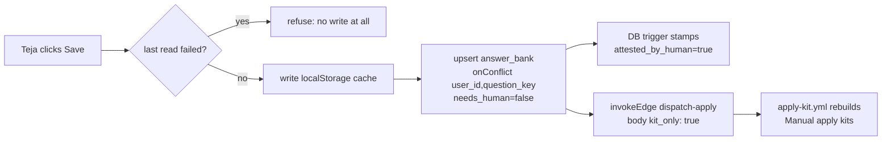

# Answer bank and Settings

_Written 2026-11-08 against 2a9ac31._ HEAD moved to `2936e8c` while this was written. That commit adds the
"rebuild the kit after an answer is saved" step described below, so it is included here as committed code.

## What it is

The Settings area is the group of pages where Teja tells the system **who he is, what he wants, and what he
allows**. Every agent reads these settings. No agent writes them, except where noted.

There are six pages. Each is a route in `apps/web/src/App.tsx`, and all code lives in
`apps/web/src/features/settings/`.

| Route | Page file | What it controls | Table(s) it writes |
|---|---|---|---|
| `/search-preferences` | `SearchPreferencesPage.tsx` | What to look for: titles, places, employment types, work-auth countries, remote policy. Also the pipeline controls (on/off switch, daily cap, apply-on-approve). | `search_preferences`, `system_settings` |
| `/master-profile` | `MasterProfilePage.tsx` | The master resume as structured JSON. Every tailored resume is built from it. | `master_profiles` |
| `/answer-bank` | `AnswerBankPage.tsx` | Answers to application-form questions. The worker fills forms only from these. | `answer_bank` (reads `unanswered_questions`) |
| `/filters` | `FiltersPage.tsx` | The cheap code-only filter cascade that runs before any LLM call. | `filter_rules` |
| `/watchlist` | `WatchlistPage.tsx` | Which company job boards the scouts poll. | `company_watchlist` |
| `/blocklist` | `BlocklistPage.tsx` | Companies to never apply to. | `company_blocklist` |

The **answer bank** is the most important page here. It is the only page that grows by itself over time, and
it is the place where the "never invent an answer" rule is enforced.

## Why it exists

### The problem

The product goal is one human-approved pipeline that runs end to end for real (see
[vision-and-why.md](../vision-and-why.md)). The last step is a bot that fills a real application form. Forms ask
questions: notice period, expected salary, "are you located in India?", "do you need visa sponsorship?", gender,
"why do you want to work here?".

A bot that guesses an answer can lie on a real application in Teja's name. So the system has a hard rule: **it
never invents an answer.** If the bot meets a question it has no stored answer for, it stops and parks the row at
`blocked_needs_human`. The answer bank is where those stored answers live.

The other settings pages exist for a cost reason. Without them, every discovered job would go to Gemini. The
Filters page header gives the example: 400 jobs a morning, about 40 survive plain-code filters, so 40 LLM calls
instead of 400. That saving repeats on the tailor and the auditor too.

### Rulings that shaped this area

| Date | Ruling (from code headers and handoffs) | Where it lives now |
|---|---|---|
| 2026-10-09 | Teja ruled that eligibility questions (location, sponsorship, employment restrictions) may be answered automatically, but **only from answers he saved himself**. | `answer_bank.attested_by_human` + trigger, migration `20261009160000_answer_bank_attested_by_human.sql` |
| 2026-10-09 14:19 IST | Teja ruled that EEO questions (gender, race, Hispanic/Latino, veteran status) may be answered, but only from his own attested answers, never guessed and never defaulted to "Decline". | `EEO_TEMPLATES` in `worker/src/plan-fill.ts`; the EEO selects in `EligibilityAnswers.tsx` |
| 2026-10-24 18:44 and 19:13 IST | Teja ruled: drop jobs that need US work authorization; allowed = "indian + remote + india visa free countrys". | `search_preferences.work_authorized_countries`, migration `20261024190000_search_preferences_work_authorized_countries.sql`; gate in `supabase/functions/_shared/screen/work-auth-gate.ts` |
| 2026-10-24 | Opinions, preferences and acknowledgements (pronouns, onsite, relocation, "I understand this is in-person") are statements Teja signs, so they fill only from an attested bank row. | `OPINION_FRAGMENTS` in `worker/src/plan-fill.ts` |
| 2026-11-04 18:26 IST | Teja reversed the 10-24 remote half: a remote job locked to another country ("Remote - US") is dropped; remote with no country lock is kept. | `search_preferences.remote_location_policy` (`unlocked_or_authorized` default, `any` = old behaviour), migration `20261104193000_remote_location_policy_and_experience_ceiling.sql` |
| 2026-11-01, confirmed 2026-11-04 | Experience ceiling: a hard requirement above 1 year drops the job. | `EARLY_CAREER_MAX_YEARS = 1` in `filtersStore.ts` |
| 2026-11-04 19:06 | No native browser dialogs. Deletes confirm inline. | `apps/web/src/app/InlineConfirm.tsx`, used by `AnswerBankPage.tsx` |
| 2026-11-05 22:55 IST | Teja answers each blocking required form question **once**, on the Answer bank page. | `unanswered_questions` table (migration `20261105230000_unanswered_questions.sql`), `UnansweredQuestions.tsx` |
| 2026-11-01 | SmartRecruiters boards are off (robots.txt ruling), so the watchlist never offers them. | `ADDABLE_ATS_PROVIDERS` in `companyCatalog.ts` |
| 2026-11-07 22:55 | Rows the bot cannot apply to go to the Manual apply lane; his answers there grow the answer bank. | `apps/web/src/features/manual-apply/`, see [manual-apply-lane.md](manual-apply-lane.md) |

## How it works

### 1. The answer bank

#### The table

`public.answer_bank` was created in `supabase/migrations/20260909234800_supporting_tables.sql`. One row per
(user, `question_key`).

| Column | Meaning |
|---|---|
| `question_key` | Normalised key, for example `notice_period_days`. The same question phrased differently on two ATSs hits one row. |
| `question_text` | The label. Untrusted when it came from an ATS page; shown escaped. |
| `answer_type` | `text`, `number`, `boolean`, `single_select`, `date`, `long_text`. |
| `answer_value` | `jsonb`, so a number stays a number and a multi-select stays an array. |
| `needs_human` | `true` = placeholder waiting for Teja. The worker refuses it. |
| `times_used`, `last_used_at` | Evidence that answering once paid off many times. |
| `attested_by_human` | `true` only when the last write came from Teja in the browser. Stamped by a trigger. |

#### Who wrote this answer? (`attested_by_human`)

The value of an answer is not enough. For eligibility, EEO and opinion questions, the worker must know **who**
wrote it. The client cannot claim it: a `BEFORE INSERT OR UPDATE` trigger
(`answer_bank_stamp_attestation`, function `applyy_internal.stamp_answer_attestation()`) overwrites whatever the
client sent.

The rule, from the migration:

```
attested_by_human = (agent_key_state() = 'missing'  -- no x-applyy-agent-key header
                     AND JWT role = 'authenticated') -- a signed-in user, not SQL editor or service_role
```

| Writer | Agent-key header | Result |
|---|---|---|
| Teja saving on the Answer bank page or a Manual apply card | none | `true` |
| Worker or edge function | valid key | `false` |
| A stale or forged key | invalid key | `false` (fail-closed) |
| SQL editor, MCP, `supabase db query`, service_role | none, but no `authenticated` JWT | `false` |

The stamp is recomputed on **every** write. If a machine ever updates a row (even just `times_used`), the row
loses its attestation and the worker refuses it. The failure is visible, not silent. Re-saving in the browser
restores it. Migration `20261102210000_agent_key_fail_closed.sql` changed the empty-key-table behaviour for
agents, and its header says `stamp_answer_attestation()` is unaffected: it marks a row human only on `missing`.

Example from the 2026-11-08 handoff: 15 India answers were inserted by CLI at 22:20, so they are
`attested_by_human = false`. They still fill ordinary questions, but not eligibility, EEO or opinion questions.
Teja can stamp them by saving each one once in the browser.

#### How the worker uses the bank

`worker/src/plan-fill.ts` decides each form field in this order (see the header comments there):

1. **Never-automatic questions** (`NEVER_FRAGMENTS`, `NEVER_TOKENS`): date of birth, age, criminal history,
   background checks, salary history, consent, "I certify". No stored answer can reach them. Teja only.
2. **EEO** (`EEO_FRAGMENTS`): answered only through one of the four `EEO_TEMPLATES` keys (`eeo_gender`,
   `eeo_hispanic_latino`, `eeo_race`, `eeo_veteran_status`) from an attested row. Optional EEO fields with no
   answer are left blank.
3. **Eligibility** (`ELIGIBILITY_FRAGMENTS`): location, sponsorship, visa, work authorisation, non-compete,
   former employment. Answered only through anchored templates from an attested row. Anything else in this
   territory goes to Teja.
4. **Opinions** (`OPINION_FRAGMENTS`): pronouns, onsite, hybrid, relocation. Only from an attested row keyed to
   that label.
5. **Everything else**: a plain bank lookup by normalised key, then the master profile.

`attestedRow()` in `plan-fill.ts` returns `awaiting_human_answer` for a `needs_human` row, and refuses any
`attested_by_human` value that is not exactly boolean `true` (so `null`, missing or `"true"` all refuse).

When the planner refuses a **required** field, the row parks at `blocked_needs_human`, and the worker records the
question through the RPC `record_unanswered_questions` (`worker/src/supabase-gateway.ts`).

#### The page: three sections

`AnswerBankPage.tsx` shows three things, all sharing one loaded bank:

1. **Unanswered questions** (`UnansweredQuestions.tsx`, logic in `unansweredQuestionsView.ts`). One card per
   question key from `public.unanswered_questions`. The same question on ten forms is one card that says "blocks
   10 applications". Only applications still in an open status are counted (`OPEN_STATUSES`). Keys already in
   the bank are hidden. Cards are grouped:
   - `fact`: reusable facts (education, notice period, years of experience).
   - `attest`: statements only Teja may make (acknowledgements, in-person events).
   - `essay`: per-company free text.
   - `rule`: no saved answer can clear it. Shown with no input at all.

   To decide "can a saved answer clear this?", the page runs the **real** worker `planFill`, imported by relative
   path (`../../../../../worker/src/plan-fill.ts`), with one hypothetical attested answer. So the page cannot
   drift from the worker. The table is a report only: the planner never reads it.
2. **Eligibility answers** (`EligibilityAnswers.tsx`). The keys in `ELIGIBILITY_KEYS`
   (`answerBankStore.ts`): `located_in_country`, `visa_sponsorship_required`, `employment_restrictions`, and the
   two GitLab free-text questions (primary language, open-source links). Plus the four EEO selects with their
   exact option strings (`EEO_QUESTIONS`). Each field shows its attestation state: "Not saved yet" (no row),
   "Saved, not attested" (`false`), or attested. Suggestions (from his rulings and the master profile) only
   **prefill a draft**. Nothing saves without a click, because an auto-save would stamp a machine's guess as his
   answer.
3. **The main table**: every other answer, filterable by category (`compensation`, `auth`, `eeo`, `written`,
   `general`, plus "needs attention"). Custom questions are added with `AddQuestionModal.tsx`. Deleting a custom
   question asks for an inline confirm. The table hides the `eeo_*` keys and the legacy `gender` and
   `disability_status` seeds (`TABLE_HIDDEN_KEYS` in `answerBankView.ts`): the worker never reads the legacy
   ones, and their option text does not match Greenhouse.

#### The one save path

Every answer on the page, and on Manual apply cards, saves through `saveBankAnswer()` in `answerBankStore.ts`:



- The payload never carries `attested_by_human` or an agent key. The trigger decides.
- If the last bank read failed, the save is refused before any write. A failed read must not look like an
  empty bank.
- After a remote write lands, the store asks `dispatch-apply` for a kit-only sweep (added in `2936e8c`,
  2026-11-08). That dispatches `apply-kit.yml` only, never the applier. It never fails the save; the result
  comes back as `kitRefresh: 'requested' | 'failed'`. Before this, a Manual apply card kept saying "needs your
  answer" until the next applier run or the daily cron.

### 2. Search preferences and work authorisation

`SearchPreferencesPage.tsx` and `FiltersPage.tsx` are two halves of one decision. Search preferences say **what
to look for**. Filters say **what to throw away**. They are separate so it is clear which controls cost money:
search terms drive how many jobs arrive; filters drive how many reach Gemini.

**Work-auth countries.** `search_preferences.work_authorized_countries` (a `text[]` of English country names) is
read by the screener's stage-0b gate, `supabase/functions/_shared/screen/work-auth-gate.ts`. In plain words:

- On-site or hybrid job located only outside the list: **dropped**.
- Remote job with no country lock: **kept**.
- Remote job locked to a country outside the list ("Remote - US"): **dropped** under the default policy
  `unlocked_or_authorized`. Under `any` it is kept.
- Unclear location ("In-Office", "2 Locations"), missing location, or a place the gate does not recognise:
  **kept**, unless the JD's own "Location:" line names only places outside the list.

`null` or an empty list means "never set": the gate passes everything. A missing answer must never become
"authorised nowhere" (CLAUDE.md section 6). The page sends `null`, not `[]`, when the box is empty.

**Pipeline controls.** The same page writes three columns of `system_settings`:

| Column | Meaning |
|---|---|
| `system_enabled` | The on/off switch every agent checks first. Default off. |
| `max_applications_per_day` | Daily cap. `NULL` = no cap (the worker reads it that way). |
| `auto_apply_on_approve` | Read by `dispatch-apply`: submit right after Teja approves. Default off. |

The page reads `system_settings` separately from `search_preferences`, so an outage in one is not mistaken for
the other being empty.

### 3. Filters

`FiltersPage.tsx` is the live editor of `public.filter_rules`. Nothing in the cascade is hard-coded. The rule
types are the enum `public.filter_rule_type` (`supabase/migrations/20260909234500_enums.sql`):
`experience_ceiling`, `title_blocklist`, `location_allowlist`, `employment_type`, `already_applied`,
`company_blocklist`, `staleness`, `degree_mismatch`, `per_company_weekly_cap`. Rules run cheapest first and stop
at the first drop. `filtersStore.ts` holds the built-in defaults and the "Early Career SDE" preset; both use
`EARLY_CAREER_MAX_YEARS = 1`, the same value the live rule has. Before 2026-11-04 the preset wrote 2, so one
click would have let every "2+ years" job back in.

The work-auth gate is **not** a filter rule. It is a `search_preferences` column on purpose: a new enum value
needs `ALTER TYPE ... ADD VALUE`, an enum-parity edit in `packages/shared-types`, and a cascade change.

### 4. Master profile

`MasterProfilePage.tsx` shows the master resume as structured JSON. The tailor can only select and reword nodes
from it; an id that is not there fails the whole tailoring. Intake is a PDF upload (parsed in the browser,
`pdfExtractor.ts`, `masterIngest.ts`) reviewed against the stored profile (`masterReview.ts`,
`MasterUploadReview.tsx`), or a pasted JSON. Each section also has an Add button (`masterAdd.ts`).

Editing creates version N+1; old versions never change. Applications store the version they came from. A
re-upload of an unchanged profile hits a unique content hash
(`20260910212600_enforce_master_profile_content_hash.sql`); `masterStore.ts` reports that as "already stored",
not as an error, so the page does not cry wolf.

### 5. Watchlist and blocklist

- `WatchlistPage.tsx` edits `company_watchlist`: one row per company board on one ATS, identified by its board
  token. The scouts poll only these boards, so this list **is** the funnel. The page shows `last_polled_at`,
  `last_poll_job_count` and `consecutive_failures`, because a stale token returns zero jobs, not an error.
  `CompanySuggestionsModal.tsx` and `companyCatalog.ts` offer a curated catalog; SmartRecruiters is never offered.
- `BlocklistPage.tsx` edits `company_blocklist` with a reason (`consultancy`, `mlm`, `ghosted`,
  `rejected_recently`, `personal_choice`, `other`). The screener's `company_blocklist` rule reads it.

## Rules and guardrails

- **Never invent an answer.** No stored answer means park at `blocked_needs_human`, never guess.
- **Provenance is decided by the database, not the client.** Only the trigger sets `attested_by_human`.
- **Agents cannot attest.** A CLI, MCP or agent write stays `false`. On 2026-11-08 the classifier blocked an
  agent attempt to attest; the handoff says never route around it.
- **Suggestions prefill; only a click saves.**
- **Some questions are Teja-only forever** (`NEVER_FRAGMENTS`), whatever the bank holds.
- **Fail-open on missing location data, fail-closed on provenance.** The work-auth gate keeps a job when data is
  missing. The attestation check refuses anything that is not exactly `true`.
- **A failed read blocks writes** on the Answer bank and Filters pages, so an outage is not saved over.
- **No native dialogs.** Deletes use `InlineConfirm`.
- Live counts change. Regenerate them, never quote them:
  - `select attested_by_human, count(*) from answer_bank group by 1`
  - `select reason, count(*) from unanswered_questions group by 1`
  - `select work_authorized_countries, remote_location_policy from search_preferences`

## Known gaps and open questions

- **JWT without the key reads as human.** Any holder of Teja's JWT who omits the agent-key header is stamped
  human (CLAUDE.md section 7). The migration names the worker assist path with `APPLYY_AGENT_KEY` unset as the
  known case.
- **Usage counters drop attestation.** If a machine ever writes `times_used`, the row loses `attested_by_human`.
  No code does this today (recon 2026-10-09).
- **`rule` cards cannot be answered.** They need a new planner template or checkbox support in the worker.
- **react-select options are not captured** (`unansweredQuestionsView.ts`), so most dropdown cards fall back to a
  text input, and a typed answer may not match the form's option text.
- **Legacy `gender` and `disability_status` seeds** are hidden but still in the seed list and the DB.
  `disability_status` has no `eeo_*` replacement yet.
- **`degree_mismatch`** exists as a rule type but is not produced yet (memory: experience-level screening).
- **Locked-remote ruling still open** for some cases (memory: work-auth leaks 2026-11-04).
- **In progress (uncommitted at writing time):** edits in `supabase/functions/_shared/screen/work-auth-gate.ts`
  and `worker/src/apply-one.ts`. This doc describes the committed versions.
- **Is the kit-rebuild call live?** `2936e8c` is committed. Whether `dispatch-apply` with `kit_only` is deployed
  needs a check before relying on it (the handoff says deploy it right after the push).

## Related docs

- [Pipeline end to end](../../architecture/pipeline-end-to-end.md)
- [DB schema and status graph](../../db/schema-and-status-graph.md)
- [Edge functions](../../functions/README.md)
- [Web app](../../features/web-app.md)
- [CI and workflows](../../ops/ci-and-workflows.md)
- [Screening](screening.md), [Job discovery](job-discovery.md), [Manual apply lane](manual-apply-lane.md), [Auto apply](auto-apply.md)
- [User journey](../user-journey.md), [Vision and why](../vision-and-why.md)
- Settings theming: [docs/ui/theming-convention.md](../../ui/theming-convention.md)
