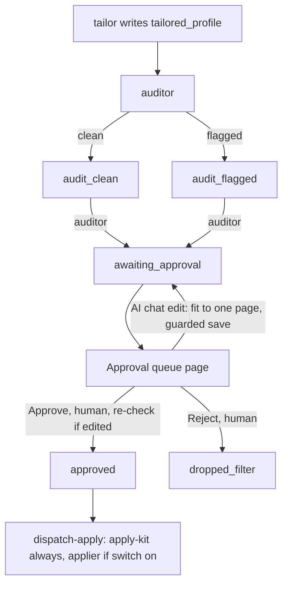

# Approval queue

_Written 2026-11-08 against 2a9ac31._

## What it is

The Approval queue is the page in the web app (`apps/web/src/features/approval/`) where Teja reads each
tailored resume and decides: **Approve** or **Reject**. It is the only door to submission. Nothing in
the whole system can move an application to `approved` except a human click on this page.

On one card Teja sees:

- the job: title, company, location, a facts line (status, work type, salary, link to the original
  posting, a "Pay band UK/US only" warning when it applies);
- two scores: **Fit** (the matcher's score) and **ATS score** (JD keyword coverage);
- the resume preview, rendered exactly as the worker will print it;
- the audit summary: any claim the auditor could not trace to the master profile;
- an **AI resume chat** docked on the right, one thread per row, which is the only way to edit;
- **Approve** and **Reject** buttons at the bottom of the card.

## Why it exists

### The problem

applyyy tailors a resume per job with an LLM (Gemini). An LLM can write a claim that is not true
("production API" when the master says "college event portal"). After approval the worker submits by
itself (since `c557533`, 2026-10-09). So a wrong word that passes this page goes to a real employer.
The page is the last place a human can catch it.

### Rulings that shape the page

| Date | Ruling (Teja) | Effect on the page |
|---|---|---|
| Project plan, §2 | "Two buckets, batch-approve the clean ones" | Bucket A (clean) and Bucket B (needs review). See below. |
| Project plan, constraint 15 | "DON'T automate final submission by default without human approval." | `awaiting_approval -> approved` allows the `human` agent only. |
| 2026-10-24 | "latest need to be on top" | Newest arrival in review first (`queueOrder.ts`). |
| 2026-11-01 | "my ai need to perform the actions" | The AI chat applies safe ops by itself (see auto-apply rules). |
| 2026-11-02 | Fold a review away | "Hide review" folds a Bucket B card; it never approves it. |
| 2026-11-04 | Sort, filter, search | Sort by newest, oldest, ATS score, salary; filter onsite/hybrid/remote; search (`queueView.ts`). |
| 2026-11-05 | "Check on Approve, hold for a 2nd click" | An edited row is re-audited on Approve (`approveCheck.ts`). |
| 2026-11-07 10:08-10:25 IST | "the UX of the approval queue is very very bad" | Redesign `7211fd7`: the AI chat is the **only** edit path; hand-edit controls removed. |
| 2026-11-07 22:43 IST | One-page resume: "This is rule." | Every save is fitted to one page. |
| 2026-11-07 23:18 IST | "handled live while adding new skills and all, but not by AI" | The fit is deterministic code, run on every edit (`pageFitEdit.ts`, `7a78d05`). |
| 2026-11-07 23:55 IST | Trim order | Certifications trim first, then project bullets over the cap, then the weakest bullets. Skills are never removed. |

### Why a human approves every row

- The edge `awaiting_approval -> approved` lists only `human` in
  `supabase/migrations/20260909234900_status_transition_guard.sql` ("CONSTRAINT 15. A human, and only a
  human, opens this door."). No agent value opens it.
- Machine agents are told apart from the browser by the `x-applyy-agent-key` header (see repo
  `CLAUDE.md` §7). A call without the key is treated as human; a call with it is a machine and cannot
  take this edge.
- Teja ruled the bot only submits what he picked. A tailored resume is a set of claims about him. He is
  the only one who can say "I can defend this".

### Why two buckets (not one list)

From the header of `ApprovalQueuePage.tsx`: the split is not about speed. One flat list gives risky
rows the same three seconds as safe ones. So:

- **Bucket A**: every line traces to the master. Shown as a count with one button,
  "Approve all N and queue for submission".
- **Bucket B**: any untraced claim, any operator edit, or any dropped JD keyword
  (`deriveBucket` in `diffModel.ts`). Shown open, one by one, each with its own Approve. Never batched.
- Bucket B is placed **first** on the page, so Teja never scrolls past thirty green rows to reach the
  risky one.

## How it works

### Flow

### Loading the queue

- The page reads `applications` where `status = 'awaiting_approval'` for the signed-in user.
- Order: `status_changed_at` desc, ties by id (`queueOrder.ts`). Not `created_at` (discovery time) and
  not `updated_at` (it moves on every edit, so a card would jump mid-review).
- `diffAdapter.ts` builds the diff: it rebuilds the ORIGINAL tailored resume from `tailor_refs` plus the
  pinned master version, and compares it with the stored resume. "Edited" is never stored; it is derived.
- `queueView.ts` applies sort, work-type filter and search. Rows with no real value (no salary, no
  measured coverage) sort last; they are never given a fake 0.

### Reviewing a card

| Element | File | What it does |
|---|---|---|
| Diff / review | `DiffView.tsx`, `diffModel.ts` | Shows flagged claims. Each has "Keep it, I can defend it". Approve stays locked until every flagged claim is kept. |
| "Changes by AI (N)" | `DiffView.tsx` | Collapsed list of lines the AI changed or removed, each with **Reset** back to the tailor's text. This is the chat's undo. |
| ATS score chip | `diffModel.ts` `coveragePercent` | A closed union: `measured` (a percent) or `unmeasured`. No JD keywords never reads as "0%". |
| Resume preview | `apps/web/src/features/resume-preview/ResumePreview.tsx` | The real template in a sandboxed iframe (no scripts). "Download PDF" opens the browser print dialog. |
| Skill attest | `attestSkill.ts` | Vouching for a skill the master lacks writes a new master version first, then adds it to the resume and re-pins the row. |
| Bullet attest | `attestBullet.ts` | Same rule for a brand-new bullet. |

### The AI resume chat (resume assist)

- UI: `AiEditPanel.tsx`. Contract: `aiEdit.ts`. Memory: `resumeChat.ts` (table `resume_chat_messages`,
  migration `20261101120000`). Server: edge function `supabase/functions/resume-assist/` (`assist.ts`).
- Teja types an instruction, for example "add Kafka to skills, make b2 about latency".
- The browser sends a compact projection: bullets under short ids (`b0`, `b1`), entries (`e0`), and a
  capped list of master items not on the resume (`m0`, `n0`). The model never sees refs, so it cannot
  invent one.
- Gemini answers with **ops only** (changes), never a full resume. Op kinds include `edit`, `add_skill`,
  `remove_skill`, `remove_entry`, `new_bullet`, moves and add-backs. Dropped ops come back named in
  `rejected`, so the chat reply is never the only account.
- `resume-assist` never writes. Each op maps onto the page's own `EditAction`, the same action a click
  would make. The AI gets no new write path.
- The browser writes chat history, not the edge function. RLS lets the user append only their own rows.

**Auto-apply rules** (`shouldAutoApply` in `aiEdit.ts`):

| Op | Applies by itself? | Why |
|---|---|---|
| `edit` (bullet text) | Only when rule 5 of the auditor finds it grounded | The untrusted JD is in the prompt and could steer wording. |
| Summary edit | No | No rule 5 for the summary. |
| Bullet remove, move, add-back | Yes | No new text; resume-only; Reset undoes it. |
| `add_skill` | Only if the master already has it | A new skill would land in the master under the AI's chosen group. |
| `remove_skill` | Only if Teja named that skill | "trim my skills" names none. |
| `remove_entry` | No, always a click | Biggest single change; a posting could ask for it. |
| `new_bullet` | No, always a click | It writes a new claim into the master. |

Other ops wait as cards. "Apply all (N)" applies the open ones.

### Saving an edit: one write path

Every edit (AI op, attest, Reset) ends in `saveTailoredEdit.ts`:

1. **Fit to one page first** (`pageFitEdit.ts`). It runs the tailor's own `fitToOnePage`
   (`supabase/functions/_shared/tailor/page-trim.ts`) on the edited resume. Typography shrinks first (the
   renderer picks it). Then content is cut in `TRIM_ORDER`: `certification`, `project_bullet_over_cap`,
   `weakest_bullet`, never below the floors. If the floors overflow, or the resume cannot be measured,
   the edit is **refused** (fail closed). Every cut is shown as a toast ("Trimmed to fit one page: ...")
   and recorded as `page_fit_trimmed`.
2. **Batch preflight.** Before the first op of an AI batch is saved, `preflightBatch` simulates the whole
   batch (each op plus the fit). A batch never lands half-applied.
3. **Write the resume** (`applications.tailored_profile`), with shape, R0' (every node traces to the
   pinned master under its true parent), status and stamp guards.
4. **Write a note** in `application_events` (append-only): who changed which words.

`saveTailoredEdit` never throws. If a write's fate is unknown, it re-reads the row and shows what is
really stored.

### Approve and Reject

Both go through `settle()` in `ApprovalQueuePage.tsx`, which calls the RPC
`advance_application_status` with agent `human`. Never a bare UPDATE (a bare update skips the claim
release and strands the row).

- **One row at a time**, even for "Approve all". If row 9 of 30 fails, rows 1-8 stay approved and the
  failure names row 9.
- **Stale guard.** Each call passes the row's stamp (`updated_at`). If the row changed since Teja saw it
  (another tab, a re-tailor), the RPC refuses with `PT409`
  (migration `20261008130000_advance_status_expected_updated_at_and_master_version.sql`). The card says so.
- **Re-check on Approve.** If the row has edits, `checkBeforeApprove` (`approveCheck.ts`) runs the
  auditor's own function on the stored resume. Anything but a clean verdict holds the row: "Not approved
  yet: your edits were re-checked against your master profile..." A second click ("Approve with these")
  sends it.
- **Batch re-checks bucket.** "Approve all" sends only rows that are still Bucket A at send time, and only
  rows the current filter shows. A hidden row is never approved unseen.
- **What is recorded.** `p_detail` carries the kept claims, `edited_lines`, `edited_refs` and the
  review path (for example `bucket_a_batch`).
- **Reject** sits behind `InlineConfirm` (no browser dialogs, repo rule). It moves the row to
  `dropped_filter` (edge: "Human declined. A human is the last filter in the cascade.").

### After approve

`dispatchApply.ts` asks the `dispatch-apply` edge function once. Since `5c3ce87` it always starts the
kit builder (`apply-kit.yml`) and starts the applier only when Teja's auto-apply switch is on. The
answer is read into a closed union (`dispatched`, `skipped`, `error`). A failure shows "Approved, but
GitHub did not start the run: ...". The approval itself still stands.

## Rules and guardrails

- **Only a human approves.** Enforced by the transition graph, not by review. Check:
  `select * from application_status_transitions where from_status = 'awaiting_approval'`.
- **The AI proposes; it never writes.** All writes go through `saveTailoredEdit`.
- **Every line traces to the master.** A new claim goes into the master first (attest), then onto the
  resume.
- **One page, always.** Fitted on every save, by code, not by the AI.
- **Fail closed.** A check that cannot run holds the row (`unverified`), never passes it.
- **Bulk-move warning (process rule).** Teja ruled after an incident on 2026-11-07 09:49 IST: before
  any bulk status move on queue rows (re-tailor, sweep, re-gate), tell Teja to stay off the Approval
  queue until it finishes, and tell him again when done. That day a re-tailor of 13 rows ran while he
  was approving; only 1 approval reached the DB. The page's stale guard names such clicks, but it
  cannot stop them; only the warning can.
- **No native dialogs** (`alert`, `confirm`). Use `apps/web/src/app/InlineConfirm.tsx`.

## Known gaps and open questions

- **Max 2 projects** (Teja 2026-11-08 15:36 IST: "only 2 projects"). Not enforced in committed code at
  2a9ac31. The trimmer caps bullets per project, not the project count.
- **Bulk-move warning is not in code.** Nothing stops an orchestrator re-tailor while the page is open.
- **Re-tailored rows need re-approval.** A one-page re-tailor sends approved rows back
  (`awaiting_approval/approved -> passed_filters`); Teja must approve them again (handoff 2026-11-08-0045,
  item 6).
- **"Human" means "no agent key".** Anyone holding Teja's JWT who omits the header is treated as human
  (repo `CLAUDE.md` §7).
- **Attest is two writes.** Master insert, then the row update. If the second fails, the master keeps the
  new version and the row is unchanged. Full atomicity would need a DB function.
- **Chat history window.** `resumeChat.ts` reads one page of rows per application; long chats would need
  paging.
- **In progress (uncommitted).** Peer edits to the resume preview and manual-apply files are not described
  here.

## Related docs

- [Pipeline end to end](../../architecture/pipeline-end-to-end.md)
- [Schema and status graph](../../db/schema-and-status-graph.md)
- [Edge functions](../../functions/README.md)
- [Web app](../../features/web-app.md)
- [CI and workflows](../../ops/ci-and-workflows.md)
- [Resume tailoring](resume-tailoring.md)
- [Matching and scoring](matching-and-scoring.md)
- `PROJECT_PLAN.md` §11, "The honesty gate — worked example"
