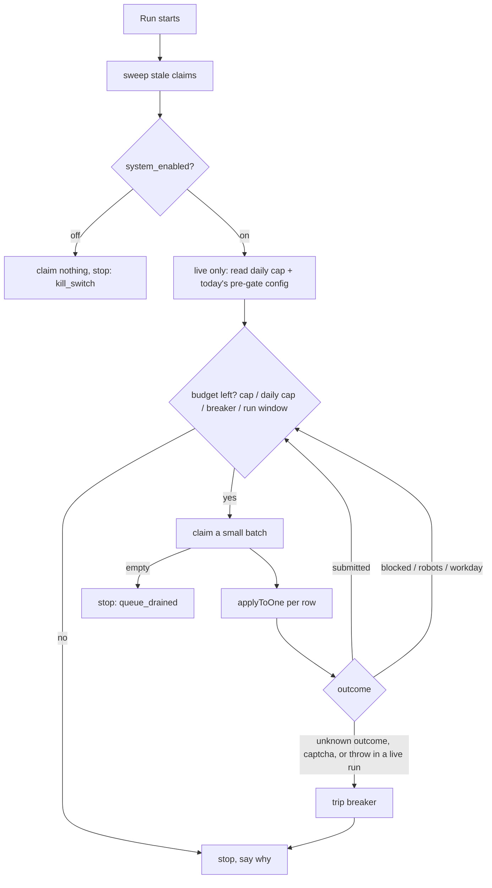

# Auto-apply: the worker that submits approved applications

_Written 2026-11-08 against 2a9ac31._

## What it is

Auto-apply is the last machine step of the pipeline. Teja approves a job in the dashboard.
Then a Playwright worker opens the employer's real application form, fills it from his master
profile and answer bank, attaches the tailored resume, and clicks Submit. It records what
happened as a status on the row.

The status path it owns:

```
approved -> applying -> applied            (worker saw a confirmation page)
approved -> blocked_needs_human            (something stopped it BEFORE the click)
applying -> blocked_needs_human            (the click was refused, nothing left the page)
applying -> (left as is) -> needs_verification   (click happened, outcome unknown; the sweeper moves it)
```

The worker runs on GitHub Actions (`.github/workflows/apply.yml`). There is also a
local, headed path (`worker/src/cli/assist.ts`) where Teja clicks Submit himself.

| Piece | File |
|---|---|
| Workflow (cron + manual + drain) | `.github/workflows/apply.yml` |
| CLI entry for the workflow | `worker/src/cli/apply.ts` |
| Batch loop: claim, caps, breaker, kill switch | `worker/src/claim-loop.ts` |
| One application, start to finish | `worker/src/apply-one.ts` |
| Dry vs live gate | `worker/src/submission-mode.ts` |
| Token and time budget per run | `worker/src/run-window.ts` |
| Playwright page adapter (captcha detect, submit, confirm) | `worker/src/playwright-page.ts` |
| Field reading | `worker/src/extract-fields.ts` |
| What to type in each field | `worker/src/plan-fill.ts`, `worker/src/profile-answers.ts` |
| Which file input gets the resume | `worker/src/plan-resume-attachment.ts` |
| Resume PDF render | `worker/src/render-resume-pdf.ts`, `worker/src/resume-renderer.ts` |
| Embedded form URL resolver (Greenhouse embeds) | `worker/src/form-url.ts` |
| Workday guard | `worker/src/workday.ts` |
| Robots gate (shared package) | `packages/master-robots/src/index.ts` |
| Status writes through the guarded RPC | `worker/src/guarded-advance.ts`, `worker/src/supabase-gateway.ts` |
| Headed assisted submit | `worker/src/cli/assist.ts`, `worker/src/assist/assisted-submit.ts` |
| Read-only rehearsal of a first submit | `worker/src/cli/rehearse-assist.ts`, `worker/src/assist/rehearse.ts` |
| Apply on approve (starts the workflow) | `supabase/functions/dispatch-apply/handler.ts` |

## Why it exists

**The problem.** Applying is the slow, repetitive part of a job search. Every form asks the
same identity questions, wants the same resume upload, and many have the same screening
questions. The pipeline already finds, screens, scores and tailors jobs. Without a submit
step, every approved job still costs Teja several minutes of form filling.

**The decisions, in order:**

- **2026-09-10:** the first claim loop and dry-run CLI (`eb1e5f2`, `21f0701`). Submission
  was built but OFF. PROJECT_PLAN.md §18.6 asked for a trust period: dry runs with
  screenshots first, so Teja sees exactly what would be sent before the system may send.
- **2026-10-04:** the assisted-submit CLI (`1f7aa47`). A visible browser fills the form and
  a human clicks Submit. This was the safe way to apply while the bot was unproven.
- **2026-10-09:** automatic submission switched on (`c557533`). Submission still happens only
  after a human approves the row. The same day: a submit cap and a circuit breaker, and cron
  kept dry behind `APPLYY_CRON_LIVE` (`0c437e4`), then the robots.txt gate (`a3b4115`).
  Teja ruled 2026-10-09: a transient robots outage must not create manual parks (see the
  comment at `worker/src/apply-one.ts`, robots section).
- **2026-11-01:** Workday rows are parked for a human, never submitted (`de5967f`). The daily
  cap counts real submit attempts (`3c77d53`). Teja ruled 2026-11-01: honor robots; the
  applier stays strict (a 401 or soft-200 robots.txt is not "no rules" for the applier).
- **2026-11-05:** apply on approve (`625a437`, `a157d7f`). Teja said (00:16 IST) "whenever i
  approve a job it need to be applied at that time, no daily job apply limits at all".
  Teja ruled (12:50 IST): build it behind an OFF switch he turns on only after one proven
  live submit. Then a live drain re-dispatches itself when it stops on its batch (`c2744c4`, "B1").
- **2026-11-07:** Teja ruled (22:55 IST): any approved row the bot cannot submit goes to the
  Manual apply lane with its kit. His answers there grow the answer bank. The bot never ticks
  declarations (for example an "I did not use AI" box) for him. Teja also authorized the
  orchestrator (23:02 IST) to run real bot submits itself through `apply.yml`.

**Why the safety design is heavy.** Submitting is the one action in the whole system that
cannot be undone and cannot be safely retried. A blind retry can send the same application
twice (PROJECT_PLAN constraint #7). So every design choice below answers one question: "after
a crash, do we know whether it was sent?"

## How it works

### Triggers: who starts a run

| Trigger | Mode | Scope | Per-run submit cap |
|---|---|---|---|
| Daily cron `30 2 * * *` (08:00 IST on paper; GitHub cron is best-effort and has started hours late) | DRY unless repo variable `APPLYY_CRON_LIVE` is exactly `true` | whole approved queue | `APPLY_MAX_SUBMITS` = `3` |
| Manual `gh workflow run apply.yml --ref main -f dry_run=false -f apply_only_id=<uuid>` | LIVE | one row only | 3 (only one row is claimable anyway) |
| Manual with `dry_run` left at its default `true` | DRY | whole queue | n/a |
| `dispatch-apply` on approve, `drain_approved=true` + `dry_run=false` | LIVE | approved queue | 25 |
| `redispatch` job in `apply.yml` (B1) | LIVE | next batch of the drain | 25 |

The mode is decided in shell inside `apply.yml`, with exact string compares. GitHub's `${{ == }}`
ignores case, so `dry_run=FALSE` once ran live (W30, 2026-11-01). Shell `[ = ]` does not.

Guards in the workflow step, before any claim:
- A live manual run with no `apply_only_id` and no drain fails red. You cannot submit the whole
  queue by clicking through.
- `drain_approved` and `apply_only_id` together fail red: the scope would be ambiguous.
- `concurrency: applyy-applier` with `cancel-in-progress: false`. Two runs never overlap, and a
  running run is never cancelled mid-submit.
- `timeout-minutes: 60`. The worker's own run budget is 50 minutes (`run-window.ts`), so the
  worker stops claiming before GitHub kills the job.

Then the worker has its own gate: `resolveSubmissionMode` in `worker/src/submission-mode.ts`.
Only `DRY_RUN` equal to exactly `false` enables submit. Unset, `False`, `" false "`, `0`: all
dry. The workflow check and the worker check fail closed independently.

**Apply on approve.** When Teja approves a row in the web app, the browser calls the
`dispatch-apply` edge function. It always dispatches `apply-kit.yml` (the kit never submits).
It dispatches `apply.yml` as a live drain only if `system_settings.auto_apply_on_approve` is
exactly true. A missing row reads as off. An unreadable switch is a 503, never a guess.

### One run (claim-loop.ts)



Stop reasons are a closed set (`StopKind` in `claim-loop.ts`): `queue_drained`, `batch_cap`,
`daily_cap`, `breaker`, `run_budget`, `kill_switch`, `only_id`. A run that stopped early always
says why, so "we did 2 today" never looks like "the queue had 2".

**Submit cap.** `APPLY_MAX_SUBMITS` is parsed by shape (`parseMaxSubmits`). A non-integer
value stops the run; it never becomes a cap nobody chose. The default is
`DEFAULT_MAX_SUBMITS = 3`. Attempts = `submitted + outcomeUnknown`. Unknown outcomes count,
because each one may have been sent.

**Daily cap.** The Settings value `max_applications_per_day`. The effective limit is
`min(per-run cap, daily cap - sent in the last 24 h)`. If the gateway cannot read what was
sent, the run stops (fail closed). A null setting means no daily cap.

**Circuit breaker.** In a live run only. It trips on the first:
- `submit_outcome_unknown` (the click happened and no confirmation was seen),
- `blocked` with reason `captcha` (the next form on the same IP will very likely challenge too),
- any thrown error (the loop cannot tell a throw before `applying` from one after it).

A tripped run claims nothing more. A dry run never trips it. Robots refusals and Workday parks
never trip it, because nothing was opened or sent.

**Self re-dispatch (B1).** `shouldRedispatchDrain` says yes only when a live run stopped on
`batch_cap` or `run_budget` AND sent at least one application. Never after the breaker, the kill
switch, the daily cap, an `apply_only_id` run, a drained queue, or a dry run. So the chain
always ends.

### One application (apply-one.ts)

The order is the design. Everything that can be learned about a form is learned while the row
is still `approved`. The row enters `applying` only for the click itself.

1. **Workday guard.** A Workday job is parked at `blocked_needs_human` in a live run. The page
   is never opened.
2. **Resolve the form URL** (`form-url.ts`), so robots.txt is asked about the URL that will
   really be opened (a Greenhouse embed resolves to its board form).
3. **Robots gate**, product token `applyy-applier`. One cache per run, so one board's
   robots.txt is fetched once.
   - `refuse` (a real answer) in a live run: park `approved -> blocked_needs_human`,
     `block_reason = robots_refused`.
   - `refuse` with source `indeterminate` (timeout, 5xx, network drop), a `wait`, or any dry
     run: release the claim, leave the row at `approved`, ask again next run.
4. **Open the page, detect walls** (`detectBlocker`): captcha, MFA, login wall, anti-bot page.
5. **Read fields** (`extractFields`, accessibility tree) and **plan the fill** (`planFill`).
   The planner copies a profile value or a human's answer-bank answer, or reports a blocker.
   It has no branch that invents an answer (constraint #4).
6. **Plan the resume attachment.** A form that cannot carry the resume is not viable.
7. **Fill, attach, screenshot.** The screenshot goes to the Supabase Storage bucket
   `screenshots`.
8. **Dry run stops here.** It logs one line (`[applyy] dry run <id>: wouldSubmit=...`) and
   releases the claim. A dry run never writes a status.
9. **Any blocker:** park `approved -> blocked_needs_human` with a `block_reason` and the list of
   unanswered labels.
10. **The non-idempotent window.** `approved -> applying`, then `page.submit()`.
    - Throws: **no status write**. The row stays at `applying`; its lease expires; the sweeper
      moves it to `needs_verification`, which only a human can resolve.
    - `unconfirmed`: same as a throw. No proof, no write.
    - Refused in the page (form validation, a challenge appeared, no click made, a Greenhouse
      security code): `applying -> blocked_needs_human`. Safe to say, because nothing left the
      page.
    - `confirmed`: log the evidence first, take a bounded confirmation screenshot (15 s cap),
      then `applying -> applied` with the resume path, the resume sha256 and the confirmation
      evidence in the event.

`playwright-page.ts` decides "confirmed" only from a positively shaped confirmation. A click
that returned is not proof. It also watches network requests after the click: a request that
could carry the form (and is not captcha traffic) means the outcome is unknown, not "not sent".

**Block reasons** are an enum, not extra statuses (`BLOCK_REASONS` in
`packages/shared-types/src/enums.ts`): `captcha`, `mfa`, `unanswerable_question`,
`unsupported_form`, `login_required`, `submission_unconfirmed`, `other`, `robots_refused`.
Rule from that file: add a state when the handler differs; add a reason when only the
explanation differs.

### Who may take which edge

Edges come from `application_status_transitions` (first defined in
`supabase/migrations/20260909234900_status_transition_guard.sql`). Read them live, never assume:

```sql
select * from application_status_transitions
where from_status in ('approved','applying','blocked_needs_human','needs_verification');
```

| From | To | Agent | Meaning |
|---|---|---|---|
| approved | applying | applier | the only edge into `applying` |
| applying | applied | applier | worker saw a confirmation |
| applying | blocked_needs_human | applier | click refused in the page |
| applying | needs_verification | sweeper, human | stale lease: outcome unknown |
| applying | failed | applier | edge exists; no committed worker code writes it today |
| needs_verification | applied / approved / failed | human | only a human decides whether it went out |
| blocked_needs_human | applied / failed / dropped_filter | human | finished or abandoned by hand |
| approved | applied / failed | human | applied by hand from Manual apply (`20261105121500`) |

In practice `failed` is a human outcome. Every applier status write goes through
`advance_application_status()` and carries the `x-applyy-agent-key` header; without the key
the database refuses (42501). The worker signs in as the ordinary app user, never with a
service-role key, so RLS applies to it exactly as to the dashboard.

### The headed local path: assist.ts

```
pnpm --filter @applyy/worker run assist -- --id <application uuid>
```

It opens ONE approved row in a visible Chromium on Teja's machine. It runs the same robots
gate and form resolver, fills the form, and parks the row at `blocked_needs_human` with the
note `assisted: awaiting human submit`. Then Teja reviews and clicks Submit himself, and
answers a y/n prompt. Only his "y" moves the row to `applied`, as agent `human`. The page port
in `assisted-submit.ts` has no `submit` member, so the code cannot click Submit.

Why it exists: CI runs from a datacenter IP, and reCAPTCHA scores that IP badly. A headed
browser on a home connection, with a human clicking, passes where CI does not. The repo
CLAUDE.md prefers this path for reCAPTCHA boards. Its limit: it needs Teja at the keyboard
(stdin), so the orchestrator cannot run it unattended.

**Rehearsal before a first submit** (`fc915af`, 2026-11-07):

```
node --env-file=.env worker/src/cli/rehearse-assist.ts --id <uuid>
```

It runs every step up to the click with no sign-in claim and no status write. Its page port
has no fill, attach or submit. Exit 0 means the row is ready; then the orchestrator submits it
with the single-row `apply.yml` command above.

### reCAPTCHA and the datacenter IP

- **Invisible reCAPTCHA is not a wall.** Greenhouse loads it on every board. Counting its
  always-present anchor iframe as a captcha would park every Greenhouse row
  (`playwright-page.ts`, captcha selectors).
- A **visible** challenge (reCAPTCHA `bframe`, hCaptcha, Cloudflare `#challenge-running`) is a
  wall. The worker never solves it (constraint #5). The row parks with `block_reason = captcha`,
  and in a live run the breaker trips.
- A Greenhouse reCAPTCHA refusal comes back after the click as a non-2xx JSON `code`
  (for example `captcha-failed`). The worker reads that as "not sent" and parks the row.
- From CI, invisible reCAPTCHA can escalate or refuse. That is the "datacenter IP" problem.
  `dispatch-apply/handler.ts` records the reality as of 2026-11-05: 0 of 7 CI live submits had
  landed (Greenhouse reCAPTCHA, `unsupported_form`, `unanswerable_question`), and both
  `applied` rows were done by hand.

## Rules and guardrails

- **Submit only after a human approval.** `approved` is reached only by a human.
- **Dry by default, at two layers.** Workflow shell and `submission-mode.ts` each refuse
  anything but the exact opt-in string.
- **One row per live manual run**, unless it is the named drain from `dispatch-apply`.
- **Never retry a possible send.** Unknown outcome stays at `applying` and goes to
  `needs_verification`; only a human moves it on.
- **Never bypass a captcha, MFA or login wall.** Detect and park.
- **Never invent an answer.** A required field with no bank answer parks the row
  (`unanswerable_question`). The bot never ticks declarations for Teja.
- **Robots: strict for the applier.** A pasted link skips robots at intake only; the applier
  still asks robots.txt before it opens the form.
- **Workday: never bot-submitted.**
- **Breaker on the first unknown, captcha or error** in a live run.
- **Kill switch:** `system_enabled = false` makes `claim_applications` return nothing; the
  worker also stops between applications if it turns off mid-run.
- **Deploys and live submits are run by the orchestrator** (repo CLAUDE.md §3); a peer never
  dispatches a live run on a relayed approval.

## Known gaps and open questions

- **Stage 5 is not proven by the bot.** The 2026-11-08 00:45 handoff says no bot submit has
  landed yet. A ready row exists (TrueFoundry; 7/7 required fields filled, robots allow, no
  captcha) and waits for Teja's approval. Check with
  `select status, count(*) from applications group by 1` and the row's events, not a stored count.
- **CI and reCAPTCHA.** No fix exists for the datacenter IP. The working routes are the headed
  `assist.ts` path or the Manual apply lane.
- **`APPLYY_CRON_LIVE` and `auto_apply_on_approve`** are switches Teja turns on himself, after a
  proven live submit. Read their current value live (`gh variable list`; the
  `system_settings` row); do not assume.
- **`applying -> failed` is an unused applier edge.** The worker never "positively establishes"
  a non-send after `applying`; it parks or leaves the outcome unknown.
- **Rehearsal can pass a page with 0 fields** (handoff "Pending P1"). At `2a9ac31`,
  `rehearse.ts` has no zero-field guard, while `apply-one.ts` parks such a page. A fix that
  reuses the applier's form-shape gate is in progress (uncommitted).
- **In progress, uncommitted (2026-11-08):** edits to `worker/src/apply-one.ts`,
  `worker/src/assist/rehearse.ts`, `supabase/functions/dispatch-apply/handler.ts` and the Manual
  apply feature. This doc describes the committed behaviour at `2a9ac31`.
- **Lever** text inputs and the late-rendering Ashby SPA are known extraction traps; a page with
  0 fields is not proof that a job is closed.

## Related docs

- [Pipeline end to end](../../architecture/pipeline-end-to-end.md)
- [Schema and status graph](../../db/schema-and-status-graph.md)
- [Edge functions](../../functions/README.md)
- [Web app features](../../features/web-app.md)
- [CI and workflows](../../ops/ci-and-workflows.md)
- [Vision and why](../vision-and-why.md)
- [User journey](../user-journey.md)
- Newest handoff: `docs/handoff/2026-11-08-0045-orchestrator-handoff.md`
