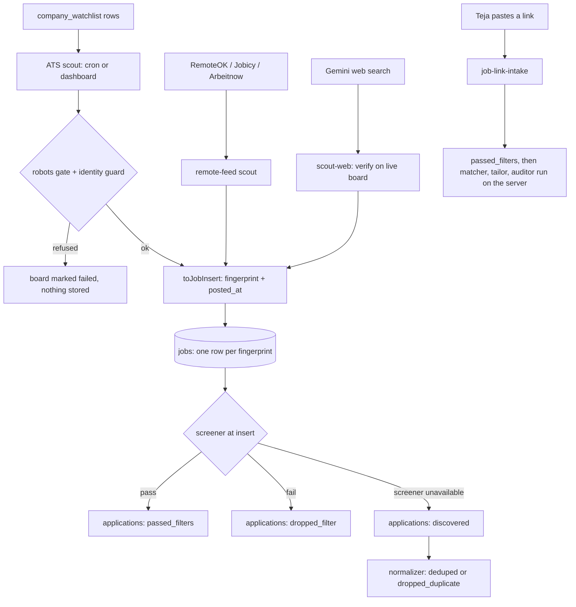

# Job discovery

_Written 2026-11-08 against 2a9ac31._

## What it is

Job discovery is the first stage of applyyy. It finds job postings and stores each one
once, as a row in `public.jobs`, with an `applications` row for Teja.

There are four ways a job enters the system:

| Path | What it reads | Who starts it | Code |
| --- | --- | --- | --- |
| ATS scout (main path) | Company job boards on Greenhouse, Lever, Ashby and Workday, listed in `company_watchlist` | GitHub cron (`scout.yml`), or the dashboard scan button | `worker/src/cli/scout.ts` (cron), `supabase/functions/scout-ats/` (dashboard) |
| Remote-feed scout | Public remote-job feeds: RemoteOK, Jobicy, Arbeitnow | GitHub cron (`scout-remote.yml`) | `worker/src/cli/scout-remote.ts`, `worker/src/scout/remote-feeds.ts` |
| Web scout | Gemini web search proposes Greenhouse/Lever/Ashby posting URLs; code checks each one on the live board | The Discovered page (`WebScoutPanel`) | `supabase/functions/scout-web/` |
| Pasted job link | One link Teja pastes (careers page, LinkedIn/X post, ATS posting) | "Add a job by link" button on the Discovered page, or `ingest-links.yml` for a list | `supabase/functions/job-link-intake/` |

The scouts do not crawl the web. They read each board's own public JSON API.
The watchlist is the funnel: no board token, no jobs.

## Why it exists

**The problem.** The product goal is one human-approved pipeline that runs end to end:
discover, screen, tailor, approve, submit, track. Everything after discovery can only be as
good as what enters here. `PROJECT_PLAN.md` §13 keeps only fresh postings (a 3-day window),
because recruiters read in arrival order. A small watchlist plus a short window gives
"single digits per day". So supply was the binding constraint for a long time.

**Key decisions and rulings**

| Date | Ruling or decision | Effect |
| --- | --- | --- |
| 2026-09-17 | Catalog tokens were name guesses (`tcs`, `zomato`). Decision: every token needs a dated, measured verdict. | `companyCatalog.ts` carries a `verification` field per row. See `docs/watchlist/2026-09-17-board-token-verification.md`. |
| 2026-09-17 | Teja ruled on `jobs.lever.co` and the robots user-agent. | `docs/robots/2026-09-17-robots-gate-design.md` §7. |
| 2026-10-23 | Watchlist expansion: many new boards, each verified by a live GET. The first scout run after it added +921 `passed_filters` rows. | `docs/harvest/2026-10-23-watchlist-expansion.md`, commit `dd2560b`. |
| 2026-10-23 / 10-24 | Greenhouse token `tcs` answered 200 with 92 jobs from Thornbury Community Services (UK), not Tata Consultancy Services. | Board-identity guard (`7501a95`, `10bfbc3`): a board that names a different company stores nothing. |
| 2026-10-24 | Remote feeds run daily through the same safety and screening path as the ATS scout. | `e2fb026`, `446eb60`. |
| 2026-10-31 | Teja: a pasted link is his choice, so "no more filter". | `job-link-intake` skips the screener, the matcher pre-gate and the score floor (`f5b3914`). |
| 2026-11-01 | Teja ruled the scout runs twice a day, not every 6 hours (Actions minutes). A third run was added 2026-11-05 at 09:47 IST. | `401ab5c`, `f66a13c`. |
| 2026-11-01 16:00 IST | Teja ruled "honor robots" for scouting. SmartRecruiters' `robots.txt` is `Disallow: /`, so SmartRecruiters is fully off. | SR rows disabled; adapter unregistered (`fc5097f`) and deleted (`2fe0264`, 2026-11-06); SR removed from the add-board forms (`8299ca5`, `a5f419e`). |
| 2026-11-01 16:14 IST | Teja ruled a **401** `robots.txt` counts as "no rules" for board reads only (RFC 9309). This keeps Ashby, whose `robots.txt` answers 401. A 403 or a real `Disallow` still refuses. The applier stays strict. | `ad19be5`. |
| 2026-11-01 ~17:19 IST | Teja ruled a link he **pastes** is a user-triggered fetch: no robots check for that URL and its redirects. The SSRF guard stays. | `job-link-intake` only. Scouts and applier stay strict. |
| 2026-11-01 | Workday adapter added, discovery only. Applying on Workday goes to a human. | `1294acc`, `de5967f`, `docs/harvest/2026-11-01-workday-coverage.md`. |
| 2026-11-01 18:13 IST | Teja: "I will just paste the link... no JD will be pasted by me... use playwright". | Link-only dialog plus a headless-browser fallback (`85ef531`, `api/render-job-page.ts`). |
| 2026-11-05 | Teja: a pasted job outside the work-authorised countries asks before it is added; pasting a dropped job asks before reviving it. | `e63f979`, `ea85dc9`. |
| 2026-11-05 15:27 / 15:31 IST | Teja ruled the database space fix is a tombstone (purge the text, keep the slim row), weekly, small batches, never on non-dropped rows. | `docs/db/2026-11-05-jobs-tombstone-policy.md`, `jobs-tombstone.yml`. |
| 2026-11-07 | Dead postings must never reach approval or the bot. | Queue liveness (`e9b6c02`, `e053f72`) and feed liveness (`8f91837`, `87dd4e5`, `af7a410`). |

## How it works

### The flow

### 1. The watchlist

- Table: `company_watchlist`. One row = one company's board on one provider, named by the
  board token (for example `stripe` in `boards.greenhouse.io/stripe`).
- Edited on the Settings page `apps/web/src/features/settings/WatchlistPage.tsx`. One-click
  adds come from `apps/web/src/features/settings/companyCatalog.ts`, where every token carries
  a measured verification verdict.
- Bulk seeds live in `supabase/snippets/*-seed-watchlist-*.sql` (dated files).
- Only providers listed in `SELECTABLE_ATS_PROVIDERS` can be chosen for a new board.
- Regenerate the current count, never quote it:
  `select ats_provider, enabled, count(*) from company_watchlist group by 1, 2`.

### 2. ATS adapters

All adapters satisfy one contract (`supabase/functions/_shared/ats/types.ts`) and are listed
in one map, `ADAPTERS` in `supabase/functions/_shared/ats/registry.ts`.

| Provider | File | Notes |
| --- | --- | --- |
| Greenhouse | `_shared/ats/greenhouse.ts` | Only an `updated_at` date, so its date is never `exact`. Identity check is free: `company_name` arrives with the jobs. |
| Lever | `_shared/ats/lever.ts` | Real `createdAt`. No company field, so no identity check is possible. |
| Ashby | `_shared/ats/ashby.ts` | Real publish date. `robots.txt` answers 401 (allowed for scouting by the 2026-11-01 ruling). |
| Workday | `_shared/scout/adapters/workday.ts` | POST-only list endpoint, 20 per page, `total` only on page one. Discovery only. A title-passing posting gets its description from the detail endpoint (`_shared/scout/workday-detail.ts`, capped by `WORKDAY_DETAIL_CAP`). |
| SmartRecruiters | removed | Off by the robots ruling. Git history keeps the old adapter. |
| Workable, Adzuna, Jooble | `_shared/scout/adapters/` | Written, **not registered, not reachable**. `_shared/scout/tiers.ts` has no importer in code. |

**Why one registry.** Adapters differ in field extraction, so that part is per adapter. But
fingerprint and freshness must be the same for every source. So an adapter returns a
`ParsedPosting`, and only `toJobInsert` in `registry.ts` can turn it into a `jobs` row. A job
seen on two boards then gets one fingerprint, and `UNIQUE(user_id, fingerprint)` keeps one row.

Adding a provider = one adapter file + one line in `ADAPTERS`. The scouts do not change.

### 3. The two ATS scouts

The same shared code runs in two places:

- **Cron scout** `worker/src/cli/scout.ts`, run by `.github/workflows/scout.yml`. Schedule:
  `17 0,12 * * *` and `17 4 * * *` UTC (05:47, 09:47 and 17:47 IST). GitHub cron is
  best-effort and often starts late. The run stops starting new boards after
  `SCOUT_BUDGET_MS` (12 minutes, `worker/src/scout/run-outcome.ts`). The boards it did not reach
  go first next time (oldest `last_polled_at` first). Respects the `system_settings` kill switch.
- **Edge scout** `supabase/functions/scout-ats/index.ts`, called from the dashboard scan
  (`apps/web/src/data/discoveryService.ts`, `DiscoveryModal.tsx`).

Per board, both do the same steps:

1. Fetch every page through the robots-gated transport (`collectBoardPages` /
   `worker/src/scout/board-pages.ts`). A board is read whole or not at all.
2. `evaluateBoardIdentity` (`_shared/ats/identity.ts`): refuse a board that reports a
   different company.
3. `boardRefusal` (`registry.ts`): refuse a soft-200 board that suddenly reads empty after
   having jobs. `failureMark` records the failed poll.
4. `toJobInsert` builds rows; `planJobUpsertGroups` (`_shared/screen/upsert-plan.ts`) makes
   sure an omitted field never blanks a stored one.
5. The screener runs **at insert** (`planScreenedApplications`,
   `_shared/screen/screen-batch.ts`). The `applications` row is born at `passed_filters` or
   `dropped_filter`. Only when the screener cannot load is it born at `discovered`, and the run
   is flagged.
6. Liveness (below) marks postings that left the board.

### 4. Remote feeds

`worker/src/scout/remote-feeds.ts` holds the three feed URLs and turns each item into a row.
It is pure, so tests pin its rules. It uses the same apply-URL check, the same fingerprint and
the same freshness policy as the ATS scout. It also cleans feed text: HTML becomes plain text,
RemoteOK's double-encoded UTF-8 is repaired, and the Arbeitnow footer is removed
(`8e732c6`, `301c5f6`, `fc58cb0`, `8801722`). Workflow: `scout-remote.yml`, daily at
`30 1 * * *` UTC. Rows carry `ats_provider = 'other'`.

### 5. Web scout

`supabase/functions/scout-web/`. The rule: **the LLM proposes, deterministic code disposes.**
Gemini with web search suggests Greenhouse/Lever/Ashby posting URLs. `core.ts` and `urls.ts`
check every URL against the live board before anything is stored. Started from the Discovered
page (`apps/web/src/features/discovery/WebScoutPanel.tsx`).

### 6. Pasted job link

Files: `supabase/functions/job-link-intake/` (`handler.ts`, `index.ts`, `extract.ts`,
`fetch-page.ts`, `pinned-get.ts`, `page-readers.ts`), web
`apps/web/src/features/discovery/AddJobLinkPanel.tsx`, browser fallback `api/render-job-page.ts`
(Vercel function, headless Chromium).

1. Teja clicks **Add a job by link** on the Discovered page and pastes a URL.
2. If the URL is a known ATS posting, the row is built from the board's own data. Otherwise
   the page is fetched and read; if the page needs JavaScript, the Vercel render fallback reads it.
3. **SSRF guard** (`fetch-page.ts`): redirects are followed by hand. Every hop is
   shape-checked, DNS-resolved and refused if the address is private. The connection goes to
   the checked IP (`pinned-get.ts`), so DNS rebinding cannot swap the address (closed 2026-11-02).
4. The job is marked `jobs.discovered_via` containing `'manual'`. That marker tells the
   screener, the matcher pre-gate and the score floor to stand aside.
5. The application goes to `passed_filters` (human edge, migration
   `20261031200000_human_pasted_link_reenters_passed_filters.sql`). The function then runs
   matcher, tailor and auditor on the server (`e8ad559`).
6. It still stops at `awaiting_approval`. **The human approval gate is never skipped.**
7. Asks first when the job is outside the work-authorised countries (`e63f979`) or was
   dropped before (`ea85dc9`). A paste of a tombstoned job clears `tombstoned_at` (`77f419a`).

A list of links can be run with `.github/workflows/ingest-links.yml` (manual dispatch only;
default is a dry run). Link lists live in `worker/ingest/*.links.json`.

### 7. Dedupe and the normalizer

- `supabase/functions/_shared/normalize/fingerprint.ts` builds the canonical key. It strips
  legal-entity suffixes only (not words like "Technologies", which would merge different
  employers) and maps renamed cities to one spelling.
- `supabase/functions/_shared/normalize/posted-at.ts` is the one freshness policy. It has a
  cold-start guard: a new board's whole back catalogue must not look "posted today".
- `supabase/functions/normalizer/` moves `discovered` rows to `deduped` or
  `dropped_duplicate`. Since the scouts screen at insert, it mostly handles the fallback path
  (`discovered`). It runs only when called: `prescreen-drain.yml` (manual) or the dashboard.

### 8. Liveness: dead postings

| Check | File | Rule |
| --- | --- | --- |
| Backlog liveness | `_shared/scout/liveness.ts` | A poll may mark jobs gone only when the poll is trustworthy and is the same board. A row outside the previous poll's basis waits `STALE_BACKLOG_MIN_AGE_MS` (14 days). Sets `jobs.disappeared_at`. The cron scout uses the same planner since `1341608` (`worker/src/scout/liveness-marking.ts`). |
| Queue liveness | `_shared/scout/queue-liveness.ts` | For `awaiting_approval` and `approved` rows: closed needs two proofs, absent from a complete listing AND the posting endpoint says gone (404, or Workday `canApply: false`). Ashby: a fresh full-board read. Anything else is "unknown". |
| Feed liveness | `_shared/scout/feed-liveness.ts` | For in-flight rows with no ATS (`other`, `unknown`): one proof, the posting page's own 404 or 410. Capped by `FEED_LIVENESS_CAP`, with a guard against a site that changes its URL scheme. |

The Discovered page shows a "Posting gone" mark (`ae5eac5`).

### 9. Tombstones (database space)

`supabase/migrations/20261105200000_jobs_tombstone.sql` and `scripts/jobs-tombstone.mjs`, run
weekly by `jobs-tombstone.yml` (`45 6 * * 0` UTC). Old `dropped_*` jobs lose
`description_raw` and `raw_payload`; the slim row and fingerprint stay, so dedupe still works.
A trigger keeps a tombstoned row slim until a writer clears `tombstoned_at`.

### 10. The Discovered page

`apps/web/src/features/discovery/DiscoveredJobsPage.tsx`, list logic in `discoveredList.ts`.
Two lanes, a closed union `Lane = 'discovered' | 'ready'`:

- **Discovered** = status `discovered` (raw, unscreened).
- **Ready to tailor** = status `passed_filters`. The page always opens here (Teja, 2026-11-01).

Each Ready card has **Reject** (`passed_filters` to `dropped_filter`, human, with Undo;
`rejectJob.ts`). Descriptions render as plain text, never raw HTML (`2164ff0`, `jdText.ts`).
The page also hosts the web scout panel and the "Add a job by link" button.
`SourceBadge` shows one chip per distinct source (`3c2601f`).

## Rules and guardrails

- **Honor robots for scouting.** Every board read goes through the robots gate
  (`packages/master-robots/`, policy `'scouting'`). A 401 `robots.txt` is "no rules" for board
  reads only; 403 and real `Disallow` refuse. The applier uses the strict policy.
- **Never seed or re-enable a SmartRecruiters board.** Probe a new provider's `robots.txt`
  before adding its boards. Workday robots rules are per site: check the exact site path.
- **A board token is data to verify**, never a guess from the company name. Verify with a live
  GET, a shape check AND an identity check. A bare 200 is not proof (the `tcs` case).
- **A wrong or emptied board stores nothing.** Identity mismatch and soft-200 emptiness refuse
  the whole board before any write.
- **One fingerprint for every source.** Only `toJobInsert` builds a `jobs` row from an ATS
  posting; remote feeds and pasted links use the same `jobFingerprint`.
- **Absence is not death.** Marking a posting closed needs evidence (see liveness table).
  Refusing is cheap; a wrong mark hides a live job.
- **A pasted link skips filters, never approval.**
- **Status changes go through `advance_application_status()`** and the transition graph.
  Inserts are allowed only at `discovered`, `passed_filters` or `dropped_filter`.
  Read the edges live: `select * from application_status_transitions where from_status = '<s>'`.
- **Cadence is coupled.** If you change `scout.yml` cron, also change the Health threshold
  `apps/web/src/data/agentFreshness.ts` (guarded by `apps/web/test/scoutScheduleFreshness.test.ts`)
  and the scan panel text in `apps/web/src/features/pipeline/DiscoveryModal.tsx`.

## Known gaps and open questions

- **Stale header comments (code says otherwise).** `supabase/functions/scout-ats/index.ts`
  still says it polls SmartRecruiters and creates rows at `discovered`. `worker/src/cli/scout.ts`
  also says `discovered`. Both now screen at insert, and SR is unregistered.
- **`PROJECT_PLAN.md` "Scout-Aggregator" row** lists a SmartRecruiters adapter in
  `_shared/scout/adapters/`. That file was deleted on 2026-11-06 (`2fe0264`).
- **`scout.yml` header says ~16 minutes for a full pass**, measured on 246 boards. The
  watchlist keeps growing, so some boards wait for the next run. Re-measure from `agent_runs`.
- **Live watchlist vs catalog.** On 2026-11-01 a re-probe found 24 enabled Greenhouse rows that
  return 404 and the `tcs` row. Whether they were disabled must be checked on the live table.
- **Lever has no identity field**, so the identity guard cannot protect Lever boards.
- **Aggregators are unreachable code** (Adzuna, Jooble, Workable, `tiers.ts`). Decide: wire
  them or delete them.
- **Workday and SmartRecruiters jobs cannot be bot-applied.** Workday is discovery only; SR job
  pages fail the applier's robots check, so they are hand-apply only.
- **Unknown location passes the work-auth gate** (Teja ruled this on 2026-11-05: keep unclear
  locations). Workday "N Locations" rows now read every site from the detail endpoint (`ab71b4f`).
- **No scheduled normalizer.** `discovered` rows (screener fallback) wait for a manual
  `prescreen-drain.yml` run or the dashboard.

## Related docs

- [Pipeline end to end](../../architecture/pipeline-end-to-end.md)
- [Schema and status graph](../../db/schema-and-status-graph.md)
- [Edge functions](../../functions/README.md)
- [Web app](../../features/web-app.md)
- [CI and workflows](../../ops/ci-and-workflows.md)
- [Robots gate design](../../robots/2026-09-17-robots-gate-design.md)
- [Watchlist expansion 2026-10-23](../../harvest/2026-10-23-watchlist-expansion.md)
- [Workday coverage 2026-11-01](../../harvest/2026-11-01-workday-coverage.md)
- [Board token verification](../../watchlist/2026-09-17-board-token-verification.md)
- [Jobs tombstone policy](../../db/2026-11-05-jobs-tombstone-policy.md)
