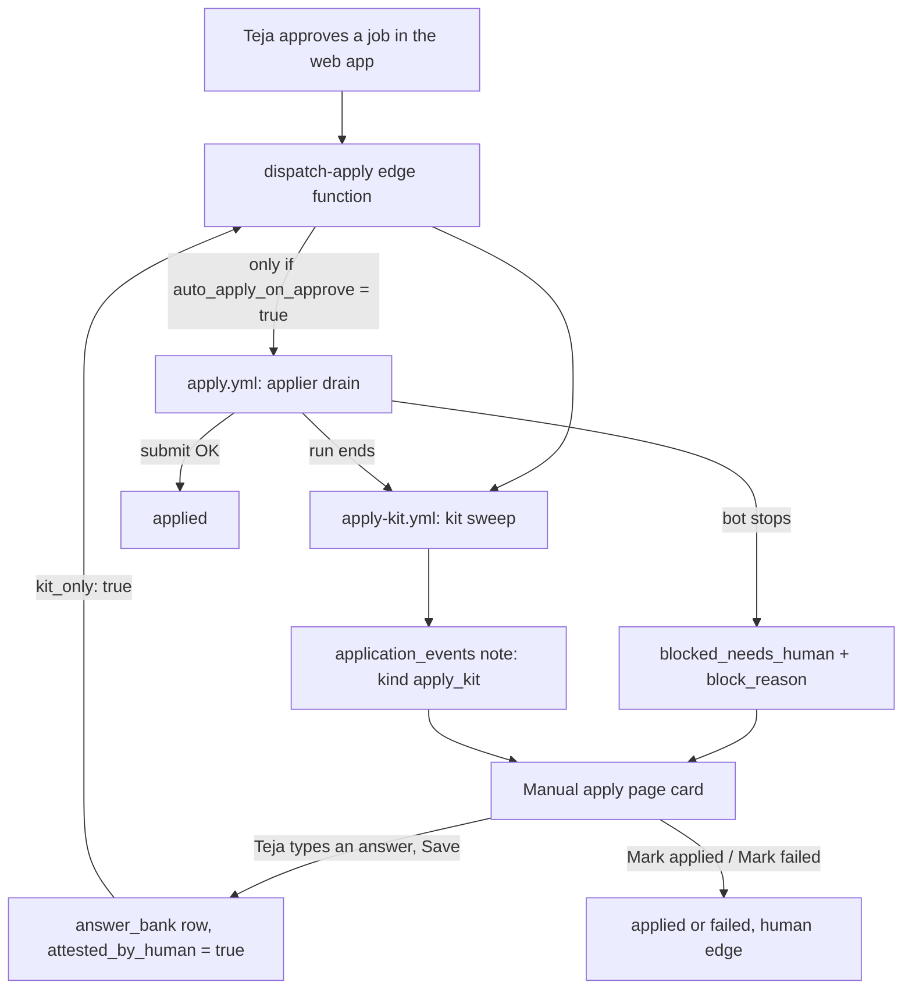

# Manual apply lane

_Written 2026-11-08 against 2a9ac31. The kit-rebuild-on-save part landed in `2936e8c` (same day, while this was
being written) and is described from that commit._

The Manual apply lane is where a job goes when the bot cannot submit it. Teja sees the job, the reason the bot
stopped, a ready "kit" of answers and the tailored resume, and applies by hand. Every question he answers there is
saved into the answer bank, so the bot can answer it next time.

---

## 1. What it is

Five parts work together:

| Part | What it does | Where |
|---|---|---|
| **Bot-can't-apply reason** | One line per card: why the bot stopped (Workday, robots, captcha, open questions...) | `apps/web/src/features/manual-apply/botCantApply.ts` |
| **Manual apply page** | The `/manual-apply` page. Lists every job that waits on Teja, with its kit, resume and buttons | `apps/web/src/features/manual-apply/ManualApplyPage.tsx` |
| **Application kit** | For one job: open the live form, plan every field from our data, render the resume, save it as one event note. Never fills or submits | `worker/src/apply-kit.ts`, `worker/src/apply-kit-sweep.ts`, `.github/workflows/apply-kit.yml` |
| **Answer bank growth** | An open question on a card has an input. Saving it writes to `answer_bank` as Teja (attested), then asks for a kit rebuild | `botCantApply.ts`, `apps/web/src/features/settings/answerBankStore.ts` |
| **dispatch-apply kit mode** | The edge function that starts `apply-kit.yml` on every approve, and (kit-only mode) after every answer save | `supabase/functions/dispatch-apply/handler.ts` |

A sixth rule cuts across all of them: **the bot never ticks a declaration.** Consent, certify, attest,
"I understand", criminal history, pay history, date of birth, and every checkbox are Teja's alone.

---

## 2. Why it exists

### The problem

The pipeline's goal is a human-approved job submitted for real. In practice most live submits fail for reasons
the bot cannot fix by itself:

- Greenhouse reCAPTCHA refuses a submit from a CI (datacenter) IP. Found 2026-10-24 (GitLab, code `captcha-failed`).
- Workday needs a candidate account. The applier refuses Workday since 2026-11-01.
- Some sites' robots.txt refuses bots.
- Many forms ask required questions the answer bank has no answer for.

The header of `supabase/functions/dispatch-apply/handler.ts` records the reality on 2026-11-05: 0 of 7 CI live
submits had landed, and both `applied` rows were done by hand.

So a large share of approved jobs will always need Teja's hands. The lane makes that fast, and makes each
manual answer reusable.

### Rulings (in order)

| Date | Ruling | What it produced |
|---|---|---|
| 2026-10-24 | Kits exist because CI submits hit reCAPTCHA; every answer must still come from the system | `worker/src/apply-kit.ts` (header "WHY IT EXISTS") |
| 2026-10-24 16:20 | Teja ruled: "the kits need to generated automatically by system, dynamically not by you" | the sweep, `apply-kit-sweep.ts`; commit `234199b` |
| 2026-10-09 | Teja ruled: eligibility questions may be answered automatically, but ONLY from his own stored answers | `answer_bank.attested_by_human`, migration `20261009160000_answer_bank_attested_by_human.sql` |
| 2026-11-05 12:04 | Teja asked for "Mark applied" and "Mark failed" on each Manual apply card | migration `20261105121500_human_resolves_approved_from_manual_apply.sql`; commit `781fe41` |
| 2026-11-05 14:47 | Teja ruled: kits "must run every time a job is in the queue"; no throughput cap | kits on every approve, self re-dispatch; commit `5c3ce87` |
| 2026-11-05 22:55 | Teja answers each blocking question ONCE; blockers must be visible | `unanswered_questions` table, migration `20261105230000_unanswered_questions.sql`; commit `4f37c97` |
| 2026-11-07 22:55 | Teja ruled: "if something is not able to apply by bots take the kit and push the job into manual section ... I will answer those questions ... and also add those answers in answer bank ... so the answer bank grows" | "Bot can't apply" line and in-card answers; commit `f5511e9` |
| 2026-11-07 22:55 | Never let the bot tick declarations (Canonical's "no AI use" question) on Teja's behalf | planner never-fill lists; card offers no input for them |
| 2026-11-07 23:02 | Teja ruled: never list his hand-applying as a task or to-do ("that's not work, never mind those") | standing rule for reports and handoffs |
| 2026-11-07 23:31 | Orchestrator ruling: a card shows an input only when the bot would use the saved answer | `savedAnswerWouldClear` check in `openQuestions()` |
| 2026-11-08 | Peer 4: saving an answer starts a kit rebuild at once (kit-only mode) | commit `2936e8c` |

The trigger for the 2026-11-07 ruling: the Canonical rehearsal failed on 15 unanswered required questions,
including an AI-use declaration. Chasing one bot-perfect row per night was stalling the pipeline.

---

## 3. How it works

### 3.1 Flow



### 3.2 Which rows the page lists

The page reads two sources and merges them by application id (`manualApplyData.ts`):

1. Rows in a manual-action lane: `needs_verification` or `blocked_needs_human`
   (`MANUAL_ACTION_STATUSES` in `apps/web/src/data/humanLanes.ts`).
2. Rows that have a kit and are still open: `approved`, `applying`, `needs_verification`, `blocked_needs_human`
   (`KIT_OPEN_STATUSES` in `applyKit.ts`).

An `approved` row with no kit yet shows as **Kit pending**, never hidden (commit `6f91221`). The rail badge counts
the same rows the page lists (`manualApplyCount`, commit `746e23b`).

There is no separate "manual" status. A row is "in the Manual apply lane" because of its status and its kit.
The worker parks a row at `blocked_needs_human` with a `block_reason`; the page picks it up from there.

### 3.3 The "Bot can't apply" reason

`botCantApplyReasons(row, kit)` in `botCantApply.ts` builds the line. It reads **only recorded facts**:

| Source | Reason text |
|---|---|
| Job is Workday (`isWorkdayJob` from `worker/src/workday.ts`, URL or `ats_provider`) | "Workday needs a candidate account" |
| Kit was skipped with code `robots_refused` | "the site's robots.txt refuses bots" |
| Row is `blocked_needs_human` with a known `block_reason` | words from `PARK_WORDS`, e.g. `captcha` = "a captcha stops the bot" |
| Kit has open required fields | "N questions need you" |

If nothing is recorded, the card prints "—". A guessed reason would send Teja to fix the wrong thing (repo
`CLAUDE.md` section 6). `PARK_WORDS` is a `Record` over the closed `BlockReason` union, so a new enum value fails
`tsc` until it gets words. Duplicates are folded: `login_required` on a Workday job says only the Workday line.

### 3.4 The application kit

**What a kit contains** (contract v1, parsed strictly in `apps/web/src/features/manual-apply/applyKit.ts`):
the form URL, the generation time, the resume file in the private `resumes` bucket, and every form field in form
order. Each field has a label, a value or `null`, a source, `required`, an input type and options.

| `source` | Meaning |
|---|---|
| `identity` | from the master profile identity |
| `tailored` | from this job's tailored resume |
| `answer_bank` | from Teja's saved answers |
| `derived` | computed by the planner |
| `unanswered` | the planner refused or had no answer |

The parse is all-or-nothing. A kit that does not prove its whole shape is shown as "unreadable", never half-shown.
Reason: Teja pastes these answers into a real employer form; a partial kit looks complete while a field is missing.

**How it is built** (`worker/src/apply-kit.ts`):

1. Check the row is in `KIT_STATUSES` (`approved`, `applying`, `needs_verification`, `blocked_needs_human`).
2. Run the robots gate (the same one `apply-one.ts` uses).
3. Open the live form with Playwright and read the fields.
4. Plan every field with `planFill` from `worker/src/plan-fill.ts`, the SAME planner the bot uses. So the kit
   shows exactly what the bot would type.
5. Render a fresh resume.
6. Append ONE `application_events` row: `event_type 'note'`, `detail.kind 'apply_kit'`.

**What it can never do, by construction:** the page port `KitPage` has only `goto`, `extractFields`,
`detectBlocker`, `postingClosed` and `readMenuOptions`. There is no fill, attach or submit method to call. The
gateway port `KitGateway` has no status method, no claim and no release. So a kit cannot submit and cannot move
a row.

**Skips:** a closed posting throws `KitSkip('posting_closed')`. It is recorded once as an `apply_kit_skipped`
note and not retried until the status changes (commit `b248a18`). Since K2 (2026-11-06, commit `5a5d9b9`), a
robots refusal or an unreadable form gets a **resume-only kit** instead of a skip.

**When a kit is due** (`apply-kit-sweep.ts`): the row waits on Teja and has no kit newer than its last status
change. Since K1 (2026-11-06, commit `07df623`), a kit is also due when an answer was edited or a master version
saved after it. Rows parked with `no_apply_url` or `posting_closed` are never due (rule W29).

**Triggers** for `.github/workflows/apply-kit.yml`:

| Trigger | When |
|---|---|
| `workflow_run` | after every applier run (`applyy applier (daily batch)`), any conclusion |
| `schedule` | daily `0 12 * * *` (17:30 IST), the backstop |
| `workflow_dispatch` | by `dispatch-apply` on approve or answer save; by hand; or by its own re-dispatch |

Limits: up to 25 kits per run; it stops starting new kits after 3000 s so the 60-minute job timeout never lands
mid-row. If due rows remain, a separate `redispatch` job (the only job with `actions: write`) starts the next run.
The concurrency group `applyy-apply-kit` with `cancel-in-progress: false` keeps one running and one pending run.
The kill switch (`system_settings.system_enabled`) stops the sweep before it reads any row (rule W28).

### 3.5 dispatch-apply: approve mode and kit-only mode

`supabase/functions/dispatch-apply/handler.ts` (decisions) and `index.ts` (the `Deno.serve` wrapper).

Both modes first pass two caller checks: the caller is verified before the app-user sign-in (W15), then
`authorizeCaller` checks the user id.

| Mode | Request body | What it dispatches | What it reads |
|---|---|---|---|
| Approve (default) | anything else | `apply-kit.yml` always; `apply.yml` drain only if `system_settings.auto_apply_on_approve` is exactly `true` | the switch, the approved count |
| Kit-only | exactly `{"kit_only": true}` | `apply-kit.yml` only. **Never `apply.yml`** | nothing: no switch, no approved count |

Kit-only answers `200` with `kit_dispatched: true`. A missing `GITHUB_APPLY_DISPATCH_TOKEN` is a named `503`
(`dispatch_token_missing`), never a silent `200`. A GitHub refusal is a `502` naming the workflow.

Why kit-only never reads the approved count: Manual apply rows are mostly `blocked_needs_human`, not `approved`.
Why it never starts the applier: saving an answer must not start a submit, whatever the switch says.

### 3.6 Answering a question on the card

`openQuestions(kit)` in `botCantApply.ts` lists the kit's open fields: required, no answer, and not the resume
upload. For each one it asks the worker's real planner whether a saved answer would ever be used
(`savedAnswerWouldClear` from `apps/web/src/features/settings/unansweredQuestionsView.ts`).

- **Answerable:** the card shows an input (text, select, radio...). The save key is the planner's own
  `questionKey(label)`, so the answer saved here is exactly the one the next kit fills.
- **Not answerable:** no input. This covers every checkbox and every never-fill label (consent, certify, birth,
  pay history and so on). An input whose answer the bot never uses would be a dead control.

Save path (`answerBankStore.ts`, `saveBankAnswer`):

1. The browser writes the `answer_bank` row as Teja's own session, with no `x-applyy-agent-key` header.
2. The trigger from migration `20261009160000` stamps `attested_by_human = true`. The client cannot set this
   column; the trigger overwrites whatever is sent.
3. After a remote write lands, `requestKitRebuild` calls `dispatch-apply` with `{ kit_only: true }`.
4. The card shows `savedLine(kitRefresh)`:
   - `requested`: "Saved to your answer bank. Kit rebuild started; press Refresh kits in about 3 minutes."
   - `failed`: saved, but the rebuild did not start; the next scheduled kit run fills it.
   - no Supabase client: "Saved in this browser only..." (the bot never reads a local-only save).

The Answer bank page (`AnswerBankPage.tsx`, `UnansweredQuestions.tsx`) uses the same builder and the same save.
Its "Unanswered questions" section is fed by `unanswered_questions`: one row per (user, question key), written by
the worker through `record_unanswered_questions()` whenever `planFill` refuses a required field. The same question
on ten forms is one card that "blocks 10 applications".

### 3.7 Declarations: why the bot never ticks them

`worker/src/plan-fill.ts` refuses these even when a bank row exists:

| List | Examples | Behaviour |
|---|---|---|
| `NEVER_FRAGMENTS` | `consent`, `certify`, `attest`, `criminal`, `background_check`, `salary_history`, `birth` | never automatic |
| `NEVER_TOKENS` | `dob`, `sex` (whole word only) | never automatic |
| `OPINION_FRAGMENTS` | `i_understand`, `i_acknowledge`, `relocat`, `why_do_you_want` | sent to Teja |
| checkbox controls | any `kind === 'checkbox'` | no safe text value; never filled |
| EEO and eligibility | gender, race, veteran; located in, sponsorship | filled ONLY from an attested row (`attested_by_human = true`, `needs_human = false`) |

Agreeing or swearing to something is a decision only Teja can make. So these fields stay `unanswered` in the kit,
and the card gives them no input. Teja ticks them himself on the employer's form.

### 3.8 Closing a row from the card

Each card has **Mark applied** and **Mark failed**. They call `advance_application_status()` as `human`.
Migration `20261105121500` added the human-only edges `approved -> applied` and `approved -> failed`
(`blocked_needs_human` and `needs_verification` already had them). The `updated_at` stamp guards against a stale
click. To see the live edges:

```sql
select from_status, to_status, allowed_agents from application_status_transitions
where to_status in ('applied', 'failed');
```

Race safety (from that migration's header): the worker claims an approved row without moving it and moves
`approved -> applying` only right before the submit click. If Teja moves first, the worker's later move has no
edge and is refused (`23514`) before any submit.

The page also has a **Left your queue** section (`LeftQueueSection.tsx`, `leftQueue.ts`): approved jobs that moved
elsewhere, who moved them, why, and a Re-open (commit `2383815`).

---

## 4. Rules and guardrails

- **A kit never submits and never moves a row.** Enforced by the narrow `KitPage` and `KitGateway` ports, not by
  a promise.
- **The kit and the bot use one planner** (`planFill`). A fork would let them disagree.
- **No guessed reasons.** The card's reason comes only from recorded facts; nothing recorded prints "—".
- **No dead inputs.** A question gets an input only if the planner would use the saved answer.
- **Attestation is server-side.** Only a browser save as Teja stamps `attested_by_human`. Agent writes and
  CLI/service-role writes are not human. The classifier blocks agents from attesting; never route around it.
- **Kit-only never submits.** `{"kit_only": true}` dispatches `apply-kit.yml` only.
- **Kits are automatic.** Never a hand-dispatched agent loop per row (Teja, 2026-10-24).
- **No native browser dialogs.** Confirmations use `apps/web/src/app/InlineConfirm.tsx`.
- **Teja's hand-applying is not a task.** Never list it as a to-do in a report or handoff (Teja, 2026-11-07 23:02).

---

## 5. Known gaps and open questions

- **Kit-only deploy not verified here.** `2936e8c` is on `main`. Whether the `dispatch-apply` function with kit-only
  mode is deployed was not checked for this doc. Until it is, a save answers `failed` and the cron fills the kit.
- **Uncommitted work in progress:** `worker/src/apply-one.ts` and `worker/src/assist/rehearse.ts` have uncommitted
  edits (rehearse-assist zero-field guard, pending task 4 in `docs/handoff/2026-11-08-1745-pending-tasks.md`).
  Not described here.
- **Unattested answers still fill non-gated questions.** 15 answers inserted by CLI on 2026-11-07 have
  `attested_by_human = false`. `planFill` gates only eligibility and EEO labels on attestation, so they still fill
  other questions. Teja can stamp them by re-saving on a card or the Answer bank page.
- **Known attestation gap:** any holder of Teja's JWT who omits the agent-key header is treated as human (repo
  `CLAUDE.md` section 7).
- **No automatic "route to manual" for good rows.** A row only reaches the lane when the bot parks it, a kit is
  written, or it is approved. A row whose rehearsal would fail is not moved there in advance.
- **Robots refusals:** a pasted link skips robots (user-triggered), but the applier is strict. A robots-refused row
  gets a resume-only kit and is always manual.

---

## 6. Related docs

- [Pipeline end to end](../../architecture/pipeline-end-to-end.md)
- [Schema and status graph](../../db/schema-and-status-graph.md)
- [Edge functions](../../functions/README.md)
- [Web app features](../../features/web-app.md)
- [CI and workflows](../../ops/ci-and-workflows.md)
- [User journey](../user-journey.md)
- [Resume tailoring](resume-tailoring.md)
- Handoff: `docs/handoff/2026-11-08-1745-orchestrator-handoff.md`
