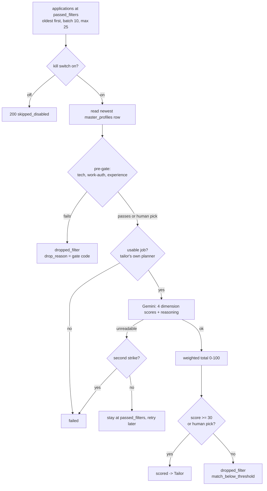

# Matching and scoring (the Matcher)

_Written 2026-11-08 against 2a9ac31._

## What it is

The Matcher is the pipeline step that asks: **"How well does this job fit Teja?"**
It reads one job posting, compares it with Teja's master resume, and gives a
score from 0 to 100. Then it decides one of three things:

| Result | Status move | Meaning |
|---|---|---|
| advance | `passed_filters -> scored` | Good enough to tailor a resume for it. |
| drop | `passed_filters -> dropped_filter` | Score below the floor (30). Stops here. |
| fail | `passed_filters -> failed` | The job can never be scored (for example, no description). |

It is an edge function: `supabase/functions/matcher/index.ts`. The scoring logic
lives in `supabase/functions/_shared/match/`.

The Matcher is the **second net**. The screener is the first net (cheap rules:
title, tech words, country, experience). The Matcher is the first step that
spends a Gemini call, so it is the most expensive filter that still runs before
a human looks.

## Why it exists

**The problem.** Scouts find thousands of jobs. The screener removes the clearly
wrong ones, but many weak fits still pass. Each row that reaches the Tailor costs
one more Gemini call, and each row that reaches the approval queue costs Teja's
time. Without a score, a 5/100 job was tailored, audited and queued exactly like
a 90/100 job (see the header of `_shared/match/score-threshold.ts`).

**The decisions, in order:**

| Date | Decision | Where |
|---|---|---|
| 2026-09-16 | Use a tested rubric (4 weighted dimensions, 5 bands) from a real job search, not invented weights. | `docs/harvest/2026-09-16-ai-job-search-harvest-plan.md` §P3, `_shared/match/rubric.ts` |
| 2026-09-18 | Matcher wired to Gemini with the key pool. | commit `92f2129` |
| 2026-10-05 | Rows below 45 (the `moderate` band floor) are dropped instead of tailored. | commit `25b4b5c` |
| 2026-10-09 | Teja ruled option (d): the matcher re-runs the screener's tech gate before scoring, so old backlog rows do not each cost a Gemini call. | `matcher/tech-pregate.ts` header |
| 2026-10-31 | A job Teja pasted by link is **never** dropped for a low score. | commit `f5b3914`, `isHumanPicked` |
| 2026-11-01 | Rows the Tailor would refuse are failed **before** the Gemini call; an unreadable answer is a strike, not an instant fail. | commits `4d57ce0`, `d57eb2d`, `matcher/fail-exit.ts` |
| 2026-11-04 | Teja: "re-scored rows get re-screened". The pre-gate also runs work-auth and the experience ceiling. | `matcher/tech-pregate.ts` header |
| 2026-11-06 | Teja first picked "Remove the floor", then reversed two minutes later: "keep the score… dont remove it". Floor stayed 45. | memory `applyyy-matcher-keeps-poor-scores.md` |
| 2026-11-07 22:45 IST | Teja ruled: **"keep floor at 30 not 45"**. The `weak` band (30-44) now reaches approval. | commit `95df3f3` |

### Why the floor must never be removed

Teja ruled 2026-11-06 and again 2026-11-07: the floor stays. It may move (it moved
from 45 to 30) but only on a fresh ruling from Teja. The reasons:

1. **Cost.** Every row above the floor costs a Tailor Gemini call, an Auditor
   call, and Teja's review time. Without a floor, every `poor` row (0-29) would
   do all of that.
2. **Teja agrees with the drops.** He reads a drop reason such as "scored 22,
   below the advance floor" and accepts it for senior, hardware or mainframe
   roles.
3. **Leaks are fixed upstream.** If a wrong job gets a high score, or a right job
   gets a low score, the fix is in the screener rules or the rubric, not in
   deleting the floor.
4. **There is a human bypass already.** A job Teja wants anyway can be sent as a
   human pick (pasted link). It is scored honestly but never dropped.

## How it works



### Step by step

1. **Pick the queue.** Select `applications` at `passed_filters` whose job has not
   disappeared from its board (`jobs.disappeared_at is null`), oldest first.
   Default batch 10, max 25 (`DEFAULT_BATCH_SIZE`, `MAX_BATCH_SIZE` in
   `matcher/index.ts`). `?application_id=<uuid>` targets one row.
2. **Kill switch.** The shared fail-closed kill switch is read first. If it is
   off, the run records `skipped_disabled` and spends nothing.
3. **Master resume.** The newest `master_profiles` row is read. Its `version` is
   pinned into the prompt and into the event, so a stale score can be detected
   later. No master row means a 409 `no_master_profile`.
4. **Pre-gate (no Gemini cost).** `matcher/tech-pregate.ts` runs the screener's
   own functions in the screener's order: tech gate, then work-auth, then the
   experience ceiling. Config comes from `_shared/pregate-config-loader.ts`, the
   same loader the Auditor uses. A failed row is dropped with the gate's own
   code in `drop_reason`. A human-picked row skips this gate.
5. **Usable-job check.** `withUsableJob` in `matcher/fail-exit.ts` asks the
   Tailor's own planner (`planTailorBatch`) whether the Tailor could ever run on
   this job. If not (for example, no description), the row goes to `failed`
   before any Gemini call.
6. **Score.** `_shared/match/scorer.ts` builds the prompt
   (`_shared/match/prompt.ts`) and calls Gemini through
   `_shared/gemini/client.ts` (key pool, 429 retry, pacing). Rows run one by one,
   with a per-run deadline (`_shared/agent/deadline.ts`) checked between rows.
7. **Decide.** `decideScoreThreshold` in `_shared/match/score-threshold.ts`
   returns `advance`, `drop` or `invalid`.
8. **Write, then move.** `matcher/write-score.ts` writes `match_score` and
   `match_reasoning` first (only while the row is still at `passed_filters`),
   then calls `advance_application_status` with the `updated_at` stamp its own
   write produced. A second, racing run gets PT409 and reports `skipped_stale`.
9. **Settle failures.** `settleModelFailures` fails a row whose answer could not
   be read only if (a) another row in the same run was read fine, and (b) the
   same row was unreadable in an earlier run too. A first strike is recorded and
   the row is retried.
10. **Report.** The run row in `agent_runs` gets `rows_in`, `rows_out`,
    `error_count`, `gemini_calls`. Since 2026-11-07 the response also has a
    top-level `reason` (`matcher/run-reason.ts`): `target_not_found`,
    `target_not_at_input_status`, `target_posting_gone` or `rate_limited`.

### The score: four dimensions, one weighted total

Gemini returns four integers (0-100) and a short `reasoning` string (max 600
chars). `weightedTotal` in `_shared/match/rubric.ts` combines them:

| Dimension | Weight | Question |
|---|---|---|
| technical | 30 | Do the required skills match what Teja has? |
| experience | 25 | Does his work history match the FUNCTION of the role (not the title)? |
| behavioral | 15 | Culture and working style, judged only from the posting. |
| career | 30 | Does this role move his career forward? |

Example: technical 70, experience 20, behavioral 60, career 50 gives
`(70*30 + 20*25 + 60*15 + 50*30) / 100 = 50`, rounded half-up. That is
`moderate`, so it advances.

### The bands

| Band | Range | Rubric meaning | What happens now |
|---|---|---|---|
| strong | 75-100 | Definitely apply | advance |
| good | 60-74 | Apply, address gaps | advance |
| moderate | 45-59 | The human-review band | advance |
| weak | 30-44 | Probably skip, unless there is a strategic reason | advance (since 2026-11-07) |
| poor | 0-29 | Skip | **drop**, `match_below_threshold` |

The band edges in `rubric.ts` did not change on 2026-11-07. Only the advance floor
moved down one band. The reason given in the code: "the strategic reason is his
call, not the Matcher's."

### Where the floor lives

- `MATCH_ADVANCE_FLOOR = 30` in `supabase/functions/_shared/match/score-threshold.ts`.
- A mirror, `MATCHER_ADVANCE_FLOOR = 30`, in
  `supabase/functions/_shared/pipeline/row-pipeline.ts`. The web uses it for the
  sentence "Dropped by the matcher: it scored N, below the matcher's advance floor"
  (`apps/web/src/features/pipeline/DrawerAppCard.tsx`).
- `apps/web/test/rowPipelineParity.test.ts` fails if the two numbers differ.
- `score-threshold.test.ts` pins 30 and checks 29 drops and 30 advances.

The check is `score >= 30`. A `>` would drop a 30, which is the first score Teja
asked to see.

### What starts the Matcher

Nothing runs it on a schedule. Every run is started by a human or by a human action.

| Trigger | File | Notes |
|---|---|---|
| Web "run" button on a row or page | `apps/web/src/features/pipeline/rowPipeline.ts` | 10 rows per click |
| Pasted job link | `supabase/functions/job-link-intake/` | starts matcher -> tailor -> auditor for that one row |
| One row by hand | `.github/workflows/run-one.yml` | one row per dispatch |
| Drain the queue | `.github/workflows/postscreen-drain.yml` | manual only (Teja ruled 2026-11-05) |
| Bulk links | `.github/workflows/ingest-links.yml` | each link starts the chain |
| Gemini-free sweep | `.github/workflows/pregate-sweep.yml` | `?mode=pregate_only`, pre-gate only, up to 500 rows a page, no scoring |

### What about ATS keywords?

The Matcher does **not** count keywords. It asks Gemini for a judgement on four
dimensions. ATS keyword work happens later, in other steps:

- **Keyword coverage** in the approval view: `apps/web/src/features/approval/diffModel.ts`
  (`KeywordCoverage`) shows which job-description keywords the tailored resume
  covers, and whether each is backed by the master resume, a flagged claim, or
  Teja's own edit.
- **Dropped keywords**: the Auditor reports `jd_keyword_dropped` findings
  (2026-11-07), shown in the same approval view.
- **ATS parse check**: `worker/src/ats-parse-check.ts` runs the final PDF through
  a real text extractor, to prove an ATS can read it.

## Rules and guardrails

- **Never remove the floor.** Change it only on a fresh ruling by Teja (2026-11-06,
  2026-11-07). Fix leaks in the screener (`supabase/functions/_shared/screen/`)
  or the rubric instead.
- **Missing data is never a score.** A missing, null, NaN or out-of-range
  dimension makes `weightedTotal` throw. It never becomes 0. A non-integer total
  (like 0.82) is `invalid`, never rescaled to 82.
- **A veto is not a low score.** Location, work-auth, salary and experience limits
  are pass/fail gates, not lost points. A strong technical match must not
  outvote a deal-breaker (`rubric.ts` header, `salary-gate.ts` header).
- **Untrusted posting text stays fenced.** Title, company, location and
  description go inside `<<<BEGIN_UNTRUSTED_JOB_POSTING>>>` in the user content.
  Only the policy and the master resume go in the system instruction. The answer
  schema has no field where an injection could do harm.
- **Payload before status.** Score is written first, status moved second, both
  guarded against a second run.
- **Drops are one-way for agents.** No agent may move a row out of
  `dropped_filter`. Only a human can, through the pasted-link edge
  `dropped_filter -> passed_filters` (migration `20261031200000`).
- **Human pick is honest.** A pasted job still gets a real score, written to the
  row, so the approval card shows the true fit. It just is not dropped.
- **Drop reason is a bare code** (`match_below_threshold`), so a group-by counts
  one reason. The score and band go in the event's `p_detail`.

Regenerate facts with these commands (never quote old counts):

```sql
-- How many rows the matcher dropped for a low score
select count(*) from applications where drop_reason = 'match_below_threshold';
-- Score spread of rows the matcher advanced
select width_bucket(match_score, 0, 100, 10) as bucket, count(*)
from applications where match_score is not null group by 1 order by 1;
```

## Known gaps and open questions

1. **Skill-fit jobs scoring under 30.** Teja flagged (2026-11-08 00:48 IST) four
   rows he wants to apply to: LSEG 27, FIS 22, Barclays 13 and 19. Open question
   in `docs/handoff/2026-11-08-1745-pending-tasks.md` item 3a: is the rubric
   under-weighting skills against experience or domain words (mainframe,
   security)? Rule: measure before changing the rubric; the floor stays 30.
2. **No eval set yet.** `_shared/eval/gate.ts` is built to run the scorer against
   hand-labelled cases, but `_shared/eval/fixtures/matcher-eval-set.json` still
   holds 3 placeholder cases (`"placeholder": true`), and `ci.yml` does not run
   the gate. So a prompt or weight change today has no regression check.
3. **The floor is a code constant, not a setting.** No min-score column exists.
   The code says it should become a per-user setting.
4. **`matcher/freshness-queue.ts` is not used.** It sorts fresh jobs (<24h) first,
   but `index.ts` orders by `created_at` ascending (oldest first). Nothing imports
   it. Either wire it in or delete it.
5. **The master resume goes in as raw JSON** (`JSON.stringify(master)`). Fine for
   now, but it costs tokens and includes fields that do not help scoring.
6. **Scores are tied to a master version.** When the master changes, old scores
   are stale. The re-run path sends rows back to `passed_filters` by hand
   (commit `87fff82`, then `postscreen-drain.yml`); nothing re-scores on its own.

## Related docs

- [Pipeline end to end](../../architecture/pipeline-end-to-end.md)
- [Schema and status graph](../../db/schema-and-status-graph.md)
- [Edge functions](../../functions/README.md)
- [Web app](../../features/web-app.md)
- [CI and workflows](../../ops/ci-and-workflows.md)
- [Rubric source: harvest plan §P3](../../harvest/2026-09-16-ai-job-search-harvest-plan.md)
- [Screener notes](../../screener/)
