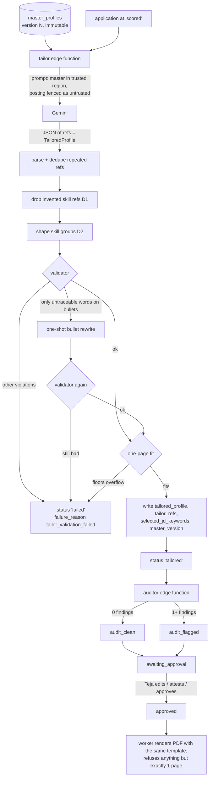

# Resume tailoring: master, tailor, validator, auditor, one page

_Written 2026-11-08 against 2a9ac31._

This page explains how applyyy turns Teja's one master resume into a resume for one job.
It covers the master profile and its versions, the `tailor` edge function, the validator,
the `auditor` edge function, the one-page rule, the shared HTML template, and the
truthfulness rules (attested skills and bullets).

Code wins over this page. Every section names the file to read and, where a number
matters, the command that gives the current value.

---

## 1. What it is

For each job that passes screening and scoring, the system writes a resume made only of
things that are already in Teja's master resume. The AI (Gemini) may choose, reorder and
reword. It may not add a fact.

| Part | What it does | Where |
|---|---|---|
| Master profile | Teja's full resume as structured JSON. Every node (job, project, bullet, skill) has a stable id. Each change is a new, immutable version. | table `master_profiles`; web `apps/web/src/features/settings/` |
| Tailor | Asks Gemini to pick and reword master nodes for one posting. Gemini answers with **refs** (node ids), not free text facts. | `supabase/functions/tailor/index.ts`, `supabase/functions/_shared/tailor/` |
| Validator | Resolves every ref against the pinned master version. Refuses the whole resume if one ref lies. The only code that can build a `ResolvedResume`. | `supabase/functions/_shared/tailor/validator.ts` |
| One-page fit | Shrinks typography first, then removes low-priority content down to fixed floors. Refuses if the floors do not fit. | `packages/resume-template/src/page-fit.ts`, `supabase/functions/_shared/tailor/page-trim.ts` |
| Auditor | A second, independent check of the stored resume against the pinned master. Sets `audit_clean` or `audit_flagged`. | `supabase/functions/auditor/index.ts`, `supabase/functions/_shared/audit/` |
| Template | One pure HTML renderer. The web preview, the web PDF download and the worker's submitted PDF all call it. | `packages/resume-template/src/render-resume-html.ts` |
| Attest | From the approval page, Teja can vouch for a new skill or bullet. It goes into the master first (new version), then onto the resume. | `apps/web/src/features/approval/attestSkill.ts`, `attestBullet.ts` |

---

## 2. Why it exists

### The problem

Applying to many jobs with one generic resume scores badly in ATS keyword matching.
Writing a resume by hand per job is slow. Letting an AI write it is fast, but an AI
invents things: a skill Teja does not have, a bigger number, a bullet moved to a
different employer. A resume with an invented claim is worse than a generic one,
because the system now submits it automatically after approval.

### The hard constraint

`PROJECT_PLAN.md` hard constraint 2: "DON'T invent experience, projects, skills,
technologies, metrics, companies, certifications, education, or qualifications."
`PROJECT_PLAN.md` also calls the validator test that rejects invented skills "the most
important test in the repo".

### The design decision: make the lie unwritable, then also detect it

The validator header states the idea: "prefer designs where the wrong answer cannot be
EXPRESSED over designs that DETECT the wrong answer."

- A tailored skill is a bare `ref` with no text field. Gemini cannot type a new skill
  name; it can only point to an existing master skill.
- A tailored bullet must carry a `ref` to a master bullet. Its reworded text is then
  checked word by word against that master bullet.
- The validator runs first (pure code, no AI cost). The auditor runs after it as
  defence in depth.

### Rulings that shaped it (dates from code comments and handoffs)

| Date | Ruling | Where it lives now |
|---|---|---|
| 2026-09-09 | `master_profiles` is versioned and immutable: an edit inserts version N+1. | `supabase/migrations/20260909234700_core_tables.sql` |
| 2026-10-06 | `tailored_profile` is frozen outside review statuses, so an approved resume cannot change silently. | `supabase/migrations/20261006190000_freeze_tailored_profile_outside_review.sql` |
| Teja ruled 2026-10-24 | One email on every resume: the `tejamallam00` Gmail address. The older address must never appear. | master v3 onward (memory `applyyy-one-email-tejamallam00`) |
| Teja ruled 2026-11-01 | Master v8 content rulings (kept claims and links) are deliberate, not bugs. Later writes build on the newest version. | memory `applyyy-master-v8-rulings` |
| Teja ruled 2026-11-05 | Re-check an edited row on Approve; hold for a second click. | `apps/web/src/features/approval/approveCheck.ts` |
| Teja ruled 2026-11-07 (D1) | An invented skill ref is dropped and recorded, not fatal. Other invented refs still fail the row. | `tailorer.ts`, event key `skills_invented_dropped` |
| Teja ruled 2026-11-07 (D2), **superseded** | Skills section: only job-relevant groups, ranked by how many of their master skills the posting names. Group counts and sizes were replaced on 2026-11-11 and again on 2026-11-12 (rows below). | `tailorer.ts` `shapeSkillGroups` |
| Teja ruled 2026-11-10 12:14 IST | Every resume has an AI skills group of at least 5 AI skills (capped at the master's size), the most job-relevant first. Never page-trimmed, and an edit below 5 is refused. | `page-trim.ts` `PAGE_FIT_FLOORS.minAiSkills`, `content-rules.ts` (rule key `skills[AI]`) |
| Teja ruled 2026-11-12 13:57 IST (`4b7e75a`) | At least 5 skill groups (at most 6). Each group prints as ONE full line: as many master skills as fit, at most 7, never wrapping. Order is posting-named first, then the model's picks, then master order. Two spellings of one skill take one seat. Only new tailorings follow this; the approval queue is not re-tailored. | `tailorer.ts` `shapeSkillGroups`, `SKILLS_MIN_GROUPS`, `SKILLS_MAX_GROUPS`, `SKILLS_PER_GROUP_CAP`, `skillTwinKey`; the width model is `packages/resume-template/src/page-fit.ts` `fillSkillLine` / `skillGroupFitsOneLine` |
| Teja ruled 2026-11-12 (`ab56ce2`, line rule `4b7e75a`) | Resume chat: on a turn that adds a skill, the server tops up every group the owner's words name with that group's master skills (job-relevant first), up to one full line and at most 7. "all" lifts both limits. | `supabase/functions/resume-assist/assist.ts` `topUpNamedSkills`, `TOP_UP_GROUP_SIZE` |
| Teja ruled 2026-11-12 (`5414b39`) | Resume chat: prompts sent while an answer is in flight are queued first-in first-out. Each one goes out only after the previous reply and its auto-applied edits have landed. | `apps/web/src/features/approval/AiEditPanel.tsx` |
| Teja ruled 2026-11-12 12:45 IST (`c77b31f`) | Compact achievements and certifications row. An achievement with no description and one bullet prints run-in as `Label: text`. An entry with exactly one link makes its title the link. Entries in the row sit 1.2mm apart. | `packages/resume-template/src/render-resume-html.ts` `renderAchievement` / `renderUndatedEntry`, `print-styles.ts`, `page-fit.ts` |
| Teja ruled 2026-11-07 (A) | A posting keyword the master bullet had and the tailored bullet lost is an audit finding (`jd_keyword_dropped`). | `_shared/audit/detector.ts` |
| Teja ruled 2026-11-07 22:43 IST | "the tailored resume and the resumes after applying edits need to be in 1 page only, this is rule." | `page-trim.ts`, `page-fit.ts`, `worker/src/render-resume-pdf.ts` |
| Teja ruled 2026-11-07 23:00 IST | Typography first, then content; never remove skills; fail closed when floors overflow. | `page-trim.ts` header |
| Teja ruled 2026-11-07 23:18 IST | The fit runs live in the approval editor on every edit, deterministically, not by AI. | `apps/web/src/features/approval/pageFitEdit.ts` |
| Teja ruled 2026-11-07 23:55 IST, **superseded 2026-11-09** | Certifications were trimmed before bullets. | (replaced by the next row) |
| Teja ruled 2026-11-09 20:41 IST | At least 5 certifications and every achievement on every tailored resume; neither is ever page-trimmed. The fit trims bullets only. | `page-trim.ts` `PAGE_FIT_FLOORS` (`minCertifications`, `minAchievements`) and `TRIM_ORDER` |
| 2026-11-08 (`dc8ac5c`) | Two denser typography rungs (4 and 5). Body font never below 9.5pt. | `page-fit.ts` `TYPOGRAPHY_LADDER` |

---

## 3. How it works

### 3.1 The flow

### 3.2 The master profile

- Table `master_profiles` (`20260909234700_core_tables.sql`). Columns: `version`
  (assigned by a BEFORE INSERT trigger as max+1), `profile` (jsonb, shape
  `MasterProfile` in `packages/shared-types/src/profile-nodes.ts`), `content_hash`,
  `label`. Update and delete are blocked by triggers.
- `UNIQUE (user_id, content_hash)` (migration `20260910212600_enforce_master_profile_content_hash.sql`):
  uploading an unchanged profile does not mint a version. The web treats that 23505 as
  "identical", not as an error (`apps/web/src/features/settings/masterStore.ts`).
- Node ids must stay stable across versions. Old applications are pinned to old versions,
  and the auditor reads the pinned one.
- Ways a new version is made:
  - PDF upload and review: `packages/master-pdf`, `packages/master-ingest`,
    `apps/web/src/features/settings/MasterUploadReview.tsx`, `masterIngest.ts`, `masterReview.ts`.
  - Add a node on the Master page: `apps/web/src/features/settings/masterAdd.ts`,
    `MasterProfilePage.tsx`.
  - Attest from the approval page (section 3.7).
- Optional `summary_variants`: alternative headline + summary. The tailor may pick one per
  job by id (`d9bbad2`, 2026-11-07). The response schema closes `summary_variant` to the
  master's own ids (`_shared/tailor/prompt.ts`).
- Current version: `select max(version) from master_profiles`.

**Which version is used where**

| Reader | Version |
|---|---|
| tailor (`tailor/index.ts`) | newest (`order by version desc limit 1`) |
| validator | the version the tailor passed in; Gemini must echo it back (`master_version_mismatch` otherwise) |
| auditor | the version **pinned** on the row (`_shared/audit/pinned-master.ts`; closed union `pinned | unpinned | invalid_pin | pinned_version_missing`) |
| approval page re-check | the version pinned on the row now (an attest moves the pin) |

When the master changes, rows already in the queue are re-run by moving them back to
`passed_filters` and running `postscreen-drain.yml` (commit `87fff82`, migration
`20261101173000_master_change_reruns_pipeline.sql`). See memory `applyyy-master-change-rerun`.

### 3.3 The tailor

Entry: `supabase/functions/tailor/index.ts`. It is glue only. Logic lives in pure modules:

| File | Job |
|---|---|
| `_shared/tailor/tailor-batch.ts` | Which `scored` rows can be tailored at all (for example, not an empty posting). |
| `_shared/tailor/posting-text.ts` | Stored postings may be raw HTML; every reader sees text (N1, 2026-11-07). |
| `_shared/tailor/prompt.ts` | Builds the prompt. Master and pin go in the instruction region; the posting goes in a fenced untrusted region. Also the keep rule: never remove a JD keyword the master bullet already has (`630d6b5`). |
| `_shared/tailor/tailorer.ts` | The runner: prompt, model, parse, dedupe, D1 skill drop, D2 skill shape, validate, one-shot rewrite, one-page fit. |
| `_shared/tailor/jd-keywords.ts` | Deterministic posting keywords (`extractJdKeywords`, `keywordAppearsIn`). Used for skill ranking, trimming, and stored as `selected_jd_keywords`. |
| `_shared/tailor/validator.ts` | The honesty gate (section 3.4). |
| `_shared/tailor/page-trim.ts` | The content side of the one-page rule (section 3.5). |
| `_shared/tailor/persist.ts` | The write order (below). |

Batch size: default 10, max 25 per call (`tailor/index.ts`). Each call has a deadline;
rows not reached are reported as `deferred`.

**Write order (persist.ts).** "The status is a claim that the payload exists."

1. One UPDATE writes `tailored_profile`, `tailor_refs`, `selected_jd_keywords`,
   `master_version`, and clears `cover_letter` + `cover_letter_generated_at`.
2. Only then `advance_application_status(..., 'tailored', 'tailor', detail)`.

The event `detail` records what the tailor changed, so nothing is silent:
`deduplicated_refs`, `skills_floor_added`, `skills_dropped`, `skills_invented_dropped`,
`retry` (first violations + rewritten refs), `page_fit_trimmed`.

On refusal the row goes `scored -> failed` with `failure_reason` =
`tailor_validation_failed` or `tailor_input_unusable`, written before the move.
Read the reasons:
`select detail from application_events where agent='tailor' and detail->>'reason'='tailor_validation_failed'`.

**One-shot rewrite (`87098fc`, 2026-11-05).** If every violation is an untraceable word
on a bullet, the tailor asks Gemini once to rewrite only those bullets, naming the banned
words. The merged resume goes through the same unchanged validator. Any other violation
fails the row with no extra call.

### 3.4 The validator

`supabase/functions/_shared/tailor/validator.ts`. Pure: no clock, network or database.
It returns either `{ ok: true, resume: ResolvedResume }` or `{ ok: false, violations }`.

| Violation kind | Meaning |
|---|---|
| `unresolved_ref` | A ref that exists nowhere in the pinned master. Invented content. |
| `misattributed_bullet` | A real bullet placed under the wrong job or project. |
| `duplicate_ref` | The same master node used twice. |
| `empty_selection` | Nothing substantive selected. |
| `master_version_mismatch` | Answered against a different master version than the pin. |
| `summary_without_refs` | Summary prose with no master nodes behind it. |
| `invented_metric` | A number not in the referenced master bullet. |
| `unverifiable_token` | A word in a rewording that traces to nothing in the master. |
| `ambiguous_master_ids` | The master itself has two nodes with one id. Fix the master, not the tailor. |
| `page_overflow` | Produced by the tailorer, not the validator: over one page even at every floor. Carries `blockedBy`. |

**Why the validator output must be stable.** The approval page rebuilds the tailor's
original resume by re-running this validator over the stored `tailor_refs` and the
pinned master (`rebuildOriginal` in `apps/web/src/features/approval/tailoredEdits.ts`).
It compares the rebuild with the stored `tailored_profile` to show what Teja edited.
So a new optional field must be copied "as held" (absent stays absent). Normalising it
to `[]` broke this once (memory `applyyy-validator-rebuild-must-equal-snapshot`; guard:
`apps/web/test/tailorRefsWithoutSchemaVersion.test.ts`).

### 3.5 The one-page rule

Two halves, both pure, both shared by the tailor (Deno), the web editor (browser) and tests (Node).

**Half 1: typography ladder** (`packages/resume-template/src/page-fit.ts`).
`renderResumeHtml` picks the widest rung that fits by itself. So the preview, the
download and the submitted PDF always use the same rung, and no "scale" field is stored.

| Rung | Font scale | Line height | Gap scale | Page margin |
|---|---|---|---|---|
| 0 | 1 (body 10.5pt) | 1.38 | 1 | 14mm |
| 1 | 1 | 1.30 | 0.8 | 12mm |
| 2 | 0.952 | 1.28 | 0.7 | 11mm |
| 3 | 0.905 (body 9.5pt) | 1.25 | 0.6 | 10mm |
| 4 (dense, 2026-11-08) | 0.905 | 1.18 | 0.4 | 8mm |
| 5 (readable minimum) | 0.905 | 1.15 | 0.3 | 7mm |

The fit is an **estimate** (a line model), because Deno and Node cannot lay out HTML.
The model may be pessimistic, never optimistic. `worker/test/page-fit-calibration.test.ts`
renders a ladder of resumes in real Chromium under both possible fonts and asserts
"model says fits" implies "real PDF is one page".

**Half 2: content trim** (`supabase/functions/_shared/tailor/page-trim.ts`, `fitToOnePage`).
Runs only when even rung 5 overflows. It **removes** whole items; it never shortens a
bullet, because a cut sentence can change the claim's meaning.

`TRIM_ORDER` (first step with a candidate wins; fit is re-measured after each removal):

1. `certification`: remove a certification entry, never below `minCertifications` (2).
2. `project_bullet_over_cap`: a project with more than 4 bullets loses one first.
3. `weakest_bullet`: the bullet with the fewest JD keywords (ties: the later one).

Floors (`PAGE_FIT_FLOORS`, change them only there):

| Floor | Value |
|---|---|
| Experience bullets per entry | 1 |
| `exp_aczen` (the Aczen internship) | 4 |
| Project bullets per entry | 3 (soft cap 4) |
| Achievement bullets per entry | 1 |
| Certification entries | 2 |
| Skills, summary, education | never removed |

If the floors still overflow, the tailor refuses with `page_overflow` and `blockedBy`,
and the row goes to `failed`. A trimmed profile is re-validated by the same validator.

**The three gates in practice**

| Where | What happens |
|---|---|
| Tailor | Fit after validation; trims recorded as `page_fit_trimmed`; refuse on overflow. |
| Web editor | Every save runs `fitEditToOnePage` (`apps/web/src/features/approval/pageFitEdit.ts`). Teja sees a notice of what was cut; the event records it. A batch of edits is saved atomically and fitted on its end state (`onEditBatch`, T16). |
| Worker | `worker/src/render-resume-pdf.ts` counts real PDF pages and throws `ResumeNotOnePageError` unless the count is exactly 1. All four render sites go through it, and it runs before `approved -> applying`, so nothing is sent. |

Measure page counts of queued rows: `worker/src/cli/resume-pages.ts`.

### 3.6 The auditor

Entry: `supabase/functions/auditor/index.ts`. Reads rows at `tailored`.

1. Re-runs the matcher's pre-gate (`auditor/pregate.ts`, `394d9ed`, 2026-11-05), so a
   leak upstream is caught before a human sees the row.
2. Loads the **pinned** master (`_shared/audit/pinned-master.ts`). Bullet fidelity is
   checked against the pinned master only, never the resume's own text (`49cd616`).
3. `auditApplication` (`_shared/audit/audit.ts`) calls `detectAuditFindings`
   (`_shared/audit/detector.ts`).
4. Writes `audit_findings` (jsonb array), then moves `tailored -> audit_clean | audit_flagged`,
   then `-> awaiting_approval`. Rows stuck between the two moves are retried (self-healing).

Finding kinds (`AUDIT_FINDING_KINDS` in `packages/shared-types/src/enums.ts`):

| Kind | Meaning |
|---|---|
| `unresolved_ref` | A ref the pinned master does not hold. |
| `misattributed_bullet` | Real bullet, wrong parent. Carries `claimed_parent_ref` and `actual_parent_ref`. |
| `unfaithful_rewording` | Right bullet, but the words claim more: a new number, a new technology, scope inflation. Since `11e858f` also: a bullet naming a skill its master entry never used. |
| `summary_unsupported` | Summary prose not backed by its refs. Since `11e858f` also: a summary skill word the master never names. |
| `jd_keyword_dropped` | A posting keyword the master bullet had and the tailored bullet lost. Carries `keywords`. |
| `other` | Anything unclassified. |

Each finding has `path` (positional) and, since `6526679`, `ref_path` (ref-keyed, what the
review page uses). Words allowed in a rewording without a source are a fixed list,
`ALLOWED_RHETORICAL_WORDS` in `detector.ts` (verbs like "designed", "shipped"; articles).

Bucket meaning (from the transition seed): `audit_clean` rows may be batch-approved;
`audit_flagged` rows are reviewed one by one. `audit_flagged -> tailored` (re-tailor) is
human-only. Read the live edges, do not trust this list:
`select * from application_status_transitions where from_status in ('tailored','audit_clean','audit_flagged')`.

### 3.7 Review, edits and attestation (web)

Folder: `apps/web/src/features/approval/`. Details in [web-app.md](../../features/web-app.md).

- `tailored_profile` can be written only at `scored`, `audit_flagged` and `awaiting_approval`
  (trigger `guard_tailored_profile_freeze`, migration `20261006190000`). After approval it
  is frozen: "what you approved is byte-for-byte what gets sent".
- `saveTailoredEdit.ts` is the one write path for an edit. It writes the resume first,
  then an `application_events` note with a closed `EditEventKind` (for example
  `resume_edit`, `resume_add_skill`, `resume_attest_skill`, `resume_attest_bullet`).
  An edit must trace to the master (`tracesToMaster` in `tailoredEdits.ts`).
- **Attest a skill** (`attestSkill.ts`): Teja clicks a missing JD keyword. The skill is
  inserted into a **new master version** first, then added to this resume, and the row is
  re-pinned. Adding a skill the master already has is refused (`87a7ade`).
- **Attest a bullet** (`attestBullet.ts`): same order for a new bullet under a chosen entry.
- A re-pin moves three pins together: `applications.master_version`,
  `tailored_profile.master_version`, `tailor_refs.master_version`.
- **Approve re-check** (`approveCheck.ts`): when an edited row is approved, the auditor's
  own `auditApplication` runs again on the stored resume and the currently pinned master.
  It fails closed: any error or odd shape is "unverified" and holds the approval.
- **AI resume chat** (`AiEditPanel.tsx`, `aiEdit.ts`, edge function `resume-assist`): suggests
  edit ops. An edit applies by itself only when the audit finds it grounded (`c734552`).
  Every result still passes the one-page fit.

### 3.8 The template

`packages/resume-template/src/render-resume-html.ts` (`renderResumeHtml`), styles in
`print-styles.ts`. Three properties it must keep:

1. Pure: output depends only on the argument.
2. Deterministic: no Date, Intl, random or sort. Node and Deno give the same sha256
   (`test/cross-runtime-hash.ts`).
3. Single column, for ATS reading order. No CSS `order` or `row-reverse` tricks.

It takes a `ResolvedResume`, which has no master and no raw dates, so it cannot resolve
a ref or format a date even by accident. The worker renders the PDF at submit time from
the frozen `tailored_profile` (`worker/src/render-resume-pdf.ts`), not from a stored
file; `resume_storage_path` is a record, not the source.

---

## 4. Rules and guardrails

- **No fact without a master node.** Skills are bare refs. Bullets carry refs. New facts
  enter only through a new master version (upload, Master page add, or attest).
- **Validator before auditor.** A fabrication caught by typed code never costs a Gemini call.
- **A refusal is data.** Violations and findings are stored on events and rows, never only
  in a stack trace.
- **Payload before status.** Write `tailored_profile` first, then advance.
- **Every status change goes through `advance_application_status()`.**
- **Removal, never shortening,** when fitting one page.
- **Never remove skills, summary or education** to fit.
- **Fail closed** on overflow at every stage: tailor refuses, editor refuses, worker throws.
- **One renderer** for preview, download and submit.
- **Agents never attest.** `attested_by_human` and master attestations come from Teja's
  browser actions. Agent writes are refused or stay unattested.
- **Do not "fix" Teja's deliberate master content** (memory `applyyy-master-v8-rulings`).

---

## 5. Known gaps and open questions

- **`tailored_hash` is not built.** `PROJECT_PLAN.md` designs `hash(master_version +
  selected_jd_keywords)` as a PDF cache key. The column exists; nothing computes it.
- **`applications.ats_keyword_coverage` has no writer** (pending tasks, 2026-11-08).
- **`SCHEMA_CONTRACT.md` is stale** on the AuditFinding union (pending tasks, item 12).
- **Stale comment in code:** `validator.ts` line 78 says a refused row "goes to
  audit_failed". No such status exists; the tailor moves it to `failed`
  (`persist.ts`). `PROJECT_PLAN.md` already records that `audit_failed` was never real.
- **Rows trimmed in the old order:** rows tailored between the 23:00 and 23:55 IST rulings
  on 2026-11-07 had bullets trimmed before certifications (`page-trim.ts` comment).
- **Two rows failed `page_overflow`** (Tether 04d5c6e4, L&T 7890ff1b) before the dense
  rungs. The handoff says they fit on rungs 5 and 4 and should be re-run once the tailor
  is confirmed deployed from `dc8ac5c`. Check with `supabase functions list` (order by `updated_at`).
- **No cron runs tailor or auditor.** Runs come from `postscreen-drain.yml`, `run-one.yml`,
  the web runner and job-link intake (memory `applyyy-master-change-rerun`).
- **Re-tailor from `audit_flagged`** is a human-only edge; the UI lane for it is not wired
  (`persist.ts` comment, `apps/web/src/data/humanLanes.ts`).
- **The page fit is a model.** It is held to Chromium by the calibration test. A new font
  or CSS change needs that test re-run, or the worker gate will catch page two at submit time.
- **Open question for Teja:** the memory note for the one-page rule still lists the
  23:00 order (bullets before certifications) and "achievements >= 2". The code follows the
  23:55 order and keeps every achievement entry with >= 1 bullet. Which is the intended floor
  for achievements?

---

## 6. Related docs

- [Pipeline end to end](../../architecture/pipeline-end-to-end.md)
- [Schema and status graph](../../db/schema-and-status-graph.md)
- [Edge functions](../../functions/README.md)
- [Web app](../../features/web-app.md)
- [CI and workflows](../../ops/ci-and-workflows.md)
- `PROJECT_PLAN.md` sections 7 and 10 (template guarantee, trust boundaries)
- `packages/resume-template/README.md`
- Handoff: `docs/handoff/2026-11-08-1745-orchestrator-handoff.md`, `docs/handoff/2026-11-08-1745-pending-tasks.md`
