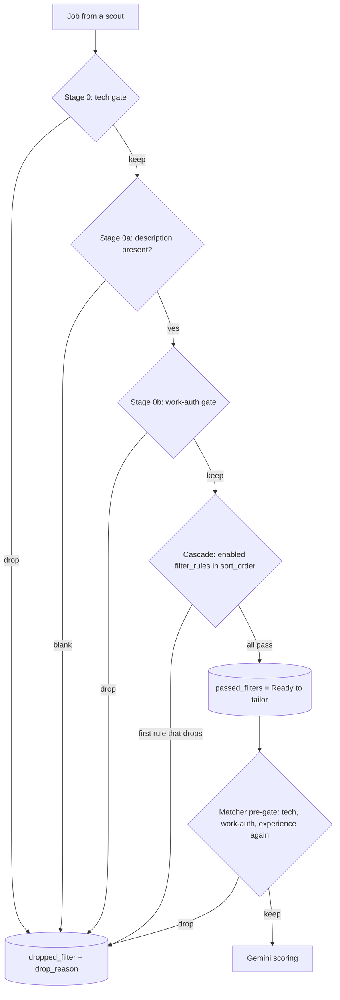

# Screening and filters

_Written 2026-11-08 against 2a9ac31._

The screener decides, for every job a scout finds, one thing: **is this posting worth a Gemini
call?** It answers with plain code (no LLM). A "yes" puts the job in Ready to tailor
(`passed_filters`). A "no" records it as `dropped_filter` with a `drop_reason` that names the rule.

Related technical docs: [pipeline end to end](../../architecture/pipeline-end-to-end.md),
[schema and status graph](../../db/schema-and-status-graph.md),
[edge functions](../../functions/README.md), [web app](../../features/web-app.md),
[CI and workflows](../../ops/ci-and-workflows.md). Neighbour feature docs:
[job discovery](job-discovery.md) (before this step) and
[matching and scoring](matching-and-scoring.md) (after it).

---

## 1. What it is

A chain of cheap, deterministic gates. Each gate can only **keep** or **drop** a job. The first
gate that drops wins, and nothing after it runs.

| Order | Gate | `drop_reason` it writes | Config lives in |
|---|---|---|---|
| 0 | Tech-role gate (title rules + your title/keyword lists) | `title_seniority`, `title_phd`, `title_non_software`, `tech_gate`, `campus_restricted`, `tech_gate_unclassified` | `search_preferences.titles`, `keywords`, `excluded_keywords` |
| 0a | Missing description | `missing_description` | none (always on) |
| 0b | Work-authorisation / location gate | `work_auth` | `search_preferences.work_authorized_countries`, `remote_location_policy` |
| 1+ | The filter cascade (9 rule types, run in `sort_order`) | the rule's own name, e.g. `experience_ceiling` | `filter_rules` rows (one per rule, `enabled` + `config`) |

The nine cascade rule types are a closed enum (`FILTER_RULE_TYPES` in
`packages/shared-types/src/enums.ts`): `experience_ceiling`, `title_blocklist`,
`location_allowlist`, `employment_type`, `already_applied`, `company_blocklist`, `staleness`,
`degree_mismatch`, `per_company_weekly_cap`.

**Two of the nine are retired (since 2026-11-10, commit 8ba2b06):** `staleness` (job age) and
`per_company_weekly_cap`. Teja, 2026-11-10 11:31 IST: job age, "dont ever skip even though they are
1 mon 2 mont old"; the cap, "remove it". `cascade.ts` runs both as `retiredRule`, which never drops
or warns; the screen context no longer counts applications per company; migration
`20261110120000_retire_job_age_and_company_cap.sql` deleted their `filter_rules` rows, stopped
seeding them and dropped `system_settings.max_applications_per_company_per_week` and
`freshness_window_days`. The enum values stay only because Postgres cannot drop one. Liveness
(`jobs.disappeared_at`, a posting gone from its board) is not age and still applies.

Every job gets a row, passed or dropped. A drop is **recorded, never omitted**, so the dashboard can
explain why a job in `jobs` never reached the queue.

---

## 2. Why it exists

### The problem

- **Cost.** Gemini runs on a small pool of free keys. The matcher, the tailor and the auditor each
  spend calls per job. The cascade's header (`supabase/functions/_shared/filter/cascade.ts`) puts it
  plainly: cut 400 jobs to 40 before the matcher, and you save on three agents, not one. That is
  why the screener has **no LLM** on purpose.
- **Noise in Teja's review queues.** Before the gates were wired, every discovered posting became a
  queued application. Teja kept seeing jobs he would never apply to (sales roles, senior roles,
  US on-site roles).
- **A wrong application costs real things.** An applied-to job that needs a US visa or 6 years of
  experience wastes a tailor run, Teja's review time, and an application slot.

### The rulings that shaped it

| Date | Ruling (Teja) | Where it lives now |
|---|---|---|
| 2026-09-17 | "Agents should discover tech jobs only." Drop non-tech postings **before the matcher**, not at discovery (boards return the whole catalogue anyway). Do not change the cascade; put the gate outside it. | `_shared/screen/tech-gate.ts`, design in `docs/design/2026-09-17-tech-only-discovery.md` |
| 2026-10-09 | Option (d): once you have configured titles or keywords, a title matching **none** of them is a drop (`tech_gate_unclassified`). Measured that day: 6636 of 6662 passed rows matched nothing, about 3155 of them sales/GTM/support. With no config at all, the gate still passes and warns. | `tech-gate.ts` header |
| 2026-10-09 | A title term matches the job **title only**; only `keywords` may also match the description head. ("work with our developers" let 111 non-tech rows through.) | `tech-gate.ts` |
| 2026-10-09 | The pre-gate sweep is **manual only**, never on a cron: a sweep that drops rows must run while someone watches the log. | `.github/workflows/pregate-sweep.yml` |
| 2026-10-24 18:44 / 19:13 IST | Drop jobs that need US work authorisation. Allowed = India + remote + countries where an Indian can work without a visa. "Visa-free" means visa-free **work**: Nepal and Bhutan. | `_shared/screen/work-auth-gate.ts`, migration `20261024190000` |
| 2026-11-01, confirmed 2026-11-04 | Drop a **hard** minimum above 1 year of experience. "Preferred" / "nice to have" years are wishes, not gates. Intern and junior roles are kept whatever the JD says. | `_shared/screen/required-experience.ts`, `filter_rules` `experience_ceiling` `config.max_years` |
| 2026-11-04 18:26 IST | Reverses the 10-24 remote half: "i dont need country lokced remote except indain remote jobs", then "i want remote jobs with no country lock too". "Remote - US" now counts as US. Show this choice in Settings. | `remote_location_policy = 'unlocked_or_authorized'` (migration `20261104193000`), Settings "Remote jobs" select |
| 2026-11-04 | "Re-scored rows get re-screened." Rows that come back to `passed_filters` by a human move must meet the gates again. | matcher pre-gate, `supabase/functions/matcher/tech-pregate.ts` |
| 2026-11-05 14:44 IST | **Unknown location passes.** "2 Locations", "In-Office", blank: keep the job. | `work-auth-gate.ts` fail-open rule |
| 2026-11-05 | Fix leaks in the gate, never with a score cutoff. | `docs/screener/2026-11-06-bulk-revive-needs-pregate-sweep.md` |
| 2026-11-07 | Drop AVP/VP/Intermediate grades, PhD-only titles and non-software titles at the tech gate. | `tech-gate.ts` `titleRuleDrop` (`e780ede`) |
| 2026-11-10 11:31 IST | Retire the job-age filter ("dont ever skip even though they are 1 mon 2 mont old") and the per-company weekly cap ("remove it"). Liveness (`disappeared_at`) still applies: gone is not old. | `cascade.ts` `retiredRule` (`8ba2b06`), migration `20261110120000` |

Why so many rulings? Each one followed a real leak Teja found in his own queue. Examples: Axiad
"AI-First Golang Developer" (JD: "6-8 years") reached manual apply on 2026-11-04 because the
experience rule had no data to read. Cohere ("Middle East") reached the approved list on
2026-11-05 because it passed before the work-auth gate knew that region.

---

## 3. How it works

### 3.1 Where screening runs

Screening happens in **one shared function**, `planScreenedApplications` in
`supabase/functions/_shared/screen/screen-batch.ts`. Every caller uses it, so two copies cannot
drift apart.

| Caller | When | Starting status |
|---|---|---|
| `worker/src/cli/scout.ts` (cron `.github/workflows/scout.yml`) | each scheduled scan | row is **born** at `passed_filters` or `dropped_filter` |
| `supabase/functions/scout-ats/index.ts` | scan started from the web | born at its verdict |
| `worker/src/scout/remote-run.ts` (`.github/workflows/scout-remote.yml`) | daily remote-feed scan | born at its verdict |
| `supabase/functions/_shared/scout/workday-detail.ts` | Workday jobs that need a detail fetch | born at its verdict |
| `supabase/functions/screener/index.ts` | rows already sitting at `deduped` (fallback / `scout-web` path) | `deduped` → `passed_filters` or `dropped_filter` |

Why "born at its verdict" and not inserted at `discovered` then moved? The scout already has the
verdict in hand. Inserting at `discovered` would force it to impersonate the normalizer to reach a
legal edge. The insert guard `guard_status_insert` (migration `20260917130000`) only allows
`discovered`, `passed_filters` and `dropped_filter` on insert. The type
`ScreenedInsertStatus = "passed_filters" | "dropped_filter"` narrows this module further. That
closed union is a safety control: it makes it impossible for screening code to create a row at
`approved`.

The backlog of `discovered` / `deduped` rows can be drained by hand with
`.github/workflows/prescreen-drain.yml` (normalizer, then screener; manual only).

### 3.2 The flow for one job



Order is **cheapest test first**: a title string match, then a blank check, then a scan of the
whole description, then the rules that read numbers and dates. Each stage shrinks the input for the
next.

### 3.3 Stage 0: tech-role gate (`_shared/screen/tech-gate.ts`)

Two layers.

**Built-in title rules** (`titleRuleDrop`), always on:

| Code | Drops | Example |
|---|---|---|
| `title_seniority` | a grade word in the title: AVP, SVP, EVP, VP, Vice President, Intermediate | "AVP, Software Engineering" |
| `title_phd` | "PhD" in the title, unless followed by preferred/plus/optional/desirable | "Research Scientist, PhD" |
| `title_non_software` | technician / technical writer always; physical (chip) design; manufacturing, supplier quality or field service unless the title is clearly software; a generic title ("Graduate Engineering Trainee") is judged by the first 500 characters of the JD | "Supplier Quality Engineer" |
| `campus_restricted` | "campus" plus a named institute (IIT, IIIT, NIT, BITS, IIM, IISc) in the title | "Campus Hiring - IIT 2026" |

Senior, Staff, Lead, Principal and "II/III" are **not** built in. They are dropped only when they
are in your `excluded_keywords` list (next table). Teja added `II`/`III`/`IV` there on 2026-11-04.

**Your lists** from `search_preferences` (edited on Settings, `SearchPreferencesPage.tsx`):

| Your list | Matched against | Effect |
|---|---|---|
| `excluded_keywords` | job **title** only | match = drop, code `tech_gate` |
| `titles` | job **title** only | match = keep |
| `keywords` | title **and** description head | match = keep |

If nothing matched:

- you configured **no** titles and **no** keywords → keep, and warn (nothing to judge by);
- you configured either list → drop as `tech_gate_unclassified`.

A level-only title term (for example "Intern") counts only when the title also carries a technical
word. "Intern, Company Secretary" is dropped and the reason names the level term.

### 3.4 Stage 0a: missing description

A job whose `description_raw` is null, empty or whitespace is dropped as `missing_description`.
Why: every later stage reads the JD. Judged on nothing, those stages would **pass**. On 2026-11-04,
459 Workday rows passed this way and 391 later failed (`8ab943d`). The check is a shape check
(a string with non-space text), never a truthiness check.

### 3.5 Stage 0b: work-authorisation and location (`_shared/screen/work-auth-gate.ts`)

Reads three texts only: title, `location_raw`, description. It does **not** read
`jobs.work_arrangement` (measured 2026-10-24: 466 rows said `remote` while their location named a
city, and the JDs said in-office).

The rule in one line (from the file header):

> DROP if a country list is set AND (every location part names a place outside the list, and under
> `any` none says remote; OR the board location names no place and the JD's "Location:" line names
> only places outside the list; OR no part is on the list AND the JD states a US-specific legal
> requirement while the US is not on the list).

Examples, with the list = India, Nepal, Bhutan and policy `unlocked_or_authorized`:

| `location_raw` | Verdict | Why |
|---|---|---|
| "Bengaluru, India" | keep | on the list |
| "Remote" | keep | remote with no country lock |
| "Remote - India" | keep | remote locked to a listed country |
| "Remote - US" | drop `work_auth` | remote locked outside the list (11-04 ruling) |
| "New York, NY" (on-site) | drop `work_auth` | only places outside the list |
| "2 Locations" or blank | keep | unknown location passes (11-05 ruling) |
| blank, JD says "Location: London" | drop `work_auth` | the JD's own location line names only outside places |

US-only legal text ("authorized to work in the US", the export-control "U.S. person") counts.
Country-neutral wording like "unable to sponsor" is **not** used: on live rows it meant the UK,
Poland or an export licence.

**Remote policy** (`search_preferences.remote_location_policy`, a closed text union with a CHECK):

- `unlocked_or_authorized` (default since 2026-11-04): remote is kept when it names no place or a
  listed place.
- `any`: the 2026-10-24 behaviour. Any remote part is kept wherever it is locked.

**Fail-open on missing data.** An unset list, an unknown place, a missing location, or a remote part
naming no place all **keep** the job. Only a positive signal drops. An unset list also produces a
warning so you can see the gate is open.

**Pay-band chip (not a drop).** `payBandRegionWarning` in the same file shows a "Pay band UK/US
only" chip on a remote job whose JD ties a salary to a UK/US place. It is used by
`apps/web/src/features/approval/ApprovalQueuePage.tsx`. The job is kept either way.

### 3.6 The cascade (`_shared/filter/cascade.ts`)

`screenJob(job, rules, context)` runs every **enabled** `filter_rules` row in `sort_order` and stops
at the first drop. Thresholds come only from the rule's `config`. Nothing is hard-coded, so
re-ordering or retuning is a Settings change, not a deploy.

A rule with no config **warns and passes**. It never drops on a missing setting. The warnings are
saved into the run row (`_shared/screen/run-summary.ts`), and the Filters page
(`apps/web/src/features/settings/FiltersPage.tsx`) says when an enabled rule cannot drop anything.

| Rule | Reads | Drops when |
|---|---|---|
| `experience_ceiling` | `config.max_years`; the JD's required years | a hard minimum > `max_years` |
| `title_blocklist` | `config.blocked_titles` | title matches |
| `location_allowlist` | `config.allowed_locations`; `locations`, else `location_raw` | no match |
| `employment_type` | `config.allowed_types` | type not allowed |
| `already_applied` | fingerprints in your history | fingerprint seen before |
| `company_blocklist` | `company_blocklist` table | company blocked |
| `staleness` | nothing (retired 2026-11-10) | never: job age never drops a job |
| `degree_mismatch` | `jobs.requires_advanced_degree` | requires Master's/PhD |
| `per_company_weekly_cap` | nothing (retired 2026-11-10) | never: there is no per-company cap |

**Experience ceiling, in detail.** Nothing writes `jobs.min_experience_years`, so
`toScreenableJob` (`screen-batch.ts`) fills it from the JD with `requiredExperienceYears(title,
description)` (`_shared/screen/required-experience.ts`). A stored value still wins. The parser:

- counts only a **hard** minimum ("3+ years required", "minimum 2 years", "(3-5)" in a title,
  "4 to 8yrs");
- ignores "preferred", "nice to have", "a bonus";
- keeps intern and junior titles whatever the JD says;
- ignores implausible numbers (company boilerplate like "30 years of investing experience");
- returns nothing when unsure, and nothing never drops.

To see the live rule config (read-only):

```bash
env -u SUPABASE_ACCESS_TOKEN supabase db query --linked "select rule_type, enabled, sort_order, config::text from filter_rules order by sort_order"
```

### 3.7 The second look: matcher pre-gate and auditor re-gate

Screening at insert is not enough. A row can come back to `passed_filters` later by a human move
(a master-change re-run, a back-fill, an undo). That move skips the screener. A gate added after the
insert also never saw the old rows.

So the same three gates run again, with **today's** config:

| Where | File | Runs on | On a drop |
|---|---|---|---|
| Matcher pre-gate | `supabase/functions/matcher/tech-pregate.ts` (`firstPreGateDrop`) | every `passed_filters` row, before any Gemini call | `passed_filters → dropped_filter` (agent `matcher`), same `drop_reason` codes; event key `pre_gate_dropped` |
| Auditor re-gate | `supabase/functions/auditor/pregate.ts` | every `tailored` row, before a human sees it | `tailored → failed` (the auditor has no edge into `dropped_filter`); the code is in the event detail |

Order is the screener's: tech, then work-auth, then experience. Both read config through
`supabase/functions/_shared/pregate-config-loader.ts`, so they cannot read it differently. Both
call the screener's own functions, so they cannot drift.

**Human-picked jobs skip these gates.** A job Teja pasted by link has `discovered_via = 'manual'`;
`isHumanPicked` (`_shared/match/score-threshold.ts`) lets it skip the pre-gate and the score floor.

### 3.8 The pre-gate sweep (`.github/workflows/pregate-sweep.yml`)

A manual workflow that calls `matcher?mode=pregate_only` page by page over the whole
`passed_filters` backlog. It makes **zero** Gemini calls. It drops what today's gates reject and
leaves the rest in place.

```bash
gh workflow run pregate-sweep.yml --ref main -f dry_count_only=true   # read the plan first
gh workflow run pregate-sweep.yml --ref main                          # real sweep (orchestrator, with Teja's yes)
```

Rule (`docs/screener/2026-11-06-bulk-revive-needs-pregate-sweep.md`): **any bulk move into
`passed_filters` is followed by this sweep in the same session.** It aborts closed on any response
it cannot read, because drops are one-way for an automated run. Each page logs
`dropped=… by_code=… survivors=… gemini_calls=0`.

### 3.9 `dropped_filter` and revive

`dropped_filter` is a resting state, not a delete. The row and its `drop_reason` stay. The legal
edges (read them live, never assume):

```sql
select * from application_status_transitions where from_status = 'dropped_filter' or to_status = 'dropped_filter';
```

At 2a9ac31 the edges into `dropped_filter` are `deduped` (screener, human), `passed_filters`
(matcher, human) and `scored` (human). The only way out is `dropped_filter → passed_filters`,
**human only** (migration `20261031200000`).

Ways a dropped job comes back:

| Path | What happens |
|---|---|
| Paste the job's link (Discovery, `AddJobLinkPanel.tsx` → `supabase/functions/job-link-intake/`) | If the job exists at `dropped_filter`, the function answers 409 `needs_confirm` with `reason: "revive_dropped"` and the old `drop_reason`. Only after you confirm does it move the row to `passed_filters`, and the overridden verdict goes on the event record (`ea85dc9`). A pasted job outside your countries also asks first (`reason: "work_auth"`, `e63f979`). |
| Undo on Discovery (`DiscoveredJobsPage.tsx`, `rejectJob.ts`) | Undoes **your own** one-click Reject (`passed_filters → dropped_filter` as human). It does not list screener drops. |
| SQL by the orchestrator | `advance_application_status(id, 'passed_filters', 'human', ...)`, then the pre-gate sweep. |

A pasted job (`discovered_via = 'manual'`) skips every automatic filter except the two questions
above (`f5b3914`).

---

## 4. Rules and guardrails

- **Every status change goes through `advance_application_status()`.** A bare
  `.update({ status })` is refused by the transition guard. The screener uses
  `_shared/screen/persist-verdict.ts`.
- **Fail open on missing data, drop only on a positive signal.** Unknown location, unknown years,
  unset config: keep the job. A missing answer must never become a rejection (CLAUDE.md §6).
- **But a blank description is a drop**, because every later gate would pass on nothing.
- **`drop_reason` names the stage or rule, never prose.** Prose goes to the run summary
  (`DroppedJob.reason`). This lets the dashboard group drops by cause.
- **Gates live outside the cascade enum.** The tech and work-auth gates read
  `search_preferences` columns, so no new `filter_rule_type` enum value, migration or `cascade.ts`
  change was needed (Teja asked the cascade stay unchanged).
- **One function per gate, called from every stage.** Screener, matcher pre-gate, auditor re-gate
  and job-link intake call the same `screenTechRole` / `screenWorkAuth` / experience functions.
- **Closed unions, not booleans:** `ScreenedInsertStatus`, `RemoteLocationPolicy`,
  `WorkAuthDropCode`, `ExperienceDropCode`. Required parameters, so no caller can skip a gate by
  leaving an argument out.
- **Sweeps and drains are manual** (`pregate-sweep.yml`, `prescreen-drain.yml`,
  `postscreen-drain.yml`: `workflow_dispatch` only). Live writes are run by the orchestrator on
  Teja's yes.
- **Bulk revive → pre-gate sweep**, same session.
- **Fix a leak in the gate**, never with a score cutoff. The matcher's score floor (30) is a
  separate control (see [matching and scoring](matching-and-scoring.md)).

---

## 5. Known gaps and open questions

Measured 2026-11-08 by the read-only query in §3.6. Re-run it; do not trust these lines later.

1. **Most cascade rules are enabled but have no config.** Live, `title_blocklist`,
   `location_allowlist`, `employment_type` and `degree_mismatch` have `config = {}`. They warn and
   pass every job. In practice the cascade drops only through `experience_ceiling`
   (`max_years = 1`), `already_applied` and `company_blocklist`. The real filtering is done by the
   stage-0 gates. (`staleness` and `per_company_weekly_cap` were retired on 2026-11-10 and their
   rows deleted; see §1. They can no longer drop or warn, whatever their config.)
2. **`degree_mismatch` has no producer.** Nothing writes `jobs.requires_advanced_degree`, so it
   always skips. PhD-only titles are caught by `title_phd` instead.
3. **The salary gate is written but not wired.** `evaluateSalaryGate` in
   `supabase/functions/_shared/match/salary-gate.ts` has no non-test caller. There is no salary drop
   today. Only the pay-band chip exists, and it never drops.
4. **No page lists screener drops.** The Discovery "Filtered Out" tab is a local preview only
   (`apps/web/src/features/discovery/discoveredList.ts`). To bring back a screener drop you paste
   its link again, or the orchestrator runs SQL.
5. **Rows at `scored` or later are not swept.** The pre-gate sweep reads `passed_filters` only.
   Those rows meet the auditor re-gate, but only after a tailor run was spent.
6. **Work-auth map holes.** The gate keeps a place it does not know. Places missing from its
   country table pass. A Workday "N Locations" string cannot be judged from the location alone
   (`ab71b4f` now reads every site from the detail response).
7. **Pay-band chip misses amount-first text** like "$125k (US)" (pending list P2 #8).
8. **Stale comments.** `supabase/functions/screener/index.ts` says it runs "stage 0 (tech gate) and
   the cascade"; it also runs the blank-description and work-auth stages through
   `planScreenedApplications`. `matcher/tech-pregate.ts` keeps its old name though it runs three
   gates.

---

## 6. Related docs

- Technical: [pipeline end to end](../../architecture/pipeline-end-to-end.md),
  [schema and status graph](../../db/schema-and-status-graph.md),
  [edge functions](../../functions/README.md), [web app](../../features/web-app.md),
  [CI and workflows](../../ops/ci-and-workflows.md)
- Design history: `docs/design/2026-09-17-tech-only-discovery.md`,
  `docs/screener/2026-09-17-screener-wiring.md`
- Runbook: `docs/screener/2026-11-06-bulk-revive-needs-pregate-sweep.md`
- Retro SQL (historical): `docs/screener/2026-10-25-work-auth-retro.sql`,
  `docs/screener/2026-11-06-scored-leak-retro.sql`
- Product neighbours: [job discovery](job-discovery.md),
  [matching and scoring](matching-and-scoring.md), [resume tailoring](resume-tailoring.md)
