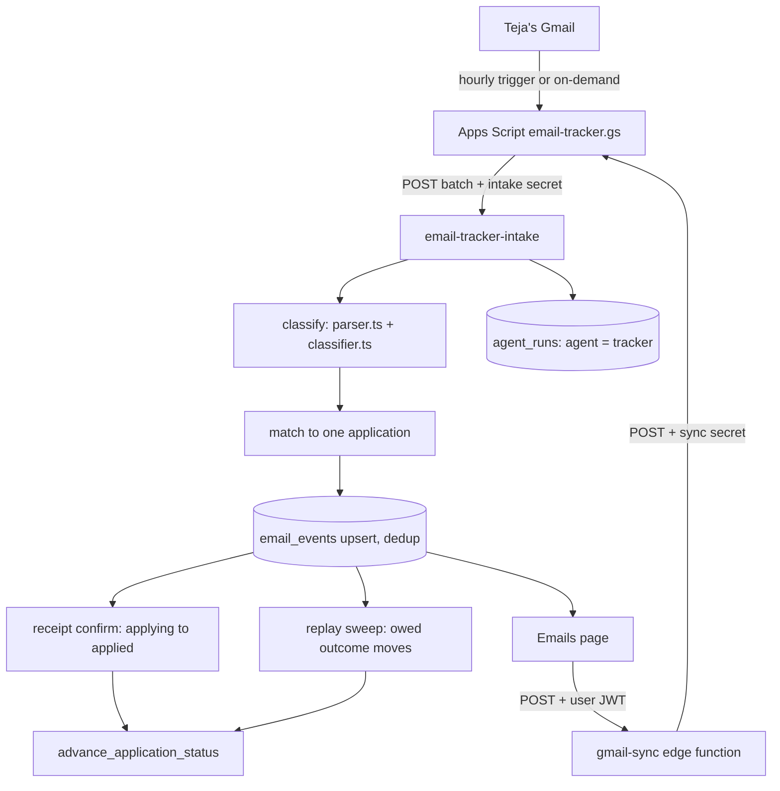

# Tracking and email: what happens after you apply

_Written 2026-11-08 against 2a9ac31._

## What it is

After an application is sent, the employer answers by email. This feature reads those emails
and uses them to keep each application's status true, without Teja copying anything by hand.

It has four parts:

| Part | Where it runs | Job |
|---|---|---|
| Gmail tracker script | Google Apps Script, inside Teja's own Gmail | Finds job mail and sends it to Supabase. Does no thinking. |
| `email-tracker-intake` | Supabase edge function | Classifies each email, matches it to an application, stores it, and moves the status when it is safe. |
| `gmail-sync` | Supabase edge function | Lets the web app ask for a sync "now" without exposing the script's secret. |
| Emails page (`/emails`) | `apps/web` | Shows every captured job email with its class, filters, a read mark, and "Add to Applied". |

Example: Greenhouse sends "Thank you for applying to Acme". The script sends it to the intake.
The intake reads it as `application_received`, finds Teja's one `applying` row at Acme, checks
that Gmail verified the sender, and moves the row `applying -> applied`. A week later Acme sends
an interview invite. The intake reads it as `interview_invite` and moves the row to `interview`.

## Why it exists

**The problem.** The worker submits forms, but a submit does not prove the employer got it. Rows
the worker cannot prove end at `applying`, and a sweep later moves them to `needs_verification`,
which only a human can clear. After that, every outcome (assessment, interview, rejection, offer)
arrives only by email. Without the tracker, the pipeline board would stop at "applied" and
slowly become false.

**Decisions and rulings, in order:**

| Date | Decision |
|---|---|
| 2026-09-09 | Teja confirmed the tracker mailbox is his personal Gmail, not his college Workspace account (that account can be blocked by its admin and is lost at graduation). See `docs/setup/gmail-tracker-apps-script.md`. |
| 2026-09-10 | Use Google Apps Script, not the Gmail API, IMAP or Zoho. The Gmail API in OAuth "Testing" mode expires refresh tokens every 7 days; `gmail.readonly` is a restricted scope that needs review; IMAP with app passwords is closed for Workspace since March 2025. Apps Script already runs as Teja, so there is no token to expire. Recorded in `docs/decisions/2026-09-10-gmail-continuous-read-write-vs-zoho.md`. |
| 2026-09-18 | Parser, classifier and intake function built (`50da19b`, `4364adf`). Classification is rules, not an LLM. |
| 2026-10-04 | Order of operations fixed: store and de-duplicate first, then move status. A re-sent batch must never replay last week's email against today's status. |
| 2026-10-09 23:24 IST | Teja ruled a verified Greenhouse receipt may mark an application `applied` with no human check (migration `20261009235000_tracker_confirms_applied.sql`). |
| 2026-10-23 10:44 IST | Teja narrowed that ruling: a receipt may confirm `applying -> applied` only. `needs_verification` stays human-only, because greenhouse.io signs real receipts for all its tenants, so anyone applying anywhere with Teja's address makes a genuine receipt. |
| 2026-10-23 | Teja ruled: hourly background run plus on-demand sync from the dashboard, at most once a minute. The secret left the browser: the web now calls `gmail-sync` with its login token (`43cdaa8`, `b7b4c5b`). The empty-batch heartbeat was added so a dead trigger no longer looks like a quiet inbox (`d926198`). |
| 2026-10-23 | Teja ruled a receipt moves nothing by classification alone. "We received your application" on an `applied` row is stored as an event; it is not evidence of screening. |
| 2026-11-01 (W6) | Owed status moves are replayed every run, so a move skipped once (kill switch off, row waiting for a human) is not lost (`2dbe677`). |
| 2026-11-02 (W33) | The Gmail search covers job mail only (lifecycle words plus ATS senders). An email that is unclassified and unmatched is stored with its subject and body blanked (`7aa3c07`). |
| 2026-11-04 20:35 IST | Teja ruled: keep subjects from ATS senders, even on a blanked row, because an ATS email often names the company only in its subject (`ce3a565`). |
| 2026-11-05 12:31 IST | Teja ruled the tracker captures all job mail, including job alerts from boards, as class `job_alert` (`33df511`). Same ruling: "Inbox + one-click add" on the Emails page (`ed95c8e`). |
| 2026-11-05 | Email can be linked to rows at `awaiting_approval`, `approved` or `blocked_needs_human` without moving them (`2ef96ac`). Add to Applied links an existing job before it creates a duplicate (migration `20261105220000`). |
| 2026-11-05 15:11 IST | The Apps Script is now shipped from git with `clasp`, at a pinned SHA, to the same Web App URL (`6ed181e`, `scripts/push-apps-script.sh`). |

## How it works

### Flow



### 1. The Apps Script (a dumb pipe)

File: `supabase/functions/_shared/apps-script/email-tracker.gs` (manifest `appsscript.json` next
to it). The repo copy is the source of truth; the editor copy is a deployment of it.

- `applyyIngest` runs the Gmail searches, collects messages, POSTs them in chunks to the intake,
  and labels each sent thread `applyy-ingested`. A label, not `is:unread`, because read state
  belongs to Teja: opening a mail on the phone must not hide it from the tracker.
- Search window `newer_than:2d`, wider than the hourly interval, so an outage loses nothing. The
  label stops re-sends.
- Two searches (`applyySearchQueries_`): lifecycle mail (keywords plus ATS sender domains), then
  job boards and alerts. The Social and Forums tabs are excluded. At most 200 threads per run.
- Each message sends headers, Gmail labels, the topmost `Authentication-Results` header, and the
  plain body cut to 4096 characters (field `snippet`).
- No mail found: it still POSTs an empty batch. That is the heartbeat.
- `applyyInstallTrigger` installs one hourly trigger and removes duplicates. `applyyTestConnection`
  sends an empty batch to check URL and secret.
- `doPost` serves the on-demand sync with its own 60-second cooldown. `doGet` refuses, because a
  secret in a URL ends up in logs.
- Ship it with `scripts/push-apps-script.sh <sha> "<why>" [--dry-run]`. It builds from
  `git show <sha>:...`, never the working tree, and always updates the one existing deployment so
  the Web App URL never changes.

### 2. The intake (`email-tracker-intake`)

Files: `supabase/functions/email-tracker-intake/index.ts`, `decide.ts` (pure rules), `replay.ts`
(the replay sweep). Contract: `supabase/functions/_shared/intake/email-contract.ts`. Auth:
`supabase/functions/_shared/intake/auth.ts`. Deployed with `verify_jwt = false` (Apps Script
cannot get a Supabase JWT) and guarded by the `X-Applyy-Intake-Secret` header.

Steps per call:

1. Check the secret, the method and the body size; validate every message against the contract.
2. Open an `agent_runs` row with `agent = 'tracker'`. An empty batch records 0 rows: proof the
   trigger is alive.
3. Classify each message (`classifyMessage` in `decide.ts`).
4. Match it to at most one application (`matchTrackedFirst`).
5. Upsert into `email_events`, de-duplicated on `(user_id, provider_message_id)`.
6. For newly stored receipts only: try the guarded `applying -> applied` confirm.
7. Run the replay sweep for outcome moves.
8. Return 202. Apps Script labels the threads only after 202.

### 3. Classification

Files: `supabase/functions/_shared/email/parser.ts` and `classifier.ts`. Pure rules, no Gemini.
The classes are the `email_classification` enum (`packages/shared-types/src/enums.ts`,
`EMAIL_CLASSIFICATIONS`):

| Class | Meaning | Status it targets |
|---|---|---|
| `interview_invite` | Interview invitation | `interview` |
| `oa_invite` | Online assessment (HackerRank, CodeSignal ...) | `oa_pending` |
| `rejection` | A no, including ones that open "thank you for applying" | `rejected` (terminal) |
| `recruiter_outreach` | Recruiter or employer contact | `employer_screening` (only from `applied`) |
| `offer` | Offer | `offer` (only from `interview`) |
| `application_received` | Receipt / auto-reply | none by class; see the receipt confirm |
| `job_alert` | Board alert or recommendation | none, ever |
| `other` | Out-of-office and similar | none |
| `unclassified` | Nothing recognised | none |

Order matters: lifecycle outcomes are tried first, the receipt reading only when no outcome
matched, and `job_alert` last. So a receipt that describes the hiring process is still a receipt
(`45cd988`), and an alert never hides a rejection.

Confidence gate (`passesConfidenceGate`): a move into a terminal status needs at least 0.8; any
other move needs at least 0.7. Below the gate the email is stored with its class, and nothing
moves.

### 4. Matching

`matchApplication` in `decide.ts` returns one application id or `null`. `null` means none OR more
than one: the tracker never guesses.

- Strongest evidence: the sender's own domain against the job's company slug. A careers suffix is
  allowed from a closed list (`hackerrankcareers.com` -> `hackerrank`). Look-alike domains do not
  match.
- Fallback: the company slug as whole words in the sender's display name or the subject. Never
  the address (spoofable) and never the body (bodies mention other companies).
- Tie between two rows at the same company: broken by the job title named in the email, and by
  nothing else.
- Pools: tracked statuses first (`applying`, `needs_verification`, `applied`,
  `employer_screening`, `oa_pending`, `interview`). Only if none match, match-only statuses
  (`awaiting_approval`, `approved`, `blocked_needs_human`) for companies with no tracked row.
  Match-only rows are linked, never moved.
- Unmatched stored emails are re-matched on every run (`rematchUnmatched`), so an email that
  arrived before its application existed can still link later.

### 5. Receipts and confirmation

A receipt may confirm a submit only when all of these hold (`receiptConfirmsApplied`,
`verifyReceiptSender`):

- The sender is in `CONFIRMING_VENDOR_DOMAINS` (`greenhouse.io`, `greenhouse-mail.io`).
- Gmail's own topmost `Authentication-Results` header shows DKIM or SPF pass for that domain.
  A missing or malformed header refuses.
- It arrived after the row last entered `applying`.
- Exactly one loaded row matches the company.
- The row is at `applying` (`CONFIRMABLE_STATUSES`). Never `needs_verification`.

On the Health page, the recovery queue (`apps/web/src/features/health/RecoveryQueue.tsx`) shows
the matched receipt beside "I applied", so Teja sees the evidence before he clears a row by hand
(`63eb1e3`).

### 6. Outcome moves and the replay sweep

`replay.ts` re-drives every stored, matched, movable email that has no tracker note for its
message id yet. `advance_application_status` writes that note in the same transaction as the
move, so "note exists" means "move committed". Rules:

- Oldest first.
- An email older than a move the tracker already made on that row, or older than a human's move
  into an employer stage, is stale and never replayed.
- Every move needs the kill switch on (`system_settings.system_enabled = true`, `mayAdvanceStatus`).
  Unreadable means off. Emails are always stored, even when moves are off.
- A refused move adds to the run's `error_count`, so Health stops showing green.

### 7. `gmail-sync` (sync now)

Files: `supabase/functions/gmail-sync/index.ts`, `respond.ts`. `verify_jwt = true` in
`supabase/config.toml`. The browser calls it with the user's JWT; it checks the caller is the app
user, then POSTs to the Apps Script Web App with `APPLYY_GMAIL_SYNC_SECRET` in the body. That
secret is separate from the intake secret (W16, 2026-11-02). Reply shape:
`{ ok, cooldown?, details?, error? }`.

### 8. The Emails page

Files: `apps/web/src/features/emails/EmailMonitoringPage.tsx`, `emailView.ts` (pure view rules),
`emailSync.ts` (sync call). Redesigned 2026-11-05 (`ed95c8e`).

- Opening the page syncs Gmail at most once a minute, whatever the server answers (`4f38458`).
  The browser cap is advisory; the script's cooldown is the real gate.
- Each row shows its stored class through a closed label map. Unknown values read "Unclassified".
- Filters live in the URL: type (default "All job mail", which hides `other` and
  `unclassified`), tracked / not tracked, text, date range, sort.
- "Mark read" sets `email_events.read_at` in this app only. Gmail's read state is never changed;
  that would need the wider `gmail.modify` scope.
- "Add to Applied": for an unmatched email about an application (receipt, rejection, assessment,
  interview, offer, recruiter). Teja confirms company and title in an inline confirm, then one
  call to `public.track_email_as_applied`. It reuses an existing job when exactly one job has the
  same company and title; otherwise it creates one. The new application goes
  `discovered -> applied` as `human` in one transaction. That edge exists only for this RPC.
  Never automatic. A refusal says where the job is and what to do (`c0bdc6c`).

### Data

- `email_events`: one row per Gmail message. Key columns: `provider_message_id`, `thread_id`,
  `from_address`, `subject`, `snippet`, `recipient_to`, `label_ids`, `received_at`,
  `classification`, `classification_confidence`, `matched_application_id`, `read_at`.
- `agent_runs` rows with `agent = 'tracker'`: one per intake call.
- `application_events`: the tracker's status moves, with the message id in the note.

Check liveness yourself (read-only):

```sql
select max(received_at), count(*) from public.email_events;
select classification, count(*) from public.email_events group by 1;
select max(started_at) from public.agent_runs where agent = 'tracker';
```

## Rules and guardrails

- All intelligence lives in the repo. The script only moves bytes.
- One secret per entry point: the intake secret in Apps Script and Supabase; the sync secret in
  Apps Script and Supabase. Never in the repo, never in the browser.
- Store first, move second. A re-sent batch is a no-op.
- The tracker never guesses a match. Ambiguous means `null`.
- A receipt confirms `applying -> applied` only, from a DKIM/SPF-verified Greenhouse sender.
  `needs_verification` stays human-only.
- Every status move goes through `advance_application_status()` and the transition graph.
- The kill switch is absolute for status moves; emails are still stored.
- `job_alert`, `other`, `unclassified` and `application_received` never move a status by class.
- Add to Applied is always a human click.
- No email is ever sent. Outbound mail at volume is what would put the account at risk.

## Known gaps and open questions

- Only Greenhouse receipts can confirm a submit. Lever, Ashby and others are classified but not
  trusted to confirm. Adding one needs a verified DKIM sample.
- An outcome email that names no job title, from a company with two tracked rows, stays
  unmatched. This is a deliberate refusal, but it needs a human.
- Blanked rows (unclassified and unmatched) cannot be re-read if the classifier improves; the
  text is still in Gmail.
- Stale comments in code contradict the hourly ruling (see below). They do not change
  behaviour, but they mislead a reader:
  - `email-tracker-intake/index.ts` says a 500 retries "on next 15-minute trigger cycle". The
    trigger is hourly.
  - `apps/web/src/features/emails/emailSync.ts` describes a "ZERO CRON INVARIANT" that replaced
    15-minute polling. An hourly trigger exists since 2026-10-23.
  - `applyyRemoveTriggers` in `email-tracker.gs` says background polling stops and monitoring is
    on-demand only. Running it would undo the hourly ruling.
- Is the hourly trigger installed live right now? The repo cannot prove it. Check the
  `agent_runs` query above: rows about every hour mean yes.

## Related docs

- `docs/setup/gmail-tracker-apps-script.md`: setup steps and why not the Gmail API.
- `docs/decisions/2026-09-10-gmail-continuous-read-write-vs-zoho.md`: the mailbox decision.
- `docs/architecture/pipeline-end-to-end.md`: the whole pipeline.
- `docs/db/schema-and-status-graph.md`: `email_events` and the transition graph.
- `docs/functions/README.md`: every edge function.
- `docs/features/web-app.md`: the web app, including the Emails page.
- `docs/ops/ci-and-workflows.md`: CI and deploys.
