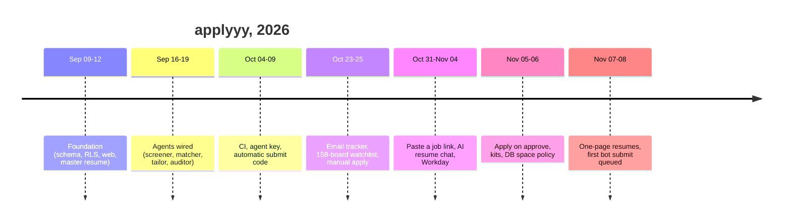

# History timeline

_Written 2026-11-08 against 2a9ac31._ (One later commit, `2936e8c`, is included at the end.)

## What it is

A short, dated map of how `applyyy` grew from an empty monorepo (2026-09-09) to a pipeline
that discovers, screens, tailors and queues jobs for Teja's approval (2026-11-08).
Each phase lists the commits that mark it. Use it to answer "when did X arrive, and why".

Regenerate the raw material any time:

```bash
git log --reverse --format='%h %cs %s'               # every commit, oldest first
git log --format='%cs' | sort | uniq -c              # commits per day (shows the bursts and the gaps)
git log --format='%h %cs %s' -- docs/handoff/        # every handoff, newest first
```

## Why it exists

Teja is an early-career developer applying to many jobs. Doing each application by hand is slow,
and blind auto-apply bots send wrong or invented resumes. `applyyy` sits between the two:
machines find, filter, tailor and audit; **Teja approves every application**; then a bot submits.
See [vision-and-why.md](vision-and-why.md) for the full product reasoning.

The project was built in **bursts**. Long gaps with no commits (2026-09-20 to 10-03,
10-10 to 10-22, 10-26 to 10-30) sit between them. Each burst was run by one orchestrator
session plus several peer sessions on one shared working tree. A burst ends with a
handoff file in `docs/handoff/`.

## Phases at a glance

| # | Dates | Phase | Headline |
|---|---|---|---|
| 0 | 2025-12-29 | Placeholder | `b4b330d` Initial commit (empty repo) |
| 1 | 2026-09-09 to 09-12 | Foundation | Monorepo, schema with RLS and a status graph, web console, master resume, ATS adapters |
| 2 | 2026-09-16 to 09-19 | Agents | Matcher, screener, robots gate, tailor, auditor wired end to end; Phase 3 extras |
| 3 | 2026-10-04 to 10-09 | Hardening and submission | CI, liveness, resume editing, agent key, automatic submit code |
| 4 | 2026-10-23 to 10-25 | Coverage and tracking | Email tracker, watchlist expansion, manual-apply lane, work-auth gate |
| 5 | 2026-10-31 to 11-04 | Intake and AI review | Add-a-job-by-link, AI resume chat, Workday, fail-closed agent key, experience ceiling |
| 6 | 2026-11-05 to 11-06 | Scale and space | Biggest day (96 commits): apply-on-approve, kits on every approve, DB space policy, answer bank |
| 7 | 2026-11-07 to 11-08 | Resume quality and first bot submit prep | One-page rule, ATS panel, auditor tightening, rehearse, Manual lane reasons |



## How it evolved

### Phase 1 — Foundation (2026-09-09 to 09-12)

- `0cd33a8` (09-09) monorepo: shared types, job normalizers, diff view, worker fixtures.
- `10b0336` (09-10) schema migrations with RLS and the **status transition guard**. The status graph
  in the DB is the backbone of everything later.
- `c2aa380` Greenhouse, Lever, Ashby adapters behind one registry. `eb1e5f2` lease-based worker claim loop.
- `7de02c3` Gemini key pool and the matcher eval gate.
- `500d9a6`, `a8cec07` the worker renders the resume itself, so **what was approved is what gets sent**.
- `a3c7426` restored nine plan sections that a `git add -A` dropped. This incident is why
  "never stage everything" is a hard rule (see `~/.claude/CLAUDE.md`).
- 09-11: master resume becomes a tree of nodes with ids (`ffbb51c`, `d71b803`); PDF upload and
  extraction in the browser (`2a6550c`); login with per-user RLS (`b3f4db1`); watchlist CRUD (`b54ea16`).
- 09-12: `c0e6c68` scout-ats entrypoint; `245dfb6` scheduled ATS discovery workflow;
  `0ff3c98` Gemini 429 failover and prompt fencing; `ab05ba4` tech-only discovery filter.

### Phase 2 — The agents (2026-09-16 to 09-19)

- 09-16: `5751184` salary gate, `b15d8e7` weighted fit rubric, `8d811be` scorer seam,
  `23d9abf` shared HTTP transport with retry.
- 09-17: `4ca08ef` robots.txt gate (`@applyy/master-robots`), `042bc78` screener cascade gets its first caller.
  `75a75a0` deleted the `audit_clean` fast path and `bb6a988` retracted the history it had forged.
  Lesson: a shortcut that skips an agent writes false history.
- 09-18: `ed09810` tailor gets its first producer, `1b95133` pending migrations applied,
  `92f2129` matcher runner, `d32e7be` **anti-fabrication auditor**.
  `a8b6e02` (09-18) claims "100% Phase 1 loop completion". See Known gaps: no real submit existed yet.
- 09-19: `0e9df17` Phase 3 tables; follow-up nudges (`d5e6689`), interview prep (`412ff02`),
  referral queue (`6241695`).

### Phase 3 — Hardening and submission (2026-10-04 to 10-09)

- 10-04: `a0149bb` scout-web (Gemini-grounded internet search); `1f7aa47` assisted-submit CLI (headed browser).
- 10-05: `6f37d50` CI on every push; `240cb3b` every action pinned to a SHA; `ca1d6a4` `run-one` workflow;
  `5f4115d` posting liveness (the tailor never works on a dead posting).
- 10-05/06: Gemini keys 12-20 started returning 403 and were disabled (memory: "Gemini keys 12-20 project-denied").
  `16eb099` overload backoff and fallback model.
- 10-06: `3724d35` `tailored_profile` frozen outside `scored|audit_flagged|awaiting_approval`; `704f472` JD keywords stored with the resume.
- 10-08: `b2a4a36`, `9615d74` **agent-key header**. Browser and agents use the same DB user, so the key is the only way to tell them apart.
  `c3195b2` edit the tailored resume in place. Teja ruled 2026-10-08: the orchestrator runs production deploys itself.
- 10-09: `c557533` **automatic submission after approval**, `0c437e4` cap of 3 per run plus a circuit breaker,
  cron stays dry unless `APPLYY_CRON_LIVE=true`; `a3b4115` robots gate before the apply page opens.

### Phase 4 — Coverage and tracking (2026-10-23 to 10-25)

- 10-23: `f0df3ac` email tracker: a verified ATS receipt confirms `applied`; `43cdaa8` hourly trigger;
  `dd2560b` +103 verified boards (watchlist reached 158 boards, memory "Coverage expanded 2026-10-23").
- 10-24: a rescue-branch day (handoffs `ce04626`, `368cf9f`). `7501a95` board-identity guard (a mismatched board saves nothing).
  `681b78e` **Manual apply page** and `d20fa45` apply kit: a pre-planned form for jobs the bot cannot do.
  `234199b` kits built automatically. Teja ruled 2026-10-24: per-row work is triggered by the system, never an agent loop.
  Teja ruled 2026-10-24: one email address on every resume.
- 10-24/25: `5500d42`, `f23e627` **work-authorization gate** with a country list.

### Phase 5 — Intake and AI review (2026-10-31 to 11-04)

- 10-31: `f5b3914` **add a job by link**; a pasted job skips filters (migration `20261031200000`).
  `74fa743` AI box proposes resume edits.
- 11-01: `4f53c25`, `c802acd` the AI box becomes a chat that performs its own edits; `e186c46` audit runs as advice, no popups.
  `1294acc` Workday adapter (discovery only); `de5967f` approved Workday rows are parked for a human.
  `87fff82` re-run queued rows when the master resume changes. `85ef531` link intake with a headless-browser fallback.
  Teja ruled 2026-11-01: SmartRecruiters boards are off (robots `Disallow: /`); a pasted link skips robots.
- 11-02: `c8e2fea` CI runs the four package suites and fails on dropped tests.
- 11-04: migration `20261102210000` makes the agent key **fail closed** (empty key table locks agents out).
  `b93a936` drop country-locked remote and over-experienced jobs (migration `20261104193000`).
  `fe0912c` every Gemini call logged with token counts. Teja ruled 2026-11-04: no native browser dialogs.

### Phase 6 — Scale and space (2026-11-05 to 11-06)

- 96 commits on 11-05, the busiest day.
- `625a437` **apply on approve** behind an off switch; `5c3ce87` a kit on every approve, no fixed cap.
- The database hit 514 MB on the 500 MB free quota (handoff `7c8659b`). `f140d15` jobs tombstone policy,
  `24ea7c3` weekly tombstone run.
- `bb55391` supabase-js pinned once in `supabase/functions/deno.json`; deploys now need `--import-map`.
- `816db6e` gitleaks scan in CI; `9384092` one CI job instead of six, docs-only pushes skip CI.
- `4f37c97` Unanswered questions in the answer bank; `aabedc8` Teja's attested answer fills EEO and eligibility.
- `bc0586d` Applied jobs page; `ed95c8e` emails page shows each job email's class.

### Phase 7 — Resume quality and first bot submit prep (2026-11-07 to 11-08)

- `e780ede` drop AVP/VP, PhD-only and non-software titles. `5a3009b` skills section capped at 5 JD-relevant groups.
- `35f1d4a` Teja's rulings D1, D2, D4: an invented skill is dropped, not kept. `11e858f` auditor flags a skill in a bullet
  that its master entry never used.
- `7211fd7` redesigned approval queue; the AI chat is the only edit path. `1fbf21d` ATS panel back.
- `fc915af` `rehearse --id <uuid>` proves a first assisted submit without claiming the row.
- `8f91837` feed liveness retires dead non-ATS postings.
- Matcher floor lowered 45 to 30 (Teja ruled 2026-11-07, `95df3f3`).
- **One-page rule** (Teja ruled 2026-11-07): `41d7430` typography shrinks first, then a floor-aware trim;
  `7a78d05` the editor fits live on save; `dc8ac5c` two dense typography rungs.
- `f5511e9` "Bot can't apply: reason" on every Manual apply card (Teja ruled 2026-11-07: bot-unsuitable rows go to Manual apply).
- `4389f9a`, `2a9ac31` the 2026-11-08 00:45 wind-down handoff: progress 71% (5 of 7 stages).
- `2936e8c` (after 2a9ac31) rebuild the kit when an answer is saved.

## Rules and guardrails the history produced

Many rules in `CLAUDE.md` come from a dated incident. A few examples:

| Rule | Incident that caused it |
|---|---|
| Never `git add -A` | 2026-09-10, plan sections dropped (`a3c7426`) |
| No agent fast paths that skip a stage | 2026-09-17, forged audit history (`bb6a988`) |
| Agent key separates machine from human | 2026-10-08 (`b2a4a36`); fail-closed 2026-11-04 |
| Deploy from a clean worktree pinned to a SHA | CLI ships uncommitted peer edits (memory "Deploy from a clean worktree") |
| `--import-map` on every function deploy | 2026-11-05 (`bb55391`) |
| Grep the whole repo when moving an export | 2026-11-05, `7a98b79` broke the worker |
| Never `git commit --amend` on the shared tree | 2026-11-06, an amend rewrote a peer commit |

## Known gaps and open questions

- **"Phase 1 100%" (2026-09-18, `a8b6e02`) was a claim, not a measurement.** As of 2026-11-08 the bot has
  never submitted a real application (handoff 2026-11-08 00:45, stage 5 "never proven").
- **"Submission is automatic" (`c557533`, 2026-10-09) is code, not proof.** The first real submit target is
  TrueFoundry `d0a7d313`, waiting for Teja's approval.
- Stage 6 (receipt confirmation) is on hold by Teja's ruling.
- `rehearse-assist` has no zero-field guard (pending P1 in the 2026-11-08 pending list).

## Related docs

- [vision-and-why.md](vision-and-why.md), [user-journey.md](user-journey.md)
- [../architecture/pipeline-end-to-end.md](../architecture/pipeline-end-to-end.md)
- [../db/schema-and-status-graph.md](../db/schema-and-status-graph.md)
- [../functions/README.md](../functions/README.md)
- [../features/web-app.md](../features/web-app.md)
- [../ops/ci-and-workflows.md](../ops/ci-and-workflows.md)
- [../handoff/2026-11-08-0045-orchestrator-handoff.md](../handoff/2026-11-08-0045-orchestrator-handoff.md)
- [../status/2026-09-progress-log-archive.md](../status/2026-09-progress-log-archive.md)
