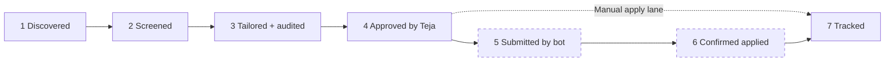

# Roadmap and open gaps

_Written 2026-11-08 against 2a9ac31._ One later commit, `2936e8c` (2026-11-08 15:44 IST), landed while this
doc was written. It is folded in below and marked where it matters.

This page says what is done, what is in progress, what is blocked and what comes next. It is a snapshot.
The live work list is always the newest pair in [`docs/handoff/`](../handoff/) (`ls docs/handoff | tail -2`).
Every number here carries the command that regenerates it. Re-run the command; do not copy the number.

---

## What it is

`applyyy` is Teja's personal, autonomous job-application pipeline. It finds jobs, screens them, scores them,
writes a one-page tailored resume for each, and puts them in a queue. Teja approves each one by hand. Then a
bot (a Playwright worker) fills the form and submits it. The email tracker records replies.

The product goal (repo `CLAUDE.md` section 1) is **one human-approved pipeline running end-to-end for real**:
discovered, screened, tailored, approved, submitted, confirmed applied, tracked. Progress is measured against
that goal, stage by stage. A stage counts only when it has run on live rows.

## Why it exists

The problem: applying by hand is slow and repetitive, and generic resumes score badly with ATS keyword filters.
The system automates the repetitive part, but keeps a human gate at the point that matters (approval), and an
honesty gate on the resume (the auditor). Background and the full "why": [vision-and-why.md](vision-and-why.md).

The rulings that shape the current roadmap:

| Ruling | Date | Effect on the roadmap |
|---|---|---|
| Submission is automatic **after** human approval | Teja ruled 2026-10-09 (`c557533`) | Stage 5 is a bot submit, never a bot decision |
| Receipt-confirm (stage 6) is on hold | Teja ruled (see the 2026-11-08 00:45 handoff) | Stage 6 is parked, not failing |
| Every resume is ONE page, tailored and after edits | Teja ruled 2026-11-07 | Shipped in `41d7430`, `7a78d05`, `dc8ac5c` |
| A row the bot cannot apply to goes to Manual apply with a kit; the bot never ticks declarations | Teja ruled 2026-11-07 22:55 | Manual lane shipped (`f5511e9`, merged `e4ae103`) |
| Matcher advance floor 30 (was 45); never remove the floor | Teja ruled 2026-11-07 22:45 | `95df3f3`, deployed |
| The orchestrator runs real bot submits itself through `apply.yml` | Teja ruled 2026-11-07 23:02 | The first bot submit needs no hand-off runbook |
| Never list Teja's own hand-applying as a task | Teja ruled 2026-11-07 | Not on this roadmap by design |
| SmartRecruiters boards are off (robots `Disallow: /`) | Teja ruled 2026-11-01 | Coverage gap accepted |
| Unknown location PASSES the work-auth gate | Teja ruled 2026-11-05 | Leak accepted on purpose |

## How it works (the stages)



Dashed boxes are not proven yet. The Manual apply lane (dotted arrow) is how every `applied` row has got there so
far: Teja applied by hand and marked it.

Full technical flow: [pipeline-end-to-end.md](../architecture/pipeline-end-to-end.md). Status graph:
[schema-and-status-graph.md](../db/schema-and-status-graph.md).

## Progress: 71% (5 of 7 stages)

Re-derived 2026-11-08 ~15:50 IST from code and live state, not copied from the handoff.

| # | Stage | State | Evidence (code) |
|---|---|---|---|
| 1 | Discovered | Live | `supabase/functions/scout-ats/`, `supabase/functions/scout-web/`, `.github/workflows/scout.yml`, `scout-remote.yml` |
| 2 | Screened | Live | `supabase/functions/_shared/screen/screen-batch.ts` (screen at insert), `supabase/functions/screener/` |
| 3 | Tailored and audited | Live | `supabase/functions/tailor/`, `supabase/functions/auditor/` |
| 4 | Approved by Teja | Live | Approval queue in `apps/web/src/features/` |
| 5 | **Submitted by the bot** | **Not proven** | `worker/src/apply-one.ts`, `.github/workflows/apply.yml`; no worker submit on a live row yet |
| 6 | **Confirmed applied (receipt)** | **On hold** | Teja's ruling |
| 7 | Tracked | Live | `supabase/functions/email-tracker-intake/`, `supabase/functions/gmail-sync/` |

**Basis:** 5 of 7 stages have run on live rows. The gap is stages 5 and 6. The proof query:

```sql
select agent, count(*) from public.application_events where to_status = 'applied' group by 1;
```

On 2026-11-08 it returned one row: `agent = human`. No `applied` transition came from the worker. The first bot
submit moves the figure to **86% (6 of 7)**. Stage 6 stays parked until Teja lifts the hold.

Status mix for context (re-run, never quote):
`select status, count(*) from public.applications group by 1 order by 2 desc;`

## Done (verified against code)

Each item was checked in the code at HEAD, not only in a handoff.

| Item | Commit | Where in code | Deployed? |
|---|---|---|---|
| One-page rule: typography ladder, then a pure trim; skills, summary, education never removed | `41d7430`, `7a78d05`, `dc8ac5c` | `supabase/functions/_shared/tailor/page-trim.ts` (`fitToOnePage`) | Web: yes (Vercel on push). Tailor: updated ~00:46 IST 2026-11-08, which matches the `dc8ac5c` background deploy (time only, not hash-proven) |
| Matcher floor 30, with a human-pick bypass | `95df3f3` | `MATCH_ADVANCE_FLOOR = 30` and `decideScoreThreshold(score, humanPicked)` in `supabase/functions/_shared/match/score-threshold.ts` | Yes (matcher, job-link-intake) |
| Auditor: skill in a bullet not tied to its entry, and unsupported summary skills | `11e858f` | `supabase/functions/auditor/` | Yes |
| ATS panel back on the approval card | `1fbf21d` | `apps/web/src/features/` (approval) | Yes (web) |
| Manual apply lane: "Bot can't apply" reason, open questions answerable on the card | `f5511e9` / `e4ae103` | `apps/web/src/features/manual-apply/` | Yes (web) |
| Non-ATS feed liveness through the SSRF guard | `8f91837`..`af7a410` | `supabase/functions/scout-ats/` | Yes |
| Workday refused by the bot and by the rehearsal | 2026-11-07 | `isWorkdayJob` in `worker/src/workday.ts`, called from `worker/src/apply-one.ts` and `worker/src/cli/rehearse-assist.ts` | Worker runs from `main` |
| Kit rebuild when an answer is saved (`{"kit_only": true}` dispatches only `apply-kit.yml`) | `2936e8c` (landed after 2a9ac31) | `supabase/functions/dispatch-apply/handler.ts`, `apps/web/src/features/settings/answerBankStore.ts` | Web: yes. **dispatch-apply: NOT yet** (see gaps) |
| "Fitted to one page (smaller type)" hint | `2936e8c` | `apps/web/src/features/resume-preview/renderPreview.ts`, `ResumePreview.tsx` | Yes (web) |

## In progress (uncommitted in the shared tree)

Describe these as work in flight. They are not on `main`.

- **Rehearsal empty-page gate.** `worker/src/assist/rehearse.ts` gains a call to `formShapeBlockersFor`, a new
  export that the uncommitted edit to `worker/src/apply-one.ts` pulls out of the applier's existing empty-page
  gate. It is not on `main` yet. The goal is that a page with 0 form fields cannot rehearse as "ready". Today (committed) the
  rehearsal CLI already FAILs when the **kit** has 0 fields (`Number(kit.fields) > 0` in
  `worker/src/cli/rehearse-assist.ts`), but a live page with 0 fields still passes. This is pending task P1 #4.
- Edits to `worker/src/apply-one.ts`, `worker/test/rehearse.test.ts`,
  `supabase/functions/_shared/screen/work-auth-gate.ts` and its sibling test. Read `git diff` before relying on them.

## Next (priority order)

### P0

1. **First bot submit, TrueFoundry `d0a7d313`** (Backend Interns, Greenhouse). On 2026-11-08 it is still
   `awaiting_approval`. Steps:
   1. Teja approves it in the queue.
   2. Wait for the kit (built by `apply-kit.yml` on approve).
   3. Run `node --env-file=.env worker/src/cli/rehearse-assist.ts --id <uuid>`. It must exit 0.
   4. The orchestrator runs `gh workflow run apply.yml --ref main -f dry_run=false -f apply_only_id=<uuid>`.
   5. Confirm an `applied` event with a non-human agent (query above).
   This proves stage 5.
2. **Deploy `dispatch-apply` from `2936e8c`.** The live function was last updated ~2026-11-05 23:00 IST, before the
   `kit_only` code existed. Until it ships, saving an answer does not rebuild the kit. Order is safe: the web
   already sends `kit_only`, and an old function treats it as the approve path while `auto_apply` is off.
   Verify: `supabase functions list` (order by `updated_at`).
3. **Re-run Tether `04d5c6e4` and L&T `7890ff1b`.** Both are `failed` with `page_overflow` from before the dense
   rungs. They need a human edge back to `passed_filters`, then `run-one.yml`.

### P1

- **Low-score rows Teja wants to apply to** (Teja, 2026-11-08 00:48 IST): LSEG (2 rows), FIS, Barclays (2 rows),
  DocCheck AG. For each, read why it scored low or why the tailor failed, show Teja, and on his yes send it on
  as a human pick (the `humanPicked` bypass of the floor). Open question: do several skill-fit rows below 30
  mean the matcher under-weights skills? Measure first; the floor stays 30 unless Teja rules.
- Rehearsal empty-page gate (in progress, above).
- Canonical `8e9d58ce`, Fractal, `58868e0a`: re-tailored to one page, so Teja re-approves them. Canonical has 15
  open questions, including an AI-use declaration, so it goes to Manual apply, never the bot.
- Watch the first live events carrying `page_fit_trimmed`, `summary_variant` and the new auditor findings.

### P2

- Rule ceiling: an amount-first pay string like "$125k (US)" is not matched.
- Lever radio groups: speculative, no live fixture needs it.
- **Auto-apply switch and `APPLYY_CRON_LIVE`**: only after stage 5 is proven. The token behind
  `GITHUB_APPLY_DISPATCH_TOKEN` expires around 2027-02-03.
- Clean up stale `%TEMP%` worktrees (remove junctions first).
- `packages/shared-types/SCHEMA_CONTRACT.md` has a stale two-member `AuditFinding` union.
- Self-hosted runner ([2026-11-05-self-hosted-runner.md](../ops/2026-11-05-self-hosted-runner.md)); Supabase CLI v3.

### P3 (waiting on Teja)

- Receipt-confirm (stage 6): on hold.
- WhatsApp alerts: needs Teja's Meta setup.

## Rules and guardrails for this roadmap

- **Live writes, deploys and `db push` belong to the orchestrator**, on Teja's yes in its own window. A relayed
  "Teja approved" is not authority (repo `CLAUDE.md` section 2).
- **Deploy from a clean worktree pinned to a SHA**, with `--import-map supabase/functions/deno.json`
  (section 3). The CLI ships the working tree, which here holds peers' uncommitted edits.
- **Consumer before producer** for a new response shape (section 3).
- **A "done" in a handoff is a claim.** The 2026-11-08 00:45 handoff listed the kit-rebuild work as uncommitted;
  it was committed later as `2936e8c`. The same handoff said rehearse-assist had no zero-field guard; the kit
  check does guard 0 kit fields, and only the live-page check is missing.
- **Never remove the matcher floor** (Teja ruled 2026-11-07). Fix leaks upstream in the screener.
- **The bot never ticks a declaration** and never applies on Workday. Those rows go to Manual apply.

## Known gaps and open questions

| Gap | Evidence | Why it matters |
|---|---|---|
| Bot submit never proven on a live row | `applied` events are all `agent = human` | Stage 5; blocks auto-apply |
| `dispatch-apply` live version predates `kit_only` | `supabase functions list`, `updated_at` | Saving an answer does not rebuild the kit yet |
| Tailor deploy SHA is inferred from time, not hash | `updated_at` ~00:46 IST vs the handoff's "if the background deploy finished" | Tether and L&T re-runs assume the dense rungs are live |
| `degree_mismatch` never fires | Nothing writes `jobs.requires_advanced_degree`; `supabase/functions/_shared/filter/cascade.ts` skips with a warning | A screening rule exists only on paper |
| `applications.ats_keyword_coverage` has no writer | Only read in `supabase/functions/_shared/agent/port.ts` and fixtures | Column is always null |
| `application_status_transitions` does not force RLS | `select relforcerowsecurity from pg_class where relname='application_status_transitions';` | Undecided; see [PROGRESS.md](../PROGRESS.md) |
| 15 India answers are `attested_by_human = false` | Inserted by CLI on 2026-11-07 | Only a browser save by Teja stamps them; an agent must not |
| Receipt-confirm (stage 6) | On hold | Caps progress at 86% until lifted |

Open questions for Teja:

1. Should the matcher weigh JD skills more, given six skill-fit rows scored 13 to 27?
2. When should receipt-confirm (stage 6) come off hold?
3. After the first bot submit, turn on `APPLYY_CRON_LIVE` and auto-apply, or keep one-by-one dispatch?

## Related docs

- [vision-and-why.md](vision-and-why.md), [user-journey.md](user-journey.md), [features/auto-apply.md](features/auto-apply.md),
  [features/manual-apply-lane.md](features/manual-apply-lane.md)
- [pipeline-end-to-end.md](../architecture/pipeline-end-to-end.md)
- [schema-and-status-graph.md](../db/schema-and-status-graph.md)
- [functions/README.md](../functions/README.md)
- [web-app.md](../features/web-app.md)
- [ci-and-workflows.md](../ops/ci-and-workflows.md)
- [PROGRESS.md](../PROGRESS.md), [PROJECT_PLAN.md](../../PROJECT_PLAN.md)
- Newest handoff pair: [orchestrator handoff](../handoff/2026-11-08-1745-orchestrator-handoff.md),
  [pending tasks](../handoff/2026-11-08-1745-pending-tasks.md)
