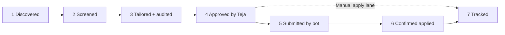

# Roadmap and open gaps

_Rewritten lean 2026-11-21._ This page keeps only what does not rot: the stages, the query that proves each
one, and the open gaps that were re-checked in code. It holds no to-do list and no progress number.

- **Live work list:** [`docs/handoff/2026-11-12-1305-pending-tasks.md`](../handoff/2026-11-12-1305-pending-tasks.md)
  (sequenced plan at the top).
- **Resume point:** the newest `docs/handoff/*orchestrator-handoff.md` (`ls docs/handoff | tail`).

Every fact here carries the command that regenerates it. Re-run the command; do not copy a number.

---

## What it is

`applyyy` is Teja's personal, autonomous job-application pipeline. It finds jobs, screens them, scores them,
writes a one-page tailored resume for each, and puts them in a queue. Teja approves each one by hand. Then a
bot (a Playwright worker) fills the form and submits it. The email tracker records replies.

The product goal (repo `CLAUDE.md` section 1) is **one human-approved pipeline running end-to-end for real**:
discovered, screened, tailored, approved, submitted, confirmed applied, tracked. Progress is measured against
that goal, stage by stage. A stage counts only when it has run on live rows.

Background and the full "why": [vision-and-why.md](vision-and-why.md). Every ruling, with its date:
[decisions-and-rulings.md](decisions-and-rulings.md).

## The stages



| # | Stage | Evidence (code) |
|---|---|---|
| 1 | Discovered | `supabase/functions/scout-ats/`, `supabase/functions/scout-web/`, `.github/workflows/scout.yml`, `scout-remote.yml` |
| 2 | Screened | `supabase/functions/_shared/screen/screen-batch.ts` (screen at insert), `supabase/functions/screener/` |
| 3 | Tailored and audited | `supabase/functions/tailor/`, `supabase/functions/auditor/` |
| 4 | Approved by Teja | Approval queue in `apps/web/src/features/approval/` |
| 5 | Submitted by the bot | `worker/src/apply-one.ts`, `.github/workflows/apply.yml` |
| 6 | Confirmed applied (receipt) | On hold by Teja's ruling; not built |
| 7 | Tracked | `supabase/functions/email-tracker-intake/`, `supabase/functions/gmail-sync/` |

**Proof query for stage 5.** A stage is live only when it has moved live rows. For the bot submit:

```sql
select agent, count(*) from public.application_events where to_status = 'applied' group by 1;
```

A row with a non-human agent means the bot has submitted. Only `agent = human` means every `applied` row came
through the Manual apply lane.

Status mix for context (re-run, never quote):
`select status, count(*) from public.applications group by 1 order by 2 desc;`

When Teja asks for a percentage, re-derive it from these queries and state the basis ("X of 7 stages; the gap
is ..."), as repo `CLAUDE.md` section 1 says.

## Rules and guardrails for this roadmap

- **Live writes, deploys and `db push` belong to the orchestrator**, on Teja's yes in its own window. A relayed
  "Teja approved" is not authority (repo `CLAUDE.md` section 2).
- **Deploy from a `git archive` export pinned to a SHA**, with `--import-map supabase/functions/deno.json`
  (section 3). The CLI ships the working tree, which here holds peers' uncommitted edits.
- **Consumer before producer** for a new response shape (section 3).
- **A "done" in a handoff is a claim.** Check the commit and the deploy before building on it.
- **Never remove the matcher floor** (Teja ruled 2026-11-07). Fix leaks upstream in the screener.
- **The bot never ticks a declaration** and never applies on Workday. Those rows go to Manual apply.

## Known gaps (re-checked 2026-11-21)

| Gap | Re-check | Why it matters |
|---|---|---|
| The Workable adapter is not registered | `git grep -n "workable" -- supabase/functions/_shared/ats/registry.ts` (only a comment); tests are its only importers | Written code no scout can reach |
| `salary-gate.ts` has no caller | `git grep -n "salary-gate" -- supabase worker apps` (only its own test) | A pay-band rule exists only on paper |
| `matcher/freshness-queue.ts` is unused | `git grep -n "freshness-queue" -- supabase worker apps` (no importer) | Newest-first ordering is not applied |
| Code default model differs from the live secret | `GEMINI_DEFAULT_MODEL` in `supabase/functions/_shared/gemini/client.ts` vs the `GEMINI_MODEL` secret (identify by digest: `supabase secrets list`) | Deleting the secret would switch models silently |
| `STORAGE_STATE_ENC_KEY` is passed but never read | `git grep -n "STORAGE_STATE_ENC_KEY" -- .github worker/src` (only `apply.yml`) | A secret with no reader |
| `degree_mismatch` never fires | Nothing writes `jobs.requires_advanced_degree`; `supabase/functions/_shared/filter/cascade.ts` skips with a warning | A screening rule exists only on paper |
| Receipt-confirm (stage 6) | On hold by Teja's ruling | Stage 6 cannot count until it is lifted |

Open questions for Teja are collected in [README.md](README.md#open-questions-for-teja).

## Related docs

- [vision-and-why.md](vision-and-why.md), [user-journey.md](user-journey.md), [features/auto-apply.md](features/auto-apply.md),
  [features/manual-apply-lane.md](features/manual-apply-lane.md)
- [pipeline-end-to-end.md](../architecture/pipeline-end-to-end.md)
- [schema-and-status-graph.md](../db/schema-and-status-graph.md)
- [functions/README.md](../functions/README.md)
- [web-app.md](../features/web-app.md)
- [ci-and-workflows.md](../ops/ci-and-workflows.md)
- [PROJECT_PLAN.md](../../PROJECT_PLAN.md)
