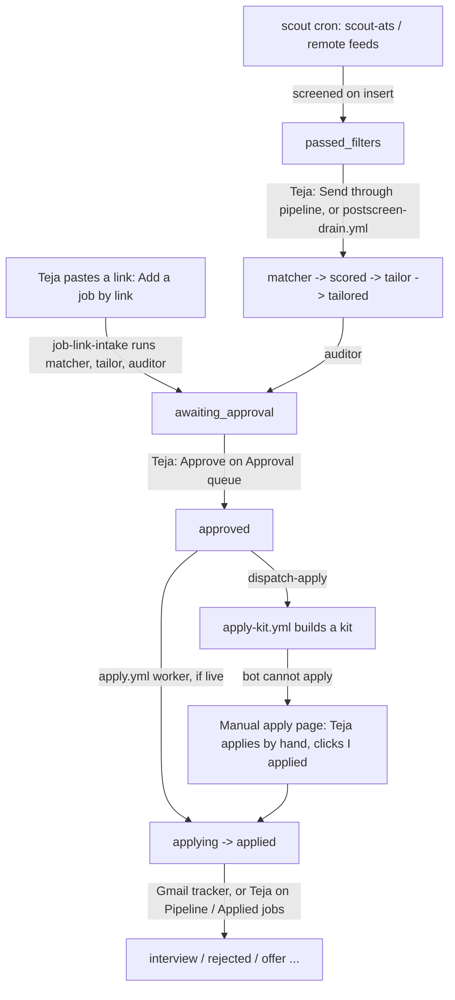

# User journey: a day with applyyy

_Written 2026-11-08 against 2a9ac31._

## What it is

This page follows Teja through one day of using applyyy. It lists the dashboard pages in the order he
uses them, what he clicks, and what the system does between his clicks (scheduled workflows, edge
functions, the worker). It describes committed code. Work that is still uncommitted is marked "in progress".

The dashboard is the React app in `apps/web/`, live at https://applyyy.vercel.app/. Every page is listed
once in `apps/web/src/app/routes.ts`. The router (`apps/web/src/App.tsx`) and the nav rail
(`apps/web/src/app/AppShell.tsx`) both read that list. `/` opens the Approval queue (`DEFAULT_ROUTE = 'approvals'`).

## Why it exists

- **The problem.** Applying to many jobs by hand takes hours a day. Most of that time is copying the same
  facts into forms and adjusting a resume. The system does that work. Teja keeps the decisions.
- **The budget for his time.** The approval page is designed for about 12 minutes a day at about 35
  applications (header of `apps/web/src/features/approval/ApprovalQueuePage.tsx`, PROJECT_PLAN.md §11).
- **A human gate before any submit.** Nothing is sent before Teja approves it. Since c557533 (2026-10-09)
  submission after approval is automatic (`SUBMISSION_IMPLEMENTED=true` in `worker/src/playwright-page.ts`),
  so the Approve click is the last human check.
- **Automate, do not hand-dispatch.** Teja ruled 2026-10-24: per-row work (kits, drafts) is started by the
  system on a state change or a schedule, never by an agent loop or a human click.
- **But the costly stages run when he starts them.** Teja ruled 2026-11-05 that the drains
  (`prescreen-drain.yml`, `postscreen-drain.yml`, `pregate-sweep.yml`) run manually only. The matcher drops
  rows one-way and uses Gemini quota, so a human starts every bulk run.

## How it works

### The day at a glance

Times are IST. GitHub cron is best-effort and often starts late (repo `CLAUDE.md` §4). Read real start
times with `gh run list --workflow=<file>`.

| When (IST) | Who | What happens |
|---|---|---|
| 05:47, 09:47, 17:47 | `scout.yml` (cron) | `scout-ats` polls the company watchlist. New jobs are screened on insert: they land at `passed_filters` or `dropped_filter`. |
| 07:00 | `scout-remote.yml` (cron) | Remote job feeds are polled the same way. |
| Morning | Teja | Opens the dashboard. Picks jobs on **Discovered jobs**, or pastes a link. Starts the tailoring. |
| Any time | Teja | Reviews and approves on the **Approval queue**. |
| On every approve | `dispatch-apply` edge function | Starts `apply-kit.yml`. Starts the applier only if the auto-apply switch is on. |
| 08:00 (cron; really later) | `apply.yml` | The daily applier. A scheduled run is DRY unless the repo variable `APPLYY_CRON_LIVE` is `true`. |
| 17:30 | `apply-kit.yml` (cron backstop) | Builds any missing manual-apply kits. Also runs after every `apply.yml` run. |
| 18:53 | `satellites.yml` (cron) | Skill-gap, follow-up, cover-letter, interview-prep and referral drafts. No status moves. |
| Every hour | Gmail Apps Script trigger | `email-tracker.gs` posts new emails to `email-tracker-intake`, which can advance post-apply statuses. |
| Weekly / every 3 days | `jobs-tombstone.yml`, `keepalive.yml` | Housekeeping and keeping the free Supabase project awake. |

Regenerate the schedule: `grep -n "cron:" .github/workflows/*.yml`.

### The flow

Full status graph: [docs/db/schema-and-status-graph.md](../db/schema-and-status-graph.md). Read the live
edges with `select * from application_status_transitions where from_status = '<s>'`.

### Step 0: sign in

`apps/web/src/features/auth/LoginPage.tsx`. Every page is wrapped in a guard in `App.tsx`. Without a
session, Teja sees the login page.

### Step 1: one-time and occasional setup (Configuration section)

He visits these rarely. They feed every later step.

| Page (route) | What he does | What it feeds |
|---|---|---|
| Search preferences (`/search-preferences`) | Target titles, skills, locations, pay. Also the kill switch (`system_enabled`), daily cap, and the **auto-apply on approve** switch (`system_settings.auto_apply_on_approve`). | Screener, applier, `dispatch-apply`. |
| Master profile (`/master-profile`) | Upload or edit the master resume. Each save is a new master version. | Tailor and auditor. Nothing may appear on a tailored resume that the master does not back. |
| Answer bank (`/answer-bank`) | Answers to common form questions. Unanswered questions from real forms show up here. | Worker form fill and manual-apply kits. |
| Filters (`/filters`) | Pre-screen rules and drop thresholds. | Screener. |
| Company watchlist (`/watchlist`) | ATS boards to poll. | `scout-ats`. |
| Blocklist (`/blocklist`) | Companies and agencies to skip. | Screener. |

Code: `apps/web/src/features/settings/`.

### Step 2: pick jobs (Discovered jobs, `/discovered`)

Code: `apps/web/src/features/discovery/DiscoveredJobsPage.tsx`.

- **What he sees.** Jobs found by the scouts, in lanes. The "Ready to tailor" lane shows rows the screener
  already moved to `passed_filters`.
- **Send through pipeline.** One click per card. The browser calls the deployed matcher, tailor and
  auditor for THIS row (`?application_id=`). Each function moves the row with its own agent key. The
  browser writes no status (Teja ruled 2026-10-08). Engine:
  `supabase/functions/_shared/pipeline/row-pipeline.ts`.
- **Reject.** One click per card: `passed_filters -> dropped_filter` as `human`, with Undo (Teja ruled 2026-11-01).
- **Add a job by link.** A header button opens a box for one URL
  (`apps/web/src/features/discovery/AddJobLinkPanel.tsx`). The `job-link-intake` function inserts the row
  at `passed_filters` (it skips the filters) and runs matcher, tailor and auditor on the server, so closing
  the tab is safe (Teja ruled 2026-11-01). A pasted link skips the robots.txt check, because a human chose it.
- **Bulk run.** `postscreen-drain.yml` drains every queued row on its own after each scout finishes and once a day
  (Teja ruling 2026-11-09). The orchestrator can also dispatch it by hand, e.g. `from_stage=tailor` for a re-run.

What runs in between: matcher (scores; rows below the floor of 30 are dropped, Teja ruled 2026-11-07),
tailor (writes a one-page tailored resume), auditor (flags claims the master does not back, then moves the
row to `awaiting_approval`).

### Step 3: review and approve (Approval queue, `/approvals`)

Code: `apps/web/src/features/approval/`. This is the page the whole product is built around.

- **Two buckets.** Bucket B (any claim the auditor could not trace to the master) comes first, open, one
  full diff per row (`DiffView.tsx`). Bucket A (every line traced) is a count with one "Approve all" button.
  The order is deliberate: risky rows must not be skimmed past.
- **Edit the resume.** Hand edits, or the AI chat panel (`AiEditPanel.tsx`, calls the `resume-assist`
  function). Every save is fitted to one page (`pageFitEdit.ts`). Teja ruled 2026-11-07: every resume is
  ONE page, before and after edits. A trim shows a toast and is recorded in the event.
- **Attest.** If a skill or bullet is true but missing from the master, he can attest it
  (`attestSkill.ts`, `attestBullet.ts`). This writes it into the master, so it is backed next time.
- **ATS chip.** Shows "ATS N% verified · +M% from edits" and keyword chips (shipped 1fbf21d).
- **Approve.** For an edited row, the auditor's own check runs again in the browser (`approveCheck.ts`,
  Teja ruled 2026-11-05: "Check on Approve, hold for a 2nd click"). A finding holds the row until a second
  click. Anything the check cannot read counts as held, never as clean.
- **After approve.** The page calls `dispatch-apply` once (`dispatchApply.ts`). That function always
  starts `apply-kit.yml`. It starts the applier only if `auto_apply_on_approve` is exactly `true`;
  otherwise the answer is `skipped` / `auto_apply_off`, which is the normal state.
- **Reject.** Drops the row. No re-check needed.

Warning (Teja ruled 2026-11-07): a bulk re-tailor while he is approving can swallow his clicks. Agents
tell him to stay off this page during bulk moves.

### Step 4: submission (no page; the worker)

- `apply.yml` runs `worker/` with Playwright. It submits `approved` rows, at most 3 per run, with a circuit
  breaker. A robots.txt gate runs before the apply page opens.
- A scheduled run is DRY unless `APPLYY_CRON_LIVE=true`. One real submit:
  `gh workflow run apply.yml --ref main -f dry_run=false -f apply_only_id=<uuid>`.
- Workday is not bot-supported (`worker/src/workday.ts`). The bot never ticks consent or declaration boxes.
- A form the bot cannot finish goes to `blocked_needs_human`, or to the Manual apply lane.

### Step 5: apply by hand (Manual apply, `/manual-apply`)

Code: `apps/web/src/features/manual-apply/ManualApplyPage.tsx` (committed version; edits to this folder are
in progress).

- **Why.** Greenhouse's captcha refuses CI submits (2026-10-24). Some jobs can only be sent from Teja's browser.
  Teja ruled 2026-11-07: when the bot cannot apply, the row goes here with a kit.
- **What he sees.** One card per job: "Bot can't apply: <reason>", every form answer in form order with a
  Copy button, the resume to download, and open questions he can answer in the card. His answers there go
  into the answer bank and are stamped `attested_by_human`, because only a browser save with his session
  does that.
- **What he clicks.** He opens the job, pastes the answers, submits it himself, then clicks
  **I applied (mark applied)**, or **Failed / skip**. Both go through `advance_application_status` as `human`.
- **Left your queue.** A collapsed list of approved jobs that left without being applied, with Re-open.
- Kits are built by `worker/src/apply-kit.ts` (and `apply-kit-sweep.ts`). A kit never moves a status.

### Step 6: track what happens (Pipeline, Applied jobs, Email monitoring)

| Page (route) | What he sees | What he can do |
|---|---|---|
| Pipeline (`/pipeline`) | A board with one column per status, derived from the status list, not hand-written. Live updates via Supabase Realtime. | Human moves on the edges the graph allows, for when the tracker is down. |
| Applied jobs (`/applied`) | Every submitted application: stage, the resume that was sent, matched emails (approved by Teja 2026-11-04). | Stage moves with an inline confirm. No browser dialogs (Teja ruled 2026-11-04). |
| Email monitoring (`/emails`) | Recruiter emails, interview detection. | Opening the page (or "Refresh Interviews") calls `gmail-sync`, at most once a minute. |

The hourly Apps Script trigger (`supabase/functions/_shared/apps-script/email-tracker.gs`) posts emails to
`email-tracker-intake`. That function classifies each email, matches it to an application, and can advance
post-apply statuses (for example to interview or rejected).

### Step 7: evening drafts (satellite pages)

`satellites.yml` runs at 18:53 IST and writes drafts only. Teja reads them the next time he opens:

- Referral queue (`/referrals`): cold outreach drafts (`referral` function).
- Follow-up nudges (`/nudges`): Day-7 follow-up drafts (`follow-up` function).
- Skill gap analytics (`/skill-gap`): missing skills ranked across rows (`skill-gap` function).
- Interview prep shows inside the Pipeline and Applied pages (`interview-prep` function). Cover letters
  are drafted by `cover-letter`, but the worker never attaches one.

### Step 8: check the system is alive (System health, `/health`)

Code: `apps/web/src/features/health/HealthPage.tsx`. Every panel shows an AGE, not a green tick. The two
silent failures are a paused Supabase project (one week idle) and GitHub disabling crons (60 days of no
repo activity). Neither raises an error. This page also holds the `blocked_needs_human` queue (with the
worker's screenshot), manual-control coverage, and the Gemini key pool.

## Rules and guardrails

- Every status change goes through `advance_application_status()`. The web never writes a status directly.
- Machine agents must send the `x-applyy-agent-key` header. A browser call without it counts as human.
- Approve is the last human gate. Approved rows can be submitted with no further click.
- One page per resume, always. Skills, summary and education are never trimmed.
- No `alert`/`confirm`/`prompt`. Confirmation is inline (`apps/web/src/app/InlineConfirm.tsx`).
- Drains are manual only. Kits and satellites are automatic.
- The bot never answers consent or declaration questions, and never submits on Workday.
- SmartRecruiters boards are not polled (robots ruling, Teja 2026-11-01).

## Known gaps and open questions

- **Bot submit is not yet proven end to end** (handoff 2026-11-08 00:45: 5 of 7 stages live). The first
  target, a TrueFoundry row, waits for Teja's approval.
- **Receipt confirmation (stage 6) is on hold** by Teja's ruling.
- **Nothing scores `passed_filters` on a schedule.** New jobs wait until Teja clicks Send through pipeline,
  pastes a link, or a drain is dispatched. This is by ruling, but it means the queue does not fill itself.
- **`rehearse-assist` has no zero-field guard** (pending P1); a form with 0 fields can read as ready.
- **Stale comments found while writing this page:**
  - `supabase/functions/email-tracker-intake/index.ts` says Apps Script retries "on next 15-minute trigger
    cycle"; the script installs `everyHours(1)`.
  - `apps/web/src/app/routes.ts` says "The nine pages" and "three are worked daily"; the file lists 16 routes.
    `AppShell.tsx` says "Ten screens".
- WhatsApp alerts wait on Teja's Meta setup (pending P3).

## Related docs

- [docs/architecture/pipeline-end-to-end.md](../architecture/pipeline-end-to-end.md)
- [docs/db/schema-and-status-graph.md](../db/schema-and-status-graph.md)
- [docs/functions/README.md](../functions/README.md)
- [docs/features/web-app.md](../features/web-app.md)
- [docs/ops/ci-and-workflows.md](../ops/ci-and-workflows.md)
- [docs/setup/gmail-tracker-apps-script.md](../setup/gmail-tracker-apps-script.md)
- [docs/handoff/2026-11-08-1745-orchestrator-handoff.md](../handoff/2026-11-08-1745-orchestrator-handoff.md)
