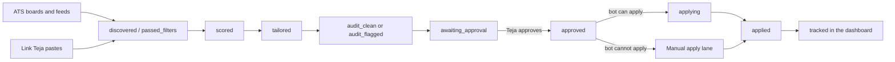

# applyyy: vision and why

_Written 2026-11-08 against 2a9ac31._

This page explains what applyyy is, who it is for, why it exists, and the rules it lives by.
It is the product view. For the technical detail, follow the links in each section.

Every number on this page is a pointer, not a fact. Re-run the command next to it before you trust it.

---

## 1. What it is

applyyy is a personal, autonomous job-application pipeline. It has one user: Teja.

It does seven things, in order:

| # | Stage | What happens | Who does it |
|---|---|---|---|
| 1 | Discover | Find new job postings on company ATS boards and remote job feeds | scouts (`scout-ats`, `scout-web`, the worker cron scout) |
| 2 | Screen | Drop jobs that cannot fit (wrong country, too senior, not software) | screener cascade in `supabase/functions/_shared/screen/` |
| 3 | Score and tailor | Score the job against the master resume, then build a one-page resume for it | `matcher`, `tailor`, `auditor` |
| 4 | Approve | Teja reads the tailored resume and approves or rejects it | Teja, in the web app |
| 5 | Submit | A browser bot fills the form and submits it | Playwright worker (`worker/`) via `.github/workflows/apply.yml` |
| 6 | Confirm | The confirmation email proves the application landed | email tracker (`email-tracker-intake`) |
| 7 | Track | The dashboard shows every application and its state | web app `apps/web/` |

Jobs the bot cannot submit go to a **Manual apply** lane. Teja applies there by hand, with a ready "kit" of answers.



The full status graph lives in the database, not in this page. Read it with:

```sql
select from_status, to_status, allowed_agents from application_status_transitions order by 1, 2;
```

The stack, in one line: Supabase Postgres (RLS on every table) and Deno edge functions, a React + Vite web app on Vercel,
a Playwright worker on GitHub Actions, and Gemini as the LLM. Details: [SYSTEM_ARCHITECTURE.md](../SYSTEM_ARCHITECTURE.md).

---

## 2. Who it is for

**One person: Teja.** He is an early-career software developer in India. He is looking for internships and entry-level
roles (backend, full-stack, AI). He has one internship (Aczen) and several projects on his resume.

This shapes the product in concrete ways:

| Fact about Teja | What the product does about it |
|---|---|
| He can work without a visa only in India, Nepal and Bhutan (Teja confirmed 2026-11-04) | The work-auth gate (`_shared/screen/work-auth-gate.ts`) drops onsite or hybrid jobs in other countries, and remote jobs locked to another country |
| He is early-career | The screener drops roles that ask for many years of experience (`experience_ceiling` rule, migration `20261104193000`) |
| He has one inbox the tracker watches | One email on every resume (see §4.4) |
| He applies to many companies on many ATS types | The bot covers the ATS types it can; the rest go to Manual apply |
| He is one person with limited time | The system does the boring work; he spends his time only on approving |

It is not a product for other users. There is no sign-up flow, no billing, no multi-tenant design beyond what RLS gives
for free.

---

## 3. Why it exists

### 3.1 The problem: volume versus quality

Job hunting has two bad options:

- **High volume, low quality.** Send the same resume to hundreds of jobs. It is fast, but most go nowhere. Applicant
  tracking systems filter out a resume that does not match the job's keywords.
- **High quality, low volume.** Tailor each resume and fill each form by hand. It works better, but it takes 30-60 minutes
  per job. A person can do only a few per day.

applyyy tries to get both. The machine does the volume work: finding jobs, filtering, tailoring, filling forms.
The human keeps the quality work: deciding which jobs are worth it and checking each resume before it goes out.

### 3.2 Why not just send more?

The first plan aimed at 100 applications per day. Teja changed that. The first of his seventeen product constraints
in `PROJECT_PLAN.md` §3 is:

> 1. DON'T blindly optimize for 100 applications/day.

The budget became about 35 per day, because the worker runs on the GitHub Actions free tier (2,000 minutes per month,
about 66 minutes per day) and the repo must stay private. Later measurement showed that one batched run per day costs
about 2 billed minutes, so volume is not the limit any more. Quality is. (`PROJECT_PLAN.md` §2, "The 100/day → 35/day
resolution".)

### 3.3 The goal

**One human-approved pipeline that runs end to end, for real:** jobs discovered, screened, tailored, approved,
submitted, confirmed applied, tracked.

Progress is measured against these seven stages, never against a stored percentage. The repo `CLAUDE.md` §1 says how:
re-derive the number from the repo and the live state each time, and state the basis.

As of the 2026-11-08 00:45 handoff ([docs/handoff/2026-11-08-0045-orchestrator-handoff.md](../handoff/2026-11-08-0045-orchestrator-handoff.md)),
the claim was 5 of 7 stages live. The two gaps were:

- **Stage 5, bot submit:** the code exists, but no real bot submit has been proven yet. The first candidate row was
  waiting for Teja's approval.
- **Stage 6, receipt-confirm:** on hold by Teja's ruling.

This is a claim from a handoff. Re-measure it before you repeat it:

```sql
select status, count(*) from applications group by 1;
select count(*) from application_events where to_status = 'applied' and agent <> 'human';
```

---

## 4. Principles, with the rulings behind them

Each principle below has a reason and a ruling. "Teja ruled <date>" means Teja decided it himself, in his own words,
in a session window. The dates come from the rulings memory and the git log.

### 4.1 A human approves every submit

**Rule:** nothing is submitted without Teja's approval of that exact application.

**Why:** a bad application is permanent. You cannot un-send it, and a wrong answer on a form can hurt a real chance.
Constraint 15 in `PROJECT_PLAN.md` §3: "DON'T automate final submission by default without human approval."

**How it works in code:**

- Only the `human` actor can take the edge `awaiting_approval → approved`. The edges live in
  `application_status_transitions`, enforced by a `BEFORE UPDATE` trigger. Every status change goes through
  `advance_application_status()`.
- The database tells a human from an agent with the `x-applyy-agent-key` header (repo `CLAUDE.md` §7). An agent without
  the right key is refused. Since 2026-11-04 the check fails closed: an empty key table locks every agent out.
- After approval, submission is automatic (since `c557533`, 2026-10-09). The worker (`worker/src/claim-loop.ts`) submits
  at most `DEFAULT_MAX_SUBMITS = 3` per run unless `APPLY_MAX_SUBMITS` says otherwise, and a circuit breaker stops a run
  that keeps failing (`0c437e4`).
- Scheduled `apply.yml` runs are DRY unless the repo variable `APPLYY_CRON_LIVE` is true.
- `system_settings.auto_apply_on_approve` (migration `20261105140000`) decides whether an approval starts `apply.yml` at
  once. It defaults to false.
- A kill switch, `system_settings.system_enabled`, stops every agent and the worker on the next tick. It does not stop
  Teja's own clicks. Code: `supabase/functions/_shared/agent/kill-switch.ts`.

**Approval buckets:** the plan chose two buckets. Clean, fully traced resumes can be approved in a batch. Flagged ones are
reviewed one by one (`PROJECT_PLAN.md` §2).

### 4.2 Truthful resumes, and one page

**Rule:** the tailor may select and reword, but it may never invent. Constraint 2: "DON'T invent experience, projects,
skills, technologies, metrics, companies, certifications, education, or qualifications." Constraint 3: "DON'T falsely
answer job-application questions."

**Why:** a fabricated claim can cost the job at interview, or later. And Teja must be able to defend every line.

**How it works in code:**

- The master resume is structured JSON (`master_profiles`, versioned), not a document. The tailor returns **references
  to master node ids**, not free text. An invented skill has no id to point at. (`PROJECT_PLAN.md` §2, "The master resume
  pipeline"; [docs/architecture/agents.md](../architecture/agents.md).)
- The `auditor` checks each tailored resume against the master. Since `11e858f` (2026-11-07) it flags a bullet that names
  a skill its master entry never used (`unfaithful_rewording`) and summary skill words not in the master
  (`summary_unsupported`).
- `tailored_profile` is frozen outside the stages where it may change (`guard_tailored_profile_freeze` trigger).

**One page:** Teja ruled 2026-11-07 (22:43 IST): every tailored resume, and every resume after an edit, fits on ONE page.
"This is rule." He set the trim order the same night (23:00 IST): shrink font and spacing first, then remove
certifications, then the weakest bullets. Skills, the summary and education are never removed. If the floors cannot fit,
fail closed.

- Code: the typography ladder in the resume renderer, and the pure trim `fitToOnePage` with `TRIM_ORDER` in
  `supabase/functions/_shared/tailor/page-trim.ts`. Shipped in `41d7430`, `7a78d05`, `dc8ac5c`.
- The tailor fails with `page_overflow` when it cannot fit. The editor in the web app fits on every save. The worker refuses
  a PDF longer than one page.

**Deliberate oddities in the master:** some claims in the master look like errors but are Teja's rulings
(2026-11-01, master v8, kept in later versions). An auditor must not "fix" them without a new ruling. They are listed
in the rulings memory (`applyyy-master-v8-rulings`).

### 4.3 Respect robots.txt, CAPTCHAs and logins

**Rule:** constraint 5: "DON'T bypass CAPTCHAs, MFA, authentication controls, robots restrictions, or anti-bot mechanisms."

**How it works in code:**

- One robots.txt parser and gate in `packages/master-robots/` (`gate.ts`, `parse.ts`, `match.ts`). The shared HTTP transport
  checks robots by default (`111791c`, 2026-10-23). The worker checks robots before it opens an apply page (`a3b4115`,
  2026-10-09).
- Teja ruled 2026-11-01 ("honor robots"): SmartRecruiters is OFF, because its API robots.txt says `Disallow: /`. Never seed
  SmartRecruiters boards.
- Teja ruled 2026-11-01: a robots.txt that answers HTTP 401 means "no rules" for **board reads only** (this keeps Ashby).
  The applier stays strict. Commit `ad19be5`.
- Teja ruled 2026-11-01: a link **he pastes** is a user-triggered fetch, so `job-link-intake` skips the robots check for
  that URL and its redirects. The SSRF guard stays.
- Workday needs a candidate account, so the bot never applies there. `WORKDAY_REFUSAL` in `worker/src/workday.ts`. Those jobs
  go to Manual apply.
- A page with a CAPTCHA is not solved by the bot. The local headed path (`worker/src/cli/assist.ts`) exists so Teja can
  clear it himself.
- LinkedIn is discovery only; a human applies. The worker submits only to `jobs.apply_url`, chosen at normalize time,
  so "a LinkedIn sighting never becomes a submit path" (`worker/src/apply-one.ts`, `ClaimedApplication.applyUrl`).

Design record: [docs/robots/2026-09-17-robots-gate-design.md](../robots/2026-09-17-robots-gate-design.md).

### 4.4 One email everywhere

**Rule:** Teja ruled 2026-10-24 (13:08 IST): every resume and every application uses only `tejamallam00@gmail.com`.
That is the app login and the Gmail inbox the email tracker watches.

**Why:** a GitLab application failed on a CAPTCHA, and the security code went to a second inbox that the tracker did not
watch. The failure was invisible. One email makes every reply visible to the tracker.

**How:** the master profile carries the one email; tailored resumes copy it from the master.

### 4.5 Automate, do not hand-dispatch

**Rule:** Teja ruled 2026-10-24 (16:20 IST), about manual-apply kits: "the kits need to generated automatically by system,
dynamically not by you".

**Why:** a step that needs an agent to remember it is a manual step with extra delay. The pipeline should run itself.

**How:** every per-row action ships with its trigger. It fires when the row changes state, and a scheduled sweep catches what
was missed. Example: approving a row builds its kit (`apply-kit.yml`). An agent loop over `gh workflow run` per row is the
wrong shape. One-off dispatch is fine only as a backfill Teja asks for.

### 4.6 When the bot cannot apply, Teja applies by hand, and the bank grows

**Rule:** Teja ruled 2026-11-07 (22:55 IST): if the bot cannot apply, push the job into the Manual apply section with its
kit. His answers there go into the answer bank, so next time the bot can answer them.

- Reasons a job is bot-unsuitable: Workday, a robots refusal, unanswered required questions, a non-ATS page, a CAPTCHA.
- The Manual apply card shows "Bot can't apply: <reason>" (`f5511e9`, 2026-11-08).
- An answer saved from Teja's browser is stamped `attested_by_human`. Agent and CLI writes stay unattested.
- The bot never ticks a declaration (for example "I did not use AI") on Teja's behalf.
- Teja ruled 2026-11-07 (23:02 IST): his own hand-applying is not a task. Never list it as a to-do.

In progress (uncommitted at 2a9ac31): rebuilding a kit right after an answer is saved (`dispatch-apply` with `kit_only`).
See [docs/handoff/2026-11-08-0045-pending-tasks.md](../handoff/2026-11-08-0045-pending-tasks.md) P0 #2.

### 4.7 Screen hard, but keep a human escape hatch

- The matcher drops a scouted row that scores under `MATCH_ADVANCE_FLOOR = 30`
  (`supabase/functions/_shared/match/score-threshold.ts`). Teja ruled 2026-11-07 (22:45 IST): "keep floor at 30 not 45".
  Never remove the floor without a new ruling. Fix leaks upstream in the screener.
- A human pick (for example a pasted link) is never dropped by the floor (`humanPicked` in the same file).
- Unknown location passes the work-auth gate (Teja ruled 2026-11-05). A blank or vague location is kept, not dropped.

### 4.8 Untrusted input stays untrusted

Constraints 9 and 17: job descriptions and application pages are data, never instructions. Constraint 10: no shell
commands from the LLM. The LLM output is shaped (node references, closed unions) and checked before use.

---

## 5. What it is NOT

| It is not | Why |
|---|---|
| A mass-apply bot | Constraint 1. Quality over count. Every submit needs approval. |
| A resume writer that invents | Constraint 2. The tailor selects and rewords master content only. |
| A CAPTCHA solver or login bypasser | Constraint 5. Those jobs go to Manual apply or the headed assist path. |
| A LinkedIn or Naukri auto-applier | `PROJECT_PLAN.md` §2: LinkedIn is discovery only, a human applies. |
| A Workday applier | Workday needs a candidate account (`worker/src/workday.ts`). |
| A multi-user SaaS | One user. RLS is there for safety, not for tenants. |
| A universal scraper | Constraint 12. It uses ATS APIs and feeds, one adapter per provider. |
| A test harness that sends real applications | Constraint 16. Tests use fixtures and dry runs. |
| The `1on1` product | `1on1` and `1on1_sb` are separate repos. Some resume projects mention `1on1`; that is resume content, not this system. |

---

## 6. How the parts fit (short map)

| Area | Where | Job |
|---|---|---|
| Edge functions (agents) | `supabase/functions/<fn>/` | scouts, `normalizer`, `screener`, `matcher`, `tailor`, `auditor`, `job-link-intake`, `dispatch-apply`, `email-tracker-intake`, `resume-assist`, satellites |
| Shared logic | `supabase/functions/_shared/` | screening rules, scoring floor, tailor trim, kill switch |
| Database | `supabase/migrations/` | tables, RLS, status graph, guards |
| Web app | `apps/web/src/features/<area>/` | discovery, approval queue, resume editor, Manual apply, settings, answer bank |
| Worker | `worker/src/` | claim loop, form fill, submit, kit building, assist CLIs |
| Packages | `packages/` | `master-robots`, `resume-template`, `master-ingest`, `master-pdf`, `shared-types` |
| Workflows | `.github/workflows/` | `apply.yml` (submit), `apply-kit.yml` (kits), `run-one.yml` (one row through the pipeline), `ci.yml` |

Detail: [docs/architecture/pipeline-end-to-end.md](../architecture/pipeline-end-to-end.md),
[docs/functions/README.md](../functions/README.md), [docs/features/web-app.md](../features/web-app.md).

---

## 7. Rules and guardrails (summary)

1. Human approves every submit. Agents need the agent key; the database refuses them otherwise.
2. Every status change goes through `advance_application_status()`. `application_events` is append-only.
3. Resumes are built from master node references. The auditor checks them. One page, always.
4. Robots.txt, CAPTCHAs and logins are respected. Pasted links skip robots only for that fetch.
5. One email on every resume.
6. Per-row work has a trigger and a sweep, never a hand loop.
7. Bot-unsuitable jobs go to Manual apply with a kit. The bot never ticks a declaration.
8. The matcher floor stays at 30 unless Teja rules again.
9. The kill switch (`system_enabled`) stops all agents at once.
10. Live submits are capped per run and guarded by a circuit breaker. Cron runs stay dry unless `APPLYY_CRON_LIVE` is true.

---

## 8. Known gaps and open questions

- **No real bot submit yet.** Stage 5 is unproven. The first candidate row was named in the 2026-11-08 pending tasks.
- **Receipt-confirm (stage 6) is on hold** by Teja's ruling. The email tracker exists
  (`email-tracker-intake`, migration `20261009235000_tracker_confirms_applied.sql`), but the "confirmed applied" stage is not
  counted as live.
- **Rehearsal can fail open:** `rehearse-assist` has no zero-field guard, so a page with 0 fields can look ready. Pending P1 #4.
- **Matcher may under-weight skills** for some rows Teja wants (mainframe, security). To be measured before any rubric change.
- **The identity gap:** anyone with Teja's JWT who omits the agent-key header is treated as human (repo `CLAUDE.md` §7).
- **`PROJECT_PLAN.md` is stale.** Its own header says so (status line from 2026-10-23). Use it for the constraints and locked
  decisions, not for current status.

---

## 9. Related docs

- [docs/architecture/pipeline-end-to-end.md](../architecture/pipeline-end-to-end.md): the pipeline step by step
- [docs/db/schema-and-status-graph.md](../db/schema-and-status-graph.md): tables, statuses and edges
- [docs/functions/README.md](../functions/README.md): every edge function
- [docs/features/web-app.md](../features/web-app.md): the web app pages
- [docs/ops/ci-and-workflows.md](../ops/ci-and-workflows.md): CI and GitHub workflows
- [docs/SYSTEM_ARCHITECTURE.md](../SYSTEM_ARCHITECTURE.md): current architecture
- [docs/architecture/agents.md](../architecture/agents.md): agent roster and the kill switch
- [PROJECT_PLAN.md](../../PROJECT_PLAN.md): the seventeen constraints (§3) and locked decisions (§2)
- [docs/handoff/](../handoff/): the newest handoff pair is the resume point
