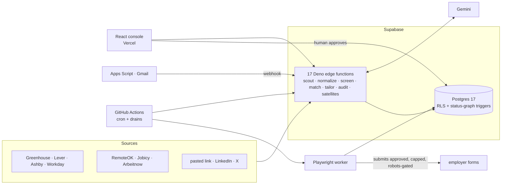

# Tech stack overview — snapshot 2026-11-05

**Dated record — never edited.** This is the one-page summary of the full inventory taken at
`00ecabb` on 2026-11-05, with the live Supabase and GitHub state read the same night. Each
section links to its detail file. For the current, living architecture, read
[../SYSTEM_ARCHITECTURE.md](../SYSTEM_ARCHITECTURE.md). For the commands that regenerate
every number here, read [README.md](README.md).

## What it is

An autonomous job-application pipeline with one human gate. Scouts discover jobs. A
deterministic screener drops most of them. Gemini scores what is left and tailors a résumé
that can only *reference* facts from the master profile. An auditor checks for fabrication.
Teja approves. A Playwright worker submits, capped and robots-gated. An email tracker follows
each application to offer or rejection.

## Headline numbers

| | |
|---|---|
| **Tracked files** | 733 |
| **Code lines** (non-blank, non-comment) | 92,449, plus 71,309 comment lines |
| **Languages** | TypeScript **84.6 %** (`.ts` 70.9 % + `.tsx` 13.7 %) · CSS 7.1 % · SQL 4.9 % · YAML 2.0 % · HTML 0.7 % · JS 0.4 % · Apps Script 0.3 % · TOML 0.1 % |
| **Tests** | 36 % of non-blank code lines; 227 test files (88 edge, 82 web, 40 worker, 15 packages, 1 api, 1 SQL) |
| **Lines per file** | mean 283, median 188; 21 files over 1,000 lines |
| **Runtime units** | 28: 1 SPA, 1 Vercel function, 1 Postgres, 17 edge functions, 7 worker CLIs, 1 Apps Script |
| **Hosting platforms** | 4: Vercel, Supabase, GitHub Actions, Google Apps Script |
| **Agents** | 17 `agent_name` values; 9 functions call Gemini |
| **Workflows** | 12 (1 CI, 6 scheduled, 5 dispatch-only); 39/39 action refs SHA-pinned |
| **Third-party integrations** | 17 services (+3 adapters written but unwired) |
| **Database** | 22 tables, RLS on all 22; 26 functions; 26 triggers; 15 enums; 50 migrations (local = applied) |
| **Dependencies** | 19 direct npm packages, 200 resolved; 1 Deno specifier |
| **Vulnerabilities** | **0 prod**; 1 moderate dev-only (vite 6.4.4); 59 Dependabot alerts fixed all-time |
| **History** | 478 commits since 2025-12-29 |

## Stack at a glance

| Layer | Choice |
|---|---|
| Frontend | React 18.3.1 + React Router 7.18.4 + Vite 6.4.4, TypeScript, hand-written CSS with `light-dark()` tokens |
| Backend | Supabase: Postgres 17 (RLS everywhere, the status graph enforced by triggers), 17 Deno edge functions |
| Worker | Node 24 + Playwright 1.55.1 on GitHub Actions |
| Serverless render | Vercel Node function + `@sparticuz/chromium` 140 |
| LLM | Google Gemini via plain `fetch` (no SDK), multi-key pool with failover |
| Email | Google Apps Script reading Gmail, pushing to an edge webhook |
| Package manager | pnpm 11.25.0, enforced |
| Tests | `node --test` (type-stripped TS), Vitest (worker), Playwright e2e (web) |
| CI/CD | GitHub Actions (CI + cron); Vercel Git auto-deploy; Supabase deploys by hand from a pinned worktree |

## Architecture in one picture

## Pipeline state at snapshot

33,523 applications. 98.4 % are `dropped_filter`, the cheap deterministic screen doing its job.
1.2 % are `failed`, 43 `awaiting_approval`, 35 `passed_filters`, 13 `scored`, 11 `approved`,
and **2 `applied`**. Scheduled applier runs are dry, because `APPLYY_CRON_LIVE` is unset. Real
submits happen only by explicit dispatch.

## Findings worth acting on

1. **vite 6.4.4 → 6.4.5**: closes the only open advisory (dev-only). The lockfile write needs a
   scheduled window.
2. **Wildcard CORS** on every edge function. Pin it to `https://applyyy.vercel.app`.
3. **No secret scanning**: GitHub scanning is off on this private repo. Add gitleaks to CI.
4. **The Deno tree is unaudited**, and supabase-js is split between 2.50.0 (Node) and 2.58.0
   (Deno) with the Deno pin repeated in 7 files. Move it to the `deno.json` import map.
5. **Leaked-password protection is off** in Supabase Auth; 2 SECURITY DEFINER functions can be
   called by `authenticated`.
6. **The CSP still allows Apps Script hosts** that the browser no longer calls.
7. **The approval feature is the size hot spot**: three of the four largest web files.
8. **Docs drift fixed in this pass**: `SYSTEM_ARCHITECTURE.md` was 13 days stale. It was
   missing 3 functions, 6 workflows, the Vercel function and 5 status edges (2 more had
   changed agents), and it described
   the agent key as fail-open when it has been fail-closed since 2026-11-04.

## Detail files

| File | Covers |
|---|---|
| [2026-11-05-languages-loc-files.md](2026-11-05-languages-loc-files.md) | language %, LOC, files, lines per file, largest files, per-area split |
| [2026-11-05-frameworks-dependencies.md](2026-11-05-frameworks-dependencies.md) | runtimes, frameworks, every dependency with version, version skew |
| [2026-11-05-services-agents-modules.md](2026-11-05-services-agents-modules.md) | 28 runtime units, every agent, every module, tests |
| [2026-11-05-integrations-apis-ci.md](2026-11-05-integrations-apis-ci.md) | 17 integrations, APIs in and out, 12 workflows, hosting config |
| [2026-11-05-database.md](2026-11-05-database.md) | tables, RLS, functions, triggers, enums, advisors, live status |
| [../security/2026-11-05-vulnerability-remeasure.md](../security/2026-11-05-vulnerability-remeasure.md) | ranked vulnerabilities, audit detail, trend since 10-05 |
