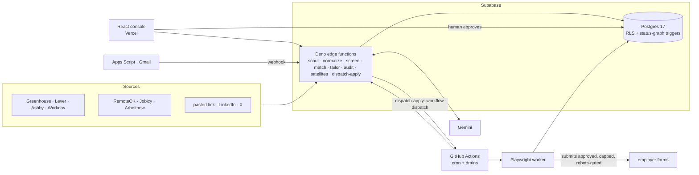

# Tech stack overview

_Last verified against code: 2026-11-08 (2a9ac31)._

The one-page summary of the stack. Each section links to its detail file. For how the parts
connect at runtime, read [../SYSTEM_ARCHITECTURE.md](../SYSTEM_ARCHITECTURE.md). For the
commands that regenerate every number here, read [README.md](README.md).

## What it is

An autonomous job-application pipeline with one human gate. Scouts discover jobs. A
deterministic screener drops most of them. Gemini scores what is left and tailors a résumé
that can only *reference* facts from the master profile. An auditor checks for fabrication.
Teja approves. A Playwright worker submits, capped and robots-gated. An email tracker follows
each application to offer or rejection.

## Headline numbers (as of 2026-11-08)

Every number below is "as of 2026-11-08 at `2a9ac31`". The right column says how to get
today's value.

| | Value | Regenerate |
|---|---|---|
| Tracked files | 883 | `node scripts/repo-stats.mjs` |
| Code lines (non-blank, non-comment) | 106,187 | same |
| Languages | TypeScript 85.7 % (`.ts` 73.0 % + `.tsx` 12.7 %) · CSS 6.1 % · SQL 4.6 % · YAML 1.9 % · HTML 0.7 % · JS 0.5 % · Apps Script 0.3 % · TOML 0.1 % | same |
| Tests | 39 % of non-blank lines (74,803 of 191,847) | same |
| Edge functions | 18 | `ls supabase/functions/*/index.ts` |
| Worker CLIs | 9 | `ls worker/src/cli` |
| Workflows | 13 (1 CI, 7 scheduled, 5 dispatch-only) | `ls .github/workflows`; `grep -n "cron:" .github/workflows/*.yml` |
| `agent_name` values | 18 | `select unnest(enum_range(null::agent_name))` |
| Functions that call Gemini | 9 | see [services](2026-11-05-services-agents-modules.md#agents) |
| Database | 23 tables, RLS on all; 60 migrations, local = applied | see [database](2026-11-05-database.md) |
| Direct npm packages | 19 (200 resolved in the lockfile) | `node scripts/repo-stats.mjs` |

## Stack at a glance

| Layer | Choice | Declared in |
|---|---|---|
| Frontend | React 18.3.1 + React Router 7.18.4 + Vite 6.4.5, TypeScript, hand-written CSS with `light-dark()` tokens | `apps/web/package.json` |
| Backend | Supabase: Postgres 17 (RLS everywhere, the status graph enforced by triggers), Deno edge functions | `supabase/config.toml`, `supabase/functions/` |
| Worker | Node 24 + Playwright 1.55.1 on GitHub Actions (plus local assisted runs) | `worker/package.json` |
| Serverless render | Vercel Node function + `@sparticuz/chromium` 140.0.0 | root `package.json`, `api/render-job-page.ts` |
| LLM | Google Gemini through plain `fetch` (no SDK), multi-key pool with failover | `supabase/functions/_shared/gemini/client.ts` |
| Email | Google Apps Script reading Gmail, pushing to an edge webhook | `supabase/functions/_shared/apps-script/email-tracker.gs` |
| Package manager | pnpm 11.25.0, enforced | root `package.json` (`packageManager`, `preinstall`) |
| Tests | `node --test` (type-stripped TS), Vitest (worker), Playwright e2e (web) | each `package.json` `test` script |
| CI/CD | GitHub Actions (CI with gitleaks, plus cron); Vercel Git auto-deploy; Supabase deploys by the orchestrator from a pinned worktree | `.github/workflows/`, `vercel.json`, `CLAUDE.md` §3 |

## Architecture in one picture

## What changed since the first snapshot (2026-11-05 at `00ecabb`)

| Change | Evidence |
|---|---|
| New edge function `dispatch-apply`: on approve it starts `apply-kit.yml`, and starts the live `apply.yml` drain only when `system_settings.auto_apply_on_approve` is true (off live on 2026-11-08) | `supabase/functions/dispatch-apply/handler.ts`, migration `20261105140000_auto_apply_on_approve.sql` |
| New weekly workflow `jobs-tombstone.yml` slims old rejected `jobs` rows to free database space; new agent name for it | migrations `20261105200000_jobs_tombstone.sql`, `20261105201000_jobs_tombstone_agent_name.sql` |
| `scout.yml` runs three times a day, not two | `.github/workflows/scout.yml` (`17 0,12 * * *` and `17 4 * * *`) |
| New table `unanswered_questions`: the worker records each required form question it could not answer | migration `20261105230000_unanswered_questions.sql`, `worker/src/apply-one.ts` |
| New web page `/applied` | `apps/web/src/features/applied/`, `apps/web/src/app/routes.ts` |
| New worker CLIs `rehearse-assist` (read-only submit rehearsal) and `resume-pages` (one-page check) | `worker/src/cli/` |
| SmartRecruiters adapter deleted | `supabase/functions/_shared/ats/registry.ts` (comment), commit `2fe0264` |
| Findings closed: vite 6.4.4 to 6.4.5; CORS pinned to `https://applyyy.vercel.app` (+ localhost); gitleaks in CI; supabase-js pinned once in the Deno import map; 2 SECURITY DEFINER functions no longer callable by `authenticated`; Apps Script hosts removed from the CSP | `apps/web/package.json`, `supabase/functions/_shared/cors.ts`, `.github/workflows/ci.yml`, `supabase/functions/deno.json`, migration `20261105203000_revoke_definer_execute_and_truncate.sql`, `vercel.json` |

## Open items worth knowing

1. **supabase-js versions still differ**: 2.50.0 on the Node side (`apps/web`, `worker`) and
   2.58.0 on the Deno side (`supabase/functions/deno.json`). Same call, two client versions.
2. **Leaked-password protection** in Supabase Auth was off on 2026-11-05. It is a dashboard
   setting, not code. Re-check with MCP `get_advisors` (`type: "security"`).
3. **Stale comments in manifests**: `apps/web/package.json` `description` says "nine settings
   pages"; `tsconfig.base.json:7` says "Vite 7" (the pin is 6.4.5). Harmless at runtime.
4. **The approval feature is the size hot spot**: `ApprovalQueuePage.tsx` is the largest file
   in the repo. See [languages](2026-11-05-languages-loc-files.md#largest-files).

## Detail files

| File | Covers |
|---|---|
| [2026-11-05-languages-loc-files.md](2026-11-05-languages-loc-files.md) | language %, LOC, files, lines per file, largest files, per-area split |
| [2026-11-05-frameworks-dependencies.md](2026-11-05-frameworks-dependencies.md) | runtimes, frameworks, every dependency with version, version skew |
| [2026-11-05-services-agents-modules.md](2026-11-05-services-agents-modules.md) | runtime units, every agent, every module, tests |
| [2026-11-05-integrations-apis-ci.md](2026-11-05-integrations-apis-ci.md) | integrations, APIs in and out, workflows, hosting config |
| [2026-11-05-database.md](2026-11-05-database.md) | tables, RLS, functions, triggers, enums, live status |
| [../security/2026-11-05-vulnerability-remeasure.md](../security/2026-11-05-vulnerability-remeasure.md) | ranked vulnerabilities (dated record) |
