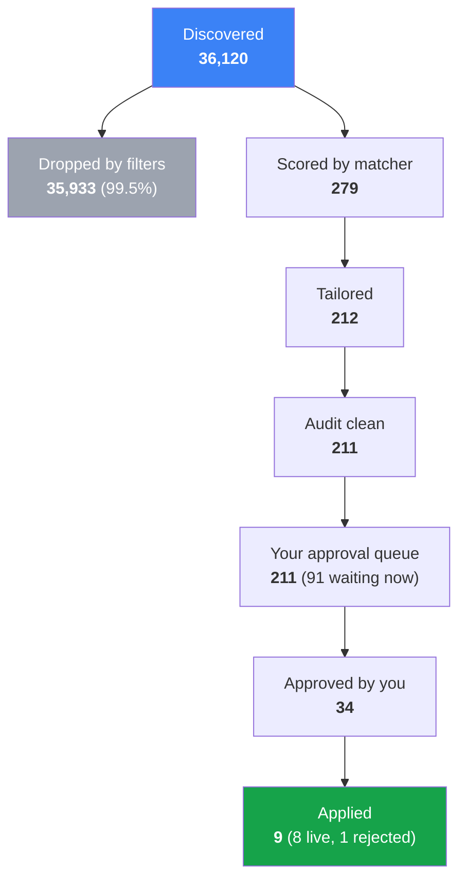
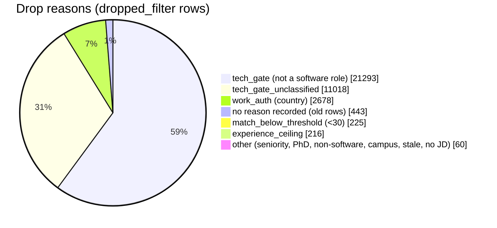
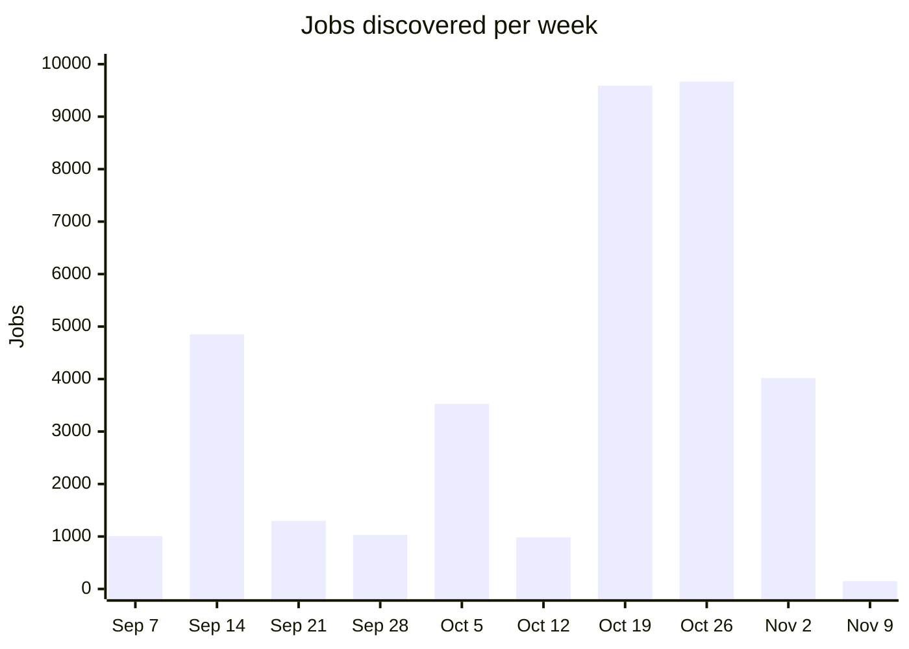
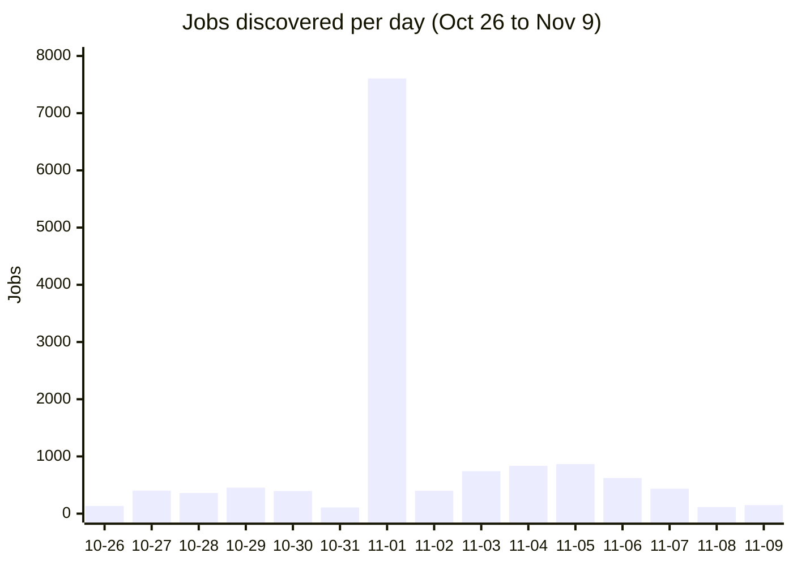
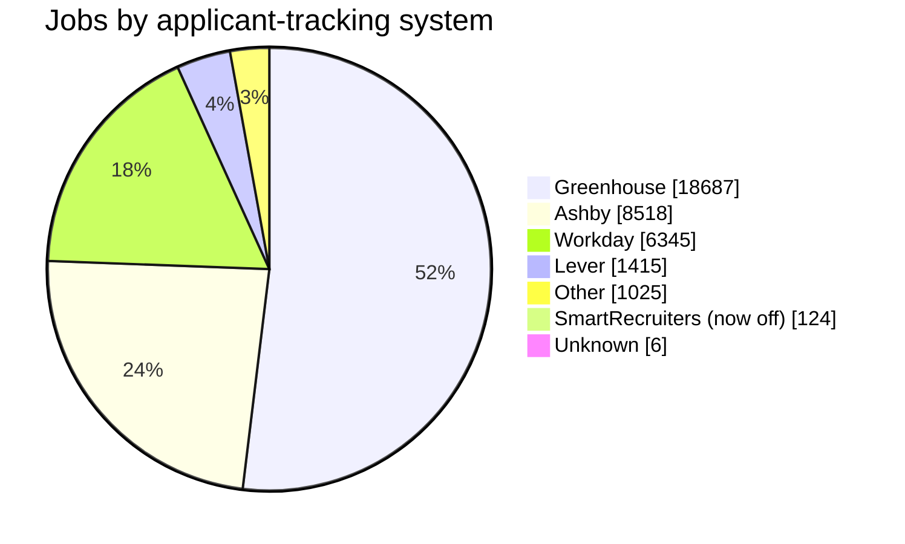
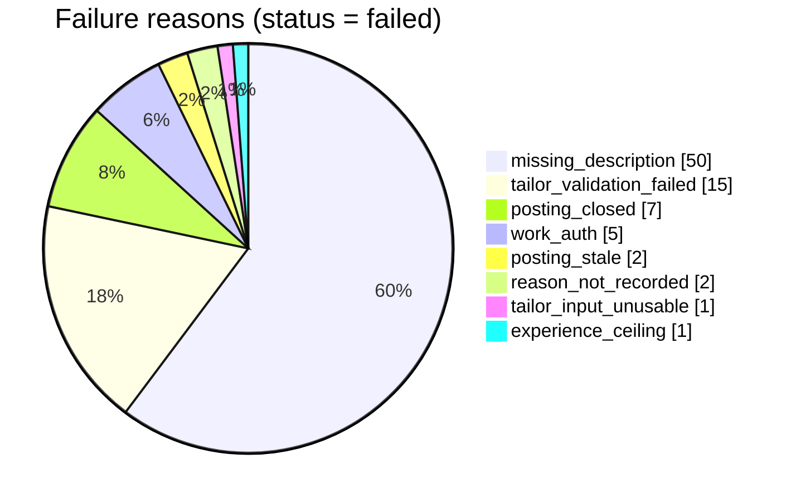
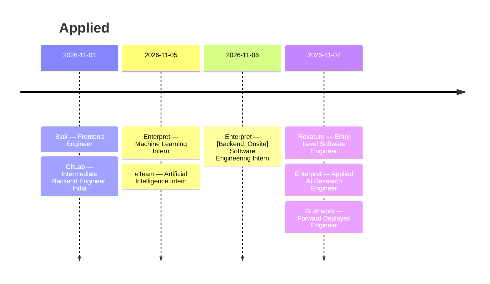

# Pipeline stats — snapshot 2026-11-10 00:03 IST

Live numbers from the production DB (project `xynqxekcqizwhtskzqrq`), read by the orchestrator at 00:03 IST.
**Re-run the queries at the bottom before quoting any of these numbers later** — they move every scout run.

## Headline

| Metric | Value |
|---|---|
| Days running | **58** (first job 2026-09-12, last 2026-11-09) |
| Jobs discovered | **36,120** (≈ 623 / day average) |
| Dropped by filters | **35,933** (99.5 %) |
| Ever scored by the matcher | **279** |
| Ever tailored | **212** |
| Ever reached your approval queue | **211** |
| Approved by you (ever) | **34** |
| **Applied** | **8** (+1 later rejected = 9 submits) |
| Waiting in your queue now | **91** |
| Approved, not yet submitted | **4** |
| Failed (with a reason) | **83** |
| Company boards watched | 299 (261 enabled) |
| Gemini calls recorded | 1,221 over 1,550 agent runs (undercount: the tailor meter only works since e99b758, 2026-11-09) |

Progress toward the goal: **5 of 7 stages (71 %)**. The gap is the first bot submit (the code gates
shipped tonight; it waits on the TrueFoundry approval click) and receipt-confirm.

## The funnel



"Scored / tailored / approved" count distinct applications that ever reached that status
(`application_events`), so a row that later failed or was dropped still counts once.

## Where the 35,933 drops come from



| Reason | Rows |
|---|---|
| tech_gate | 21,293 |
| tech_gate_unclassified | 11,018 |
| work_auth | 2,678 |
| (none — pre-reason rows) | 443 |
| match_below_threshold | 225 |
| experience_ceiling | 216 |
| title_seniority | 20 |
| missing_description | 18 |
| title_phd | 9 |
| title_non_software | 7 |
| campus_restricted | 4 |
| posting_stale | 2 |

## Discovery over time (jobs per week)



The Oct 19 / Oct 26 jump lines up in time with the watchlist expansion on 2026-10-23 (correlation, not
measured per board). The Nov 9 week is partial: only one day of data.

### Last 15 days



11-01 (7,607) is an outlier; its cause is **not verified** in this snapshot. Most other days fall between 100 and 900.

## Where jobs come from (ATS)



## Why the 83 failed rows failed



## The 8 applications that went out



## Current state of every application

| Status | Rows |
|---|---|
| dropped_filter | 35,933 |
| awaiting_approval | 91 |
| failed | 83 |
| applied | 8 |
| approved | 4 |
| rejected | 1 |
| **total** | **36,120** |

## Reading it

- **The filter is doing almost all the work.** 99.5 % of postings are dropped, and all but 225 of them
  (match_below_threshold) before the matcher runs. tech_gate is 59 % of drops; tech_gate plus
  tech_gate_unclassified is 90 %. Gemini calls stay low: 1,221 recorded in 58 days.
- **The bottleneck is after approval, not before.** 211 rows reached your queue, 34 approved,
  9 submitted. Tonight's work (declarations gate, Lever guard, honest rehearsal) is what unblocks
  bot submits on the approved rows.
- **"tech_gate_unclassified" is large (11,018).** Those were dropped because the classifier could not
  decide, not because they were judged non-software. Worth a sample audit for false drops.
- **missing_description is the top failure (50).** These postings had no JD body. Which ATS they came from is not
  broken out here.

## Queries (re-run to refresh)

```sql
select min(created_at)::date, max(created_at)::date, count(*), now()::date - min(created_at)::date from jobs;
select status, count(*) from applications group by 1 order by 2 desc;
select e.to_status, count(distinct e.application_id) from application_events e
  where e.event_type = 'status_change' group by 1 order by 2 desc;
select coalesce(drop_reason,'(none)'), count(*) from applications where status = 'dropped_filter' group by 1 order by 2 desc;
select failure_reason, count(*) from applications where status = 'failed' group by 1 order by 2 desc;
select date_trunc('week', created_at)::date, count(*) from jobs group by 1 order by 1;
select coalesce(ats_provider::text,'none'), count(*) from jobs group by 1 order by 2 desc;
```
