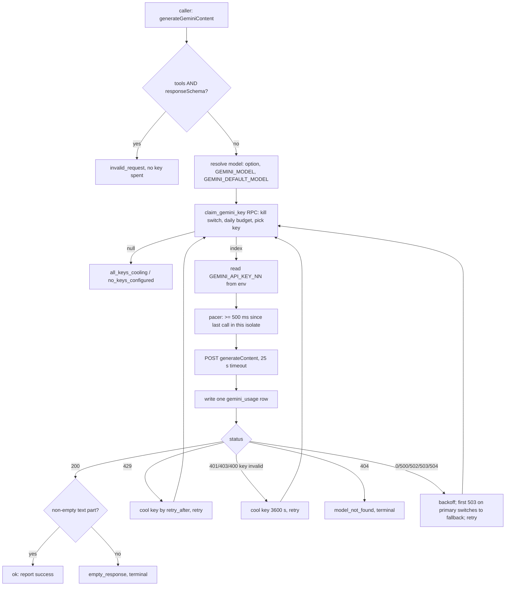

# AI and LLM usage (Gemini)

_Written 2026-11-08 against 2a9ac31._

## What it is

applyyy uses one LLM provider: **Google Gemini**, called over its REST API
(`generativelanguage.googleapis.com/v1beta/models/<model>:generateContent`).
There is no SDK. Every call in the repo goes through **one shared client**:

| File | Job |
|---|---|
| `supabase/functions/_shared/gemini/client.ts` | `generateGeminiContent()`: builds the request, picks the model, retries, falls back, checks the answer is not empty, logs usage. |
| `supabase/functions/_shared/gemini/pool.ts` | `claimKey()` / `reportResult()`: thin wrappers over the SQL key pool. Turns a key INDEX into a key VALUE from the env. |
| `supabase/functions/_shared/gemini/failure-message.ts` | `describeGeminiFailure()` / `formatGeminiFailure()`: one failure line for every caller, with API keys redacted and detail capped at 120 chars. |
| `supabase/functions/_shared/agent/deadline.ts` | Per-call time budget for the batch agents (matcher, tailor), so a run ends before the 150 s Edge Function kill. |

The design rule, repeated in many files: **the LLM proposes, deterministic code
disposes.** Gemini never moves a status, never writes a fact into a resume
without a reference, and never decides what is a "real" job URL. Typed code checks
every answer before anything is stored.

## Why it exists

The pipeline needs language work that rules cannot do well: score a job against
a resume, rewrite bullets for one job, draft a letter. Gemini was chosen because
it has a **free tier** and Teja can hold many keys. The cost of "free" is strict
and changing limits (requests per minute and per day), so most of the client is
about surviving those limits without breaking a batch.

Key decisions and the evidence behind them:

| Date | Decision | Why |
|---|---|---|
| 2026-09 (plan) | Key pool lives in Postgres, not in TypeScript. | Edge Functions are stateless isolates. An in-memory round-robin cursor starts at key 1 in every isolate, so all keys would behave like one (`pool.ts` header). |
| 2026-09 (plan) | No hard-coded quota number. | Google no longer publishes free-tier limits. The pool is reactive: use a key until it 429s, believe its `retry_after`, move on. The only human gate is `system_settings.gemini_daily_call_budget`. |
| 2026-10-05 | Key goes in the `x-goog-api-key` header, never the URL; rotate past rejected keys (7ffc22a). | A URL leaks into logs, stack traces and error text. |
| 2026-10-05 | Retry transient 5xx and network errors (409d226). | `gemini-3.8-flash` gave intermittent 503s and the old code gave up after one call. |
| 2026-10-06 | Teja disabled keys 12-20. | Since 2026-10-05 they answer 403 `PERMISSION_DENIED` "project denied access". One run spent all 4 attempts on dead keys. Keys 1-11 stay live. |
| 2026-10-06 | Optional `GEMINI_FALLBACK_MODEL`, and budget-capped overload backoff (16eb099). | A probe showed a 503 "high demand" is per MODEL, not per key. Rotating keys does not help; switching model does. Teja set `GEMINI_MODEL=gemini-3.5-flash-lite`, and the first live application then tailored and audited clean. |
| 2026-10-09 | Failures carry HTTP status and a redacted detail (d76907e). Pool functions not executable by `anon` (a625d91). | Debuggable failures; no anonymous surface. |
| 2026-10-23 | A 400 `API_KEY_INVALID` rotates and cools the key (4327531). | A key deleted at Google answers 400, not 403. |
| 2026-10-31 | Token-cost controls (`maxOutputTokens`, `thinkingLevel`) added for resume-assist (74fa743). | Thinking tokens are billed as output. A cap bounds the worst-case cost of one call. |
| 2026-11-01 | Batch workflows pace pages at 45 s, 90 s after a quota error (65aafde). | A 429 on every key looked like the daily quota was gone. It was the per-minute window: ~10 calls every ~20 s over 11 keys. |
| 2026-11-02 | Teja asked for usage logging "both the call count and the token counts" (gap W41). Shipped as `gemini_usage` (fe0912c, 2026-11-04). | No way to see spend per agent before. |

## How it works

### Who calls Gemini

Grep that regenerates this list:
`git grep -n "gemini/client" -- supabase/functions ':!*.test.ts'`

| Caller | What Gemini does | Output mode | Prompt lives in | Answer checked by | Triggered by |
|---|---|---|---|---|---|
| `matcher` | Scores a `passed_filters` job against the master resume. | JSON schema | `_shared/match/prompt.ts` | `_shared/match/scorer.ts` + `rubric.ts`; unreadable answers handled by `matcher/fail-exit.ts` | `postscreen-drain.yml`, `pregate-sweep.yml`, `run-one.yml`, `job-link-intake` |
| `tailor` | Rewrites the master resume for one `scored` job; one extra one-shot rewrite call for bullets that failed only on untraceable words (87098fc). | JSON schema | `_shared/tailor/prompt.ts` | `_shared/tailor/validator.ts` (every ref must resolve against the pinned master), `_shared/tailor/tailorer.ts` | `postscreen-drain.yml`, `run-one.yml`, `job-link-intake` |
| `cover-letter` | Drafts a cover letter. | JSON schema | `cover-letter/cover-letter-prompt.ts` | `cover-letter/parse-letter.ts` | `satellites.yml` (daily cron) |
| `follow-up` | Drafts a follow-up nudge for an `applied` row older than seven days. | JSON schema | `_shared/follow-up/prompt.ts` (called from `_shared/follow-up/nudge.ts`) | `nudge.ts` | `satellites.yml` |
| `interview-prep` | Builds interview prep notes. | JSON schema | `_shared/interview-prep/prompt.ts` | `_shared/interview-prep/prep-generator.ts` | `satellites.yml` |
| `referral` | Drafts a referral outreach message. | JSON schema | inline in `referral/index.ts` | `referral/parse-reply.ts` | `satellites.yml` |
| `scout-web` | Finds Greenhouse/Lever/Ashby posting URLs with Google Search grounding. | Free text + `tools: [{ google_search: {} }]` | inline in `scout-web/index.ts` | `scout-web/core.ts` + `urls.ts`: every URL is fetched from the live board before storage | web Discovery page (`apps/web/src/features/discovery/WebScoutPanel.tsx`) |
| `job-link-intake` | Extracts job fields from a pasted job page. | JSON schema | `job-link-intake/extract.ts` (`buildExtractPrompt`) | `job-link-intake/extract.ts` shape check | dashboard "Add a job by link", `ingest-links.yml` |
| `resume-assist` | Proposes resume edit ops on the review page AI box. | JSON schema | `resume-assist/assist.ts` (`buildAssistPrompt`) | `parseAssistOps()` in `resume-assist/assist.ts`; the web's `apps/web/src/features/approval/aiEdit.ts` also refuses unknown op kinds | web review page |

**Not an LLM caller:** the `auditor` is deterministic code (`auditApplication`
in `supabase/functions/auditor/`). `PROJECT_PLAN.md` still lists it as
"Edge Fn, Gemini"; the code wins. `screener`, `normalizer`, `scout-ats`,
`gmail-sync` and `skill-gap` also make no Gemini call.

### One call, step by step

Every retry **claims again**. That is on purpose: the claim is where the kill
switch and the daily budget are checked, so a long retry loop cannot run past
either.

### Model selection

`resolveModel()` in `client.ts` picks, in order:

1. `options.model` from the caller. No production caller sets it.
2. The `GEMINI_MODEL` Supabase secret.
3. `GEMINI_DEFAULT_MODEL` in `client.ts` (`"gemini-3.8-flash"` at 2a9ac31).

**The code default is not what runs live.** Measured 2026-10-31: the
`GEMINI_MODEL` secret was `gemini-3.5-flash-lite` and `GEMINI_FALLBACK_MODEL` was
`gemini-3.6-flash`. Secrets are shown only as sha256 digests. To re-measure,
run `supabase secrets list --project-ref xynqxekcqizwhtskzqrq` (with
`SUPABASE_ACCESS_TOKEN` unset), hash candidate ids with
`printf '%s' <model-id> | sha256sum`, and compare.

`GEMINI_FALLBACK_MODEL` has **no default**. Unset means "never switch". Only a
503 on the primary switches, and only once per call. A 503 on the fallback has
nowhere further to go.

A 404 means the model id is retired or wrong. The previous default,
`gemini-1.5-flash`, was shut down 2025-09-29 and every call 404'd. The fix is a
secret change, not a deploy.

### Key pool

- **Values:** Supabase secrets `GEMINI_API_KEY_01` ... `GEMINI_API_KEY_NN`.
  Zero-padded so string sort equals numeric sort. `discoverConfiguredKeyIndices()`
  scans 1-99, so adding a key needs no code change.
- **State:** table `public.gemini_key_state`, one row per user per key:
  `enabled`, `cooldown_until`, `used_in_cycle`, `last_used_at`,
  `requests_today`, `quota_date`, `consecutive_failures`, `last_error`.
- **Claim:** `public.claim_gemini_key()` (current body in
  `supabase/migrations/20260912001500_gemini_key_pool_cycle_randomization.sql`).
  It is `security invoker`, so RLS keeps each user to their own keys.
  1. Read `system_settings` for this user. `system_enabled` false or missing
     returns NULL (the **kill switch**).
  2. If `gemini_daily_call_budget` is set and `gemini_calls_today` has reached
     it, return NULL. The day is the **Pacific** day (`pacific_today()`),
     because Google resets quota at Pacific midnight.
  3. Pick an enabled, not-cooling key not yet used in this cycle. Key 1 goes
     first in each cycle; the rest are in random order. When every key is used,
     the cycle resets.
  4. Bump `requests_today` and `gemini_calls_today`. Return the key index.
- **Report:** `public.report_gemini_result(key_index, success, retry_after_seconds, error)`
  runs after every attempt. Success clears the failure streak. A 429 sets
  `cooldown_until` from `retry_after`. A transient 5xx passes NULL and leaves
  the cooldown alone, because the outage is the model's, not the key's.
- **Two NULLs:** `claimKey()` tells "all keys cooling / budget spent" (normal,
  self-healing) apart from "no rows at all" (needs a human) with one extra count,
  taken only on the NULL path.
- **Disabled keys:** keys 12-20 are disabled for every user since 2026-10-06.
  New signups get keys 1-11 enabled and 12-20 disabled
  (`applyy_internal.seed_user_defaults`, migration
  `20261009150000_seed_only_live_gemini_keys.sql`). The next dead key needs both
  an UPDATE for existing users and a change to that constant.

Check the live pool (read-only):
`select key_index, enabled, cooldown_until, requests_today, consecutive_failures from gemini_key_state order by user_id, key_index`

### Retry, backoff and timeouts

| Setting | Default | Where |
|---|---|---|
| Retries | 3 (so 4 attempts), shared by 429s, key rejections and transient errors | `callGeminiWithFailover` |
| Per-attempt timeout | 25 000 ms (`AbortSignal.timeout`) | `generateGeminiContent` |
| Short backoff | 1 s / 3 s / 7 s, +0-25% jitter | `BACKOFF_BASE_MS` |
| Overload backoff | Retry-After, else up to 4 s / 16 s / 48 s, capped by the time budget | `OVERLOAD_BACKOFF_MS` |
| Rejected-key cooldown | 3600 s, no sleep | `KEY_REJECTED_COOLDOWN_S` |

Worst case with defaults: 4 x 25 s plus backoff, about 114 s. That is close to
the 150 s Edge Function kill, so callers shrink it:

- `matcher` and `tailor`: `_shared/agent/deadline.ts` plans each row's
  `timeoutMs` / `maxRetries` from the time left in a 120 s budget, with a 10 s
  safety margin. Rows run one after another; the deadline is checked only
  between rows. `deadline.test.ts` reads `client.ts` and fails if the copied
  defaults drift.
- `job-link-intake`: `timeoutMs: 20_000`, `maxRetries: 2`.
- `resume-assist`: `timeoutMs: 20_000`, `maxRetries: 2` (raised from 1 in 254d5f4).

Outcome reasons a caller can see: `ok`, `invalid_request`, `all_keys_cooling`,
`no_keys_configured`, `key_env_missing`, `claim_failed`,
`rate_limited_all_retries_exhausted` (last failure a 429),
`upstream_unavailable` (last failure transient), `model_not_found` (404),
`http_error` (other terminal), `empty_response` (200 with no usable text).

### Pacing and RPM

The free tier allows roughly **15 requests per minute** per model. Two layers
handle this:

1. **In the client:** `defaultGeminiPacer` keeps at least 500 ms between calls.
   It is per isolate only. Two isolates do not see each other.
2. **In the workflows:** the batch callers pace themselves.
   `postscreen-drain.yml` and `ingest-links.yml` wait 45 s after each page and
   90 s after a quota error page. The matcher page is 10 rows, the tailor page 3.

Lesson from 2026-11-01: a 429 on every key is usually the per-minute window,
not the daily quota. Probe with one row before declaring the day lost.

### Output validation

The client checks only transport-level shape: a 200 must have
`candidates[0].content.parts` with at least one non-empty string `text`.
Otherwise it returns `empty_response` (no retry, key not blamed). A 200 with a
body that is not JSON is a terminal `http_error`, not a retried network error.

Each caller then validates its own answer. Main patterns:

- **JSON mode with a schema.** Callers pass `responseSchema`; the client adds
  `responseMimeType: "application/json"`. The schema is a request to the model,
  not a guarantee, so each caller still parses and shape-checks.
- **Untrusted text is fenced.** `_shared/match/prompt.ts` and
  `_shared/tailor/prompt.ts` keep scraped posting text out of the instruction
  region, in a labelled block. Tests check this by string search.
- **Fabrication cannot be expressed.** A tailored bullet must carry a `ref` to a
  master node, and `validateTailoredProfile()` resolves every ref and every
  number against the pinned master version. One lie refuses the whole tailoring.
  This runs before the auditor, so a catchable fabrication never costs a call.
- **Grounding and JSON mode never mix.** The client refuses
  `tools` + `responseSchema` as `invalid_request` before claiming a key.
  scout-web uses grounding, so it takes free text and keeps only URLs that pass
  a live board check.
- **Matcher strikes.** An unreadable answer is a first strike and the row is
  retried. A second strike in a later run fails the row
  (`matcher/fail-exit.ts`, d57eb2d). Rows the tailor would refuse anyway are
  failed before any call (4d57ce0).

### Usage logging and cost

Table `public.gemini_usage` (migration `20261104200000_gemini_usage_log.sql`):
one row per **attempt**, so `count(*)` equals what the pool counted. It stores
agent (from `Deno.mainModule`), key index, model, outcome and Google's token
counts (`prompt_tokens`, `output_tokens`, `thoughts_tokens`, `total_tokens`;
NULL when Google sent none). Append-only; RLS per user. A failed or slow
(>1000 ms) write is dropped with `console.warn("[gemini-usage] ...")` and the
Gemini call still goes through. Queries are in
`docs/tooling/2026-11-02-gemini-usage.md`.

Cost notes:

- Everything runs on free-tier keys. There is no paid billing in the code path.
  The real limits are RPM, requests per day, and `gemini_daily_call_budget`.
- Thinking tokens count inside `maxOutputTokens` and are billed as output.
  `resume-assist` caps output at 2048 tokens and thinking at `"low"`. No other
  caller sets `generation`, so their request bodies are unchanged.
- `thinkingLevel` is a closed union (`low | medium | high`). `"minimal"` is left
  out because `gemini-3.8-flash` answers it with a 400. Check the live model
  before adding any `generationConfig` field.
- The biggest saving is upstream: the screener drops most jobs before the
  matcher, so only survivors cost a call (PROJECT_PLAN.md: "40 LLM calls
  instead of 400").

## Rules and guardrails

- **Every Gemini call goes through `generateGeminiContent()`.** No caller builds
  its own fetch. No caller names a model.
- **The kill switch and budget live in SQL** (`claim_gemini_key()`), so an agent
  that forgets to check them still cannot get a key.
- **The key never appears in a URL or a log.** Header only;
  `failure-message.ts` redacts key-shaped strings and `key=` query params.
- **Never combine grounding and a response schema.**
- **A 200 is not an answer.** Empty or blocked answers are failures.
- **Re-measure, do not trust stored facts.** The live model, the live key
  count and the quota windows all changed during the project. Re-check them
  before acting.
- **Deploy order for usage logging:** migration first, then the Gemini
  functions. Code deployed before the table exists only logs a warning.
- **Do not add a hard-coded quota number.** Google changes them without notice.

## Known gaps and open questions

- **Stale comments in the code:**
  - `pool.ts` says the claim is "least-recently-used". The live SQL since
    `20260912001500` is "key 1 first, then random without replacement per
    cycle". `last_used_at` is still written but does not pick the key.
  - `pool.ts` says `tables.ts` declares `claim_gemini_key` as
    `{ key_index: number }`. `packages/shared-types/src/tables.ts` was corrected
    on 2026-09-10 and now says `number`.
  - `deadline.ts` cites `gemini/client.ts:186` for `BACKOFF_BASE_MS`; it is
    now near line 235. The drift test reads source, not line numbers, so the
    guard still works.
- **PROJECT_PLAN.md lists the Auditor as a Gemini agent.** The auditor makes no
  LLM call.
- **Pacer is per isolate.** Concurrent invocations (web clicks plus a workflow)
  are not paced against each other. Only the workflow gaps and Google's 429s
  protect the RPM window.
- **Same-key retry is not possible.** A 503 is per model, but each retry claims
  a new key. This is deliberate (budget and kill switch), but it spends a
  `requests_today` on a fresh key each time.
- **Disabled-key secrets** `GEMINI_API_KEY_12..20` still exist in Supabase.
  Deleting them is optional housekeeping.
- **Free tier only.** There is no cost alarm on tokens; `gemini_usage` is the
  data, but nothing reads it on a schedule.
- **Open question:** should `GEMINI_DEFAULT_MODEL` match the live
  `GEMINI_MODEL` secret, so a deleted secret does not silently switch the
  pipeline to a different model with different `thinkingLevel` support?

## Related docs

- [Pipeline end to end](../architecture/pipeline-end-to-end.md)
- [Schema and status graph](../db/schema-and-status-graph.md)
- [Edge functions](../functions/README.md)
- [Web app features](../features/web-app.md)
- [CI and workflows](../ops/ci-and-workflows.md)
- [Gemini usage log queries](../tooling/2026-11-02-gemini-usage.md)
- [Agents](../architecture/agents.md)
