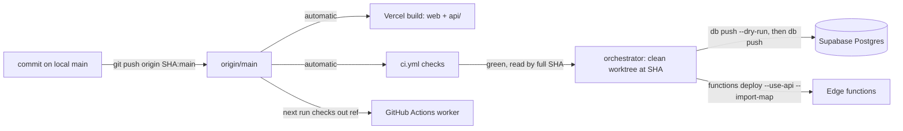

# Deploy and release

_Written 2026-11-08 against 2a9ac31._

## What it is

applyyy has three things that run in production. Each one reaches prod in a different way.

| Part | Where it runs | How it reaches prod | Who starts it |
|---|---|---|---|
| Web dashboard (`apps/web/`) and the Vercel function `api/render-job-page.ts` | Vercel, https://applyyy.vercel.app/ | Automatic: Vercel builds every push to `main` | Anyone who pushes to `main` |
| Edge functions (`supabase/functions/<fn>/`) | Supabase, project `xynqxekcqizwhtskzqrq` | Manual: `supabase functions deploy` from a clean, pinned worktree | The orchestrator session only |
| Database migrations (`supabase/migrations/`) | Supabase Postgres | Manual: `supabase db push`, after a `--dry-run` gate | The orchestrator session only |
| Worker (`worker/`) and scheduled jobs | GitHub Actions (`.github/workflows/*.yml`) | No deploy step: each workflow run checks out the code at its ref | The schedule, or `gh workflow run` |

There is **no CI job that deploys** edge functions or migrations. `grep -rn "functions deploy\|db push" .github/workflows` finds nothing. CI (`ci.yml`) only checks the code.

Push, deploy and migrate are three separate steps. A commit on `main` is not live code until the step for its part has run.



## Why it exists

The repo is a **shared working tree**: several Claude sessions edit one checkout, one index and one `.git` at the same time (repo `CLAUDE.md` §2). Every rule below comes from that fact or from an incident.

| Date | What happened | Rule it produced |
|---|---|---|
| 2026-10-05 | Nine edge functions went live with a peer's unverified, uncommitted `_shared/gemini/client.ts`. The deploy CLI bundled the working tree, not a commit. | Deploy only from a clean worktree pinned to an exact SHA. |
| 2026-10-05 | `supabase functions deploy` applies `supabase/config.toml`. A function without an entry there deploys with `verify_jwt = true` and could silently flip a live setting. | Every function is pinned explicitly in `supabase/config.toml` (see the comment above its `[functions.*]` blocks). |
| 2026-10-06 | An orchestrator assigned a deploy to a peer on the strength of a memory note. The auto-mode classifier blocked it as a production deploy. | A deploy needs real authority in the deploying session. A relay is not authority. |
| 2026-10-08 15:37 | Teja ruled: "do this by yourself, do not give me this type of tasks" after receiving a deploy runbook. | The orchestrator runs deploys and `db push` itself. It never hands Teja a runbook, and never delegates a deploy to a peer. |
| 2026-10-31 | The classifier blocked a deploy. Teja asked for the commands to run in his own terminal. | That is the fallback for a blocked deploy only. Each step in such a block must stop the next on failure (`if ($LASTEXITCODE -ne 0) { return }`). |
| 2026-11-04 | Teja hit a "fixed" browser `confirm()` popup on prod. Fix `51b8608` had been committed on 2026-11-02 but never pushed. | Committed is not deployed. On a "still broken" report, run `git log origin/main..main` first and check the prod bundle. |
| 2026-11-04 | A new resume-assist op kind would have broken every open tab, because the web's `aiEdit.ts` refuses a whole answer over one unknown op. | Deploy order: the strict reader (consumer) of a new response shape ships first. |
| 2026-11-05 | `bb55391` moved `@supabase/supabase-js` into the `supabase/functions/deno.json` import map. `--use-api` does not read `deno.json` by itself, so a deploy without the flag fails at bundle time. | `--import-map supabase/functions/deno.json` is mandatory. |
| 2026-11-05 | An 18-commit push made Vercel's shallow clone miss the previous SHA. The `ignoreCommand` exited 128 and Vercel failed the deploy (`1657938`). | `ignoreCommand` ends with `|| exit 1`: any doubt means "build". |
| 2026-11-07 | `keepalive.yml` force-pushes to `automation-keepalive`, and each push made a failing preview build (`fa809ce`). | `vercel.json` sets `git.deploymentEnabled.automation-keepalive = false`. |

## How it works

### 1. Pushing to `main`

The global git form applies (`~/.claude/CLAUDE.md`): stage explicit paths, commit with a trailing `-- <paths>`, push forward only. Two applyyy specifics:

- Before every push, read `git log origin/main..main` as its own step. You may be carrying a peer's commit.
- Push the SHA you reviewed, not the branch: `git push origin <sha>:main`. A bare `git push` sends whatever `main` points at when it runs.

Since 2026-11-08 15:25 (memory `fewer-commits-one-per-task`), the orchestrator makes one bundled commit about every 15 minutes. Peers do not add, commit or push.

### 2. Web: Vercel auto-deploy

Vercel watches the GitHub repo. A push to `main` starts a production build. The settings live in `vercel.json` at the repo root:

| Key | What it does | Why |
|---|---|---|
| `outputDirectory: apps/web/dist` | Serves the Vite build of `@applyy/web`. | The web package lives in a sub-folder of the pnpm workspace. |
| `ignoreCommand` | `git diff --quiet "$VERCEL_GIT_PREVIOUS_SHA" HEAD -- apps/web packages supabase/functions/_shared ... api || exit 1` | Skips a build when no web-relevant path changed. Exit 0 = skip, exit 1 = build. `|| exit 1` turns any git error into "build" (`1657938`). |
| `git.deploymentEnabled.automation-keepalive: false` | No preview builds for the keepalive branch. | `fa809ce`. Other branches keep the default (enabled). |
| `functions."api/render-job-page.ts"` | A Vercel serverless function with a headless Chromium, `maxDuration` 60 s. | The Playwright render fallback for "add a job by link" (`85ef531`). It ships with the web, on the same push. |
| `rewrites` | Every path serves `index.html`. | Single-page app routing. |
| `headers` | `X-Frame-Options`, `nosniff`, `Referrer-Policy`, and a Content-Security-Policy. | The CSP `connect-src` names only the Supabase project. A new browser network target needs a CSP change in the same push, or the browser blocks it. |

Note: the `ignoreCommand` path list includes `supabase/functions/_shared`, because `apps/web` imports some shared function code by relative path.

Rolling back the web means pushing a revert commit (forward-only git). Do not rewrite `main`.

### 3. Edge functions: clean pinned worktree

`supabase functions deploy` uploads what is **on disk**. In the shared tree, that includes peers' uncommitted edits. So the deploy always runs from a separate, detached worktree at an exact SHA.

Steps (PowerShell, from repo `CLAUDE.md` §3):

```powershell
# 1. A clean checkout of exactly the reviewed commit. Pin a SHA, never origin/main.
git worktree add --detach "$env:TEMP\applyyy-deploy" <sha>
# 2. Copy the link files into it: supabase/.temp/{project-ref,pooler-url,linked-project.json,postgres-version}
# 3. The user-level token belongs to the WRONG account. Clear it for this shell.
$env:SUPABASE_ACCESS_TOKEN = $null
# 4. Deploy one function. --use-api bundles on the server. --import-map is mandatory since bb55391.
supabase functions deploy <fn> --project-ref xynqxekcqizwhtskzqrq --use-api --import-map supabase/functions/deno.json
```

Before step 4:

- CI must be green for that SHA. Read it by full SHA and workflow: `gh run list --commit <full-40-char-sha> --workflow=ci.yml`. A docs-only commit runs no CI (`paths-ignore: docs/**, **/*.md`), so an empty result there means "not triggered".
- Confirm the commit you need is an ancestor of the pinned SHA.
- When the import map changes, deploy one low-traffic function first (`rls-proof`).

After the deploy:

- List live versions with `supabase functions list`. Order them by `updated_at`, never by version number. A version number counts one function's deploys and says nothing about age.
- Gateway JWT settings come from `supabase/config.toml`. Every function has an explicit `verify_jwt` entry there. `email-tracker-intake` and the machine-called agents (`normalizer`, `screener`, `auditor`, `scout-ats`) use `false`. Read the file for the reason on each one.

Housekeeping traps:

- A leftover locked folder at `%TEMP%\applyyy-deploy` can block `worktree add`. Pick a fresh path.
- PowerShell 5.1: do not use `*> $null` on `git worktree add` inside a conditional. It sets `$?` false and skips the block silently.
- Old worktrees pile up (`git worktree list`). Remove junctions first, then `git worktree remove --force` (see memory `applyyy-isolated-worktree-junctions`).

### 4. Database: `db push` with a dry-run gate

Migrations are SQL files in `supabase/migrations/`, named `<timestamp>_<name>.sql`. They apply in name order.

1. In the same clean, pinned worktree, run `supabase db push --dry-run` (token cleared, as above).
2. Read the list. Push only if it lists **exactly** the migrations you expect. An extra file means someone else's migration would ride along.
3. Run `supabase db push` (`--yes` answers the prompt).
4. Verify by **shape** with a read-only SQL query: the new column, function or policy exists and behaves. Never verify by "the command printed success".

To compare what is applied with what is in the repo: the Supabase MCP `list_migrations` against `ls supabase/migrations`.

### 5. Deploy order

Two parts of a change can ship at different times. The order matters:

| Change | Ship first | Then |
|---|---|---|
| Code calls a new DB function parameter or column | The migration | The code that calls it |
| A migration enforces a new rule (constraint, guard) | The code that obeys the rule | Switch enforcement on |
| An edge function emits a new response shape | The consumer (often the web) | The producer |

The third row is not "server first". Find the **strict reader** and ship it first. Example: `apps/web/src/features/approval/aiEdit.ts` rejects a whole AI answer when one op kind is unknown. A new `resume-assist` op would therefore break every open tab if the function shipped first (2026-11-04, `remove_skill` / `remove_entry`).

### 6. Is prod web current? The two-sentinel check

A commit message is not proof. Check the bundle Vercel actually serves:

1. `curl` https://applyyy.vercel.app/ and find the `/assets/index-*.js` file name.
2. `curl` that bundle and grep **two** strings:
   - one that **must be present** (from the new code), and
   - one that **must be absent** (from the old code).
3. First prove the "absent" string exists in the **old** bundle's source. A sentinel that never existed passes vacuously.

Example from 2026-11-04: the old bundle held two `window.confirm(` calls. The fixed bundle must hold zero of them, and must hold a string from `InlineConfirm`.

### 7. Worker and GitHub Actions

Workflows like `apply.yml`, `postscreen-drain.yml` and `scout.yml` check out the repo at their ref on each run. A push to `main` is the release for them. Things to know:

- Scheduled `apply.yml` runs stay dry unless the repo variable `APPLYY_CRON_LIVE=true`.
- A single real submit is a dispatch: `gh workflow run apply.yml --ref main -f dry_run=false -f apply_only_id=<uuid>`.
- GitHub cron is best-effort. Read real start times with `gh run list`.
- Code moved out of a function file can break the worker, which imports function code by relative path (`7a98b79`, 2026-11-05). Run worker `tsc` and vitest too, not only the functions suite.
- `playwright` is pinned in both `worker/package.json` and `apps/web/package.json`. Bump both and the lockfile together.

See [CI and workflows](../ops/ci-and-workflows.md) for each workflow.

## Rules and guardrails

| Rule | Source |
|---|---|
| Only the orchestrator deploys and runs `db push`. A peer never deploys, and never on a relayed "Teja approved". | Teja ruled 2026-10-08; repo `CLAUDE.md` §2 and §3 |
| If the classifier blocks a deploy, stop and tell Teja. Never route around it. | repo `CLAUDE.md` §3 |
| Deploy from a clean worktree pinned to an exact SHA. | 2026-10-05 incident |
| Clear `SUPABASE_ACCESS_TOKEN` for every CLI call. It belongs to another account and returns 403. | repo `CLAUDE.md` §3, §4 |
| `--use-api --import-map supabase/functions/deno.json` on every function deploy. | `bb55391`, 2026-11-05 |
| `db push --dry-run` first; push only the exact expected list. | repo `CLAUDE.md` §3 |
| CI green by full SHA and `--workflow=ci.yml` before deploying. | repo `CLAUDE.md` §4 |
| Live-data writes are run only by the session that heard Teja approve them. | repo `CLAUDE.md` §2 |
| Forward-only git. No `--force`, no `--amend`, no rewrite of pushed commits. Roll back with a new commit. | global `CLAUDE.md`; repo `CLAUDE.md` §2 |
| Verify prod by evidence (bundle sentinels, `functions list` by `updated_at`, SQL shape), not by a commit message. | memory `applyyy-committed-is-not-deployed` |

## Known gaps and open questions

- **No automated function or migration deploy.** Live edge functions can lag `main` for hours or days. The only record of what is live is `supabase functions list` plus the handoff tables. Example: the 2026-11-08 00:45 handoff says the tailor is live from `dc8ac5c` "if the background deploy finished", else from `7a78d05`. Check with `supabase functions list` before relying on it.
- **No version stamp in a deployed function.** Nothing in a live function reports the SHA it was built from. Matching a live function to a commit relies on timestamps.
- **Who may approve a deploy is written two ways.** Repo `CLAUDE.md` §3 and memory `applyyy-orchestrator-runs-deploys` say the orchestrator runs deploys under a standing authorization (2026-10-08). Memory `applyyy-deploy-from-clean-worktree` still says a deploy "needs Teja's direct approval in the deploying session", and the 2026-11-08 pending list says deploys happen "on Teja's yes in its window". These may mean the same thing, but the wording differs.
- **The deploy command in memory `applyyy-deploy-from-clean-worktree` lacks `--import-map`.** It predates `bb55391`. Repo `CLAUDE.md` §3 has the current command.
- **The worker and the edge functions pin different supabase-js versions** (2.50.0 in `worker/package.json` and `apps/web/package.json`, 2.58.0 in the `deno.json` import map). See the comment in `supabase/functions/deno.json`.
- **Uncommitted work at the time of writing** in `worker/src/apply-one.ts`, `worker/src/assist/rehearse.ts`, `supabase/functions/dispatch-apply/handler.ts` and `apps/web/src/features/manual-apply/*` is not on `main`, so it is not deployed anywhere.

## Related docs

- [Pipeline end to end](../architecture/pipeline-end-to-end.md)
- [Schema and status graph](../db/schema-and-status-graph.md)
- [Edge functions](../functions/README.md)
- [Web app](../features/web-app.md)
- [CI and workflows](../ops/ci-and-workflows.md)
- [Self-hosted runner](../ops/2026-11-05-self-hosted-runner.md)
- Repo `CLAUDE.md` §2 (shared tree), §3 (deploys), §4 (reaching live systems), §5 (verification)
