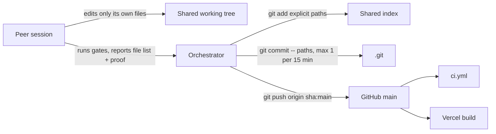

# Local development and testing

_Written 2026-11-08 against 2a9ac31._

## What it is

This page explains how to work on applyyy on Teja's Windows machine. It covers:

- the tools and versions the repo expects,
- the check and test command for each part of the repo,
- the traps that make a check report success when it did nothing,
- how to run the same checks that CI runs,
- the git rules for several Claude sessions that share one working tree.

The repo has four kinds of code. Each kind has its own checker.

| Part | Path | Runtime | Typecheck | Tests |
|---|---|---|---|---|
| Edge functions | `supabase/functions/` | Deno (deployed); Node runs the tests | `deno check` | `node --test` |
| Web dashboard | `apps/web/` (`@applyy/web`) | Vite + React, browser | `tsc --noEmit` | `node --test`, incl. Playwright e2e files |
| Worker (applier) | `worker/` (`@applyy/worker`) | Node + Playwright | `tsc --noEmit` | `vitest run` |
| Shared packages | `packages/*` (`@applyy/shared-types`, `master-ingest`, `master-pdf`, `master-robots`, `resume-template`) | raw `.ts`, imported by Deno and Node | `tsc --noEmit` | `node --test` |
| Vercel render function | `api/` | Node on Vercel | `tsc -p api/tsconfig.json` | `node --test "api/_render/*.test.ts"` |

## Why it exists

Most bugs in this repo did not come from bad tests. They came from checks that **did not run** but still looked green. Some examples from the record:

- `pnpm -r run test` could never reach `supabase/functions`. That folder is not a pnpm workspace member. So the kill-switch tests were unreachable by every runner until 2026-09-10. See the `// scripts.test` note in the root `package.json`.
- Until 2026-10-05 no workflow typechecked or tested anything. Every test count was a laptop run. Four laptop runs on 2026-10-04 nearly passed with zero files checked. See the header of `.github/workflows/ci.yml`.
- On 2026-10-08 a stale `apps/web/dist` made the web e2e suite "pass" against a two-day-old build. This is why the e2e helper now refuses a stale bundle.
- On 2026-11-05 commit `7a98b79` moved an exported name out of a function file. The functions suite stayed green, but the worker broke on `main`. The worker imports function code by relative path.

So the rule of this page is: **prove the check ran, then read its result.**

Rulings that shape local work:

- pnpm is the only package manager. The root `package.json` has `"preinstall": "pnpm dlx only-allow pnpm"` and pins `"packageManager": "pnpm@11.25.0"`.
- Teja ruled 2026-11-08 15:25 IST: "from now on only 1 big comit for 15 mins". The orchestrator makes at most one commit per 15 minutes and bundles every peer's checked files. Peers never `git add`, commit or push. (Source: memory `fewer-commits-one-per-task.md`.)
- Teja ruled 2026-10-08: the orchestrator runs deploys itself. A peer never deploys. See repo `CLAUDE.md` §3.

## How it works

### 1. Tools and versions

| Tool | Version the repo pins | Where it is pinned |
|---|---|---|
| Node | `>=24.0.0 <25.0.0` | root `package.json` `engines` |
| pnpm | `11.25.0` | root `package.json` `packageManager` and `engines` |
| TypeScript | `5.9.3` (forced for every package) | `pnpm-workspace.yaml` `overrides` |
| Deno | `v2.9.6` | `.github/workflows/ci.yml` (Install Deno step) |
| Playwright | `1.55.1` | `worker/package.json` and `apps/web/package.json` (bump both together) |

Check your machine:

```bash
node --version      # must start with v24
deno --version      # CI uses 2.9.6
supabase --version  # only needed for live reads and deploys
```

Node 24 strips TypeScript types natively. That is how every `node --test "*.test.ts"` suite runs with no build step.

Windows notes (from Teja's global `CLAUDE.md`):

- Run `npm` commands **outside** the repo. Inside it, npm fails with `EBADDEVENGINES`.
- `corepack enable pnpm` fails with `EPERM` unless the shell is elevated.

### 2. Installing dependencies

`pnpm install` is a shared-tree event. **Never run `pnpm install` unless the orchestrator scheduled it.** It writes `pnpm-lock.yaml` and `node_modules` for every session at once.

You can usually check and test without a new install:

- The package-local binaries already exist: `apps/web/node_modules/.bin/tsc`, `apps/web/node_modules/.bin/vite`, `worker/node_modules/.bin/tsc`, `worker/node_modules/.bin/vitest`.
- `node --test` needs no install for the edge function tests. They import only Node built-ins.
- `pnpm-workspace.yaml` sets `allowBuilds` for `esbuild`, `playwright` and `@playwright/test`. pnpm 11 blocks install scripts by default, and the block is fatal (`ERR_PNPM_IGNORED_BUILDS`).

CI runs `pnpm install --frozen-lockfile`. A lockfile drift fails CI; it is never repaired silently.

### 3. Environment files

| File | Committed? | Purpose |
|---|---|---|
| `apps/web/.env.example` | yes | Template. Copy to `.env.local`. |
| `apps/web/.env.local` | no (gitignored by `.env.*`) | Your local Supabase URL and **anon** key for `vite dev`. |
| `apps/web/.env.e2e` | yes | Public project URL plus an unsigned placeholder anon JWT. Used by `vite build --mode e2e`. |

`apps/web/src/data/supabase.ts` decodes the anon key at boot. It refuses to start if the role claim is not `anon`. The service-role key must never enter the web bundle.

### 4. Command reference

Run each command from the folder shown. The cwd matters: a root-relative glob run from the wrong folder matches nothing.

#### Edge functions (Deno)

Typecheck every function entry point and every non-test shared module, **and count**:

```bash
cd supabase/functions
files=$(ls */index.ts; find _shared -name '*.ts' ! -name '*.test.ts')
echo "$files" | wc -l                                  # files passed
deno check --reload $files 2>&1 | sed 's/\x1b\[[0-9;]*m//g' | grep -c "^Check"   # files checked
```

The two numbers must be **equal**. `--reload` defeats the cache; without it an unchanged tree prints nothing. The `sed` strips colour codes; without it `grep ^Check` counts zero on a healthy run.

Unit tests (run from the **repo root**):

```bash
node --test "supabase/functions/**/*.test.ts"
```

Test files are excluded from `deno check`. They import `node:test`. `deno.json` excludes `*.test.ts`, so `deno check some.test.ts` prints "No matching files found" and exits 0.

#### Web (`apps/web`)

```bash
cd apps/web
./node_modules/.bin/tsc --noEmit          # typecheck
./node_modules/.bin/vite build            # the build Vercel ships (no env needed)
./node_modules/.bin/vite build --mode e2e # the bundle the e2e files test
cd ../.. && pnpm --filter @applyy/web test
```

The filter name is `@applyy/web`. `pnpm --filter web` matches no package and exits 0 having run nothing.

`pnpm --filter @applyy/web test` runs `node --test "test/**/*.test.ts"` inside `apps/web`. That glob includes the browser e2e files (see section 5).

Dev server: `cd apps/web && ./node_modules/.bin/vite` (script `dev`). It reads `.env.local`.

#### Worker (`worker`)

```bash
cd worker
./node_modules/.bin/tsc --noEmit
./node_modules/.bin/vitest run
```

`worker/vitest.config.ts` uses a Node environment, not jsdom. Browser tests drive real Chromium against local fixture servers. `testTimeout` is 30 s and `hookTimeout` is 60 s; a cold Chromium launch takes longer than vitest's 10 s default hook timeout. Files run one after another to avoid port races.

vitest exits non-zero on a failure **and** on "no test files found", so its own exit code is a real guard.

#### Shared packages (`packages/*`)

```bash
node --test "packages/shared-types/test/**/*.test.ts"   # from the repo root
cd packages/master-robots && ./node_modules/.bin/tsc --noEmit   # if the package has its own .bin
```

Each package has `"typecheck": "tsc --noEmit"` and `"test": "node --test \"test/**/*.test.ts\""`. The glob is required. `node --test test` (a bare folder) fails on Node 24 with `MODULE_NOT_FOUND`, which looks like missing fixtures (note in `packages/master-ingest/package.json`).

`packages/shared-types` holds parity tests, for example "every table in the migrations has a Row type". Run them whenever you add a migration with a new table.

#### Vercel render function (`api/`)

```bash
apps/web/node_modules/.bin/tsc -p api/tsconfig.json
node --test "api/_render/*.test.ts"
```

These tests guard the SSRF and auth rules of `api/render-job-page.ts`, which runs a browser on pasted URLs.

#### Root scripts, and why they are not the gate

| Script | What it does | Trap |
|---|---|---|
| `pnpm run typecheck` | `pnpm -r --if-present run typecheck` | Does **not** cover `supabase/functions` (separate Deno project). Can rewrite `pnpm-lock.yaml` when an unlinked workspace package exists. Typecheck per package instead. |
| `pnpm test` | `test:functions`, then `test:api`, then `test:workspace` | Functions run first on purpose: `&&` would hide them behind an earlier failure. CI does **not** call `pnpm test`; it runs each glob itself. |
| `pnpm run lint` | `--if-present` | No package defines `lint`, so it checks nothing. |

### 5. End-to-end suites

There are two e2e kinds. Only the first runs in CI.

**Web e2e (in CI).** Files in `apps/web/test/` named `*E2e.test.ts` plus `e2eSuite.test.ts`. List them with:

```bash
git ls-files apps/web/test | grep -i e2e
```

They serve `apps/web/dist` from a local server, start Chromium, seed a fake session, and stub Supabase with `page.route`. No request leaves the machine and nothing is written to the live DB. The shared helper is `apps/web/test/support/e2eDist.ts`. It refuses a bad bundle with a named error:

| Error | Meaning | Fix |
|---|---|---|
| `E2E_DIST_MISSING` | no `dist/index.html` | `cd apps/web && ./node_modules/.bin/vite build --mode e2e` |
| `E2E_DIST_STALE` | a source file is newer than `dist/index.html` | same command |
| `E2E_DIST_UNCONFIGURED` | no JS file carries the project ref (built without `--mode e2e` and without `.env.local`) | same command |

Always build with `--mode e2e` right before you run web tests. A plain `vite build` after it overwrites `dist/`.

`apps/web` has no DOM test library. A `useEffect` bug can only be proved in an e2e file with a `page.route` gate (memory `applyyy-web-effect-bugs-need-e2e.md`).

**Worker e2e runner (local only).** `pnpm --filter @applyy/worker test:e2e` runs `worker/test/e2e-runner.mjs`. It reads `master-resume.pdf` at the repo root, which is gitignored personal data, and serves `apps/web/dist`. It is not part of `ci.yml`. It fails on a machine without that PDF.

### 6. CI parity

CI is one job in `.github/workflows/ci.yml`. It needs no secrets. Every check step runs even when an earlier check failed, so one red run lists every failure.

| CI step | Local equivalent |
|---|---|
| `deno check --reload`, and assert it checked files | section 4, edge functions (count must equal) |
| edge function tests | `node --test "supabase/functions/**/*.test.ts"` from root |
| shared-types tests | `node --test "packages/shared-types/test/**/*.test.ts"` from root |
| package tests (each `packages/*/test` except shared-types) | `node --test "packages/<pkg>/test/**/*.test.ts"` per package |
| web tsc, vite build, vite build (e2e mode), web tests | section 4, web, in that order |
| render function tsc and tests | section 4, `api/` |
| worker tsc, worker vitest | section 4, worker |
| gitleaks secret scan of the pushed commits | no local step; CI only |

Every `node --test` step in CI asserts three things from the log, not just the exit code:

1. the summary line `ℹ tests N` has N > 0,
2. `ℹ cancelled` is 0,
3. there are no lines starting with `✖`.

Do the same when you read a local run. The third check exists because a `describe()` body that throws before its first `it()` drops its tests with `fail 0`, `cancelled 0` **and** exit code 0 (audit W35, measured on Node 24.14).

Reading CI for a commit: use the full 40-character SHA and the workflow name.

```bash
gh run list --commit <full-sha> --workflow=ci.yml
```

A docs-only push runs no CI. `ci.yml` has `paths-ignore: docs/**` and `**/*.md`. An empty result for such a commit means "not triggered", not "pending".

### 7. Traps that report success while doing nothing

| Trap | What you see | What to do |
|---|---|---|
| `deno check` over zero files | exit 0 | count `Check` lines; they must equal the file count |
| `node --test` glob matched nothing | `tests 0`, `fail 0` | report tests and fail together; run from the right cwd |
| `before()` hook cannot import | tests `cancelled`, `fail 0` | read `cancelled`; it must be 0 |
| `describe()` body throws | `fail 0`, `cancelled 0`, exit 0 | look for `✖` lines |
| `$?` after a pipe | the code of `tee`/`grep`, not the checker | run the checker bare, or use `set -o pipefail` |
| `pnpm --filter web` | exit 0, nothing ran | use `@applyy/web` |
| stale `apps/web/dist` | e2e passes on old code | the helper now throws `E2E_DIST_STALE`; rebuild with `--mode e2e` |
| `--lockfile-only` dependency bump | green local run | the old version is still installed; verify a supply-chain fix on CI |
| test count changed | "N tests" differs from last time | peers land tests while you work; compare only `fail 0` |

Prove a gate works: inject an error and see it caught, or revert your fix and see a **named** test go red. A test that stays green on revert guards nothing (repo `CLAUDE.md` §5).

Side effect to watch: `deno check` writes `deno.lock` files. Never commit them by accident.

### 8. Moving code between parts

`worker/` and `apps/web/` import edge function code by **relative path**. If you move or rename an exported name in `supabase/functions/`, do all of these:

```bash
git grep -n "<name>"                       # whole repo, not one folder
cd worker && ./node_modules/.bin/tsc --noEmit && ./node_modules/.bin/vitest run
```

plus the functions suite and `deno check`. Commit `7a98b79` (2026-11-05) broke the worker on `main` by skipping this.

When you add a DB table, add its `XRow` type to `packages/shared-types` and run the shared-types tests by hand (memory `applyyy-new-table-needs-row-type.md`).

### 9. Shared working tree: several sessions, one `.git`

Several Claude sessions work in the same folder at the same time. They share one working tree, one index and one `.git`. These rules keep them from breaking each other's work.



**Write ownership.** No two sessions edit the same file. Reading is fine.

**Who commits.** Since 2026-11-08 15:25 IST the orchestrator commits, at most once per 15 minutes, bundling all peers' checked files. A peer stops with its files unstaged and reports the file list and the gate proof.

**The commit form** (from Teja's global `CLAUDE.md`):

1. `git add <explicit paths>`. Never `git add -A`, `git add .` or `git commit -a`.
2. `git diff --cached --name-status`. Confirm only your files are staged.
3. `git commit -F - -- <the same paths>`. The trailing pathspec makes the commit take only those files, even if a peer stages something meanwhile.
4. Read `git log origin/main..main` as its own step. You may be carrying a peer's commit.
5. `git push origin <sha>:main`. Push the SHA you reviewed, not the branch name.

No `Co-Authored-By` trailer and no "Generated with Claude Code" line. Teja banned both.

**Never on this tree:**

- `git stash`. It takes other sessions' in-progress edits.
- `git commit --amend`. It rewrites HEAD, which may be a peer's commit (2026-11-06: an amend on `7f8e4ce` rewrote peer commit `67b55e7`).
- `git checkout -- <file>` outside your own files.
- `pnpm install` without the orchestrator scheduling it.
- Clearing a peer's unstaged changes to unblock a pull.

**"Uncommitted" is not "abandoned".** `git status` cannot tell them apart. Ask the author before you "rescue" a file.

**Stage late.** The pathspec protects the committer, not the stager. A peer can commit a file you staged. Stage right before the commit.

### 10. Gating only your files: an isolated worktree

When peers have half-done edits in the tree, your gate may fail on their code, or pass on it. Gate in a clean worktree instead (memory `applyyy-isolated-worktree-junctions.md`):

1. `git worktree add --detach "$env:TEMP\<name>" origin/main` (PowerShell).
2. Copy your exact changed files into it.
3. Copy the gitignored `apps/web/.env.local` into it.
4. Make `node_modules` junctions to the main tree: root, `apps/web`, `worker`, each `packages/*` (`New-Item -ItemType Junction` in PowerShell).
5. Run the gates.
6. Remove: unlink each junction first with `[System.IO.Directory]::Delete(path, $false)`, then `git worktree remove --force`. A recursive delete can follow a junction into the real `node_modules`.

Leak to know about: the junctioned `node_modules/@applyy/*` links point at the **main** tree's `packages/*`. So web and worker gates in the worktree still import the main tree's shared packages. Pin the worktree to the same commit the main tree's packages are at, and re-run on any surprise failure in a file you did not touch.

Deploys use the same idea: a detached worktree pinned to a SHA, run only by the orchestrator. See repo `CLAUDE.md` §3.

### 11. Windows and Git Bash traps

| Trap | Fix |
|---|---|
| Working copies are CRLF; Git Bash `grep` is blind to `\r` | measure line endings with node; make edit scripts EOL-aware |
| Git Bash rewrites `rev:path` and leading-`/` arguments | prefix `MSYS_NO_PATHCONV=1` |
| `TZ=Asia/Kolkata` has no zoneinfo in Git Bash, silently UTC | plain `date`, `ls`, `git` already show IST |
| PowerShell 5.1 `@'..'@ \| git commit -F -` adds a BOM to the subject | write commit messages through a Bash heredoc |
| PowerShell 5.1 has no `&&` | use `A; if ($?) { B }` |
| `SUPABASE_ACCESS_TOKEN` user env var belongs to the wrong account | `env -u SUPABASE_ACCESS_TOKEN supabase db query --linked "<select>"` (Bash); read-only |

### 12. Before you report "done"

- Every gate for every part you touched ran, and you saw the counts (tests > 0, cancelled 0, no `✖`, deno count equal).
- The web e2e bundle was rebuilt with `--mode e2e` after your last source edit.
- If you moved an export, `git grep` and the worker gates ran.
- No `deno.lock` or `pnpm-lock.yaml` change you did not intend.
- You ran `/ponytail-review` on your diff (repo `CLAUDE.md` §9).
- Say "written, not applied" when a command never ran your code. That beats a green claim.

## Rules and guardrails

- pnpm only; never `npm install` in the repo.
- `pnpm install` only when the orchestrator schedules it.
- Typecheck per package. `pnpm run typecheck` misses `supabase/functions`.
- Count what ran. A check that can pass over nothing is not a check.
- Rebuild `apps/web/dist` with `--mode e2e` before web tests.
- One writer per file. Explicit-path staging with a trailing pathspec. No stash, no amend, no `-A`.
- Peers do not commit, push or deploy.
- No live DB writes from local work. Live writes go to the orchestrator (repo `CLAUDE.md` §2).

## Known gaps and open questions

- **Commit rule conflict.** Repo `CLAUDE.md` §2 says "One commit per finished task", and Teja's global `CLAUDE.md` says sessions commit and push their own work. The memory rule from 2026-11-08 15:25 IST says only the orchestrator commits, at most once per 15 minutes. The memory file says the newer rule wins, but the two `CLAUDE.md` files are not yet updated.
- **Worker e2e runner is not in CI** and needs the gitignored `master-resume.pdf`. It can rot unnoticed.
- **No local CI script.** The CI log checks (tests > 0, cancelled 0, no `✖`) live only in `ci.yml`. Locally you must read them by eye. A small `scripts/` wrapper would make local and CI checks match.
- **`pnpm run lint` checks nothing.** No package defines a `lint` script.
- **gitleaks runs only in CI.** Nothing scans a commit before it is pushed.
- Memory `applyyy-verifiable-without-install.md` (2026-09-17) says the root `node_modules` has zero top-level packages. That is stale: since 2026-11-01 it holds `@sparticuz/chromium` and `playwright-core` for `api/`.

## Related docs

- [Pipeline end to end](../architecture/pipeline-end-to-end.md)
- [Schema and status graph](../db/schema-and-status-graph.md)
- [Edge functions](../functions/README.md)
- [Web app](../features/web-app.md)
- [CI and workflows](../ops/ci-and-workflows.md)
- Repo `CLAUDE.md` §2 (shared tree), §3 (deploys), §5 (verification traps)
- `.github/workflows/ci.yml` (the CI gate, with comments on why each check exists)
